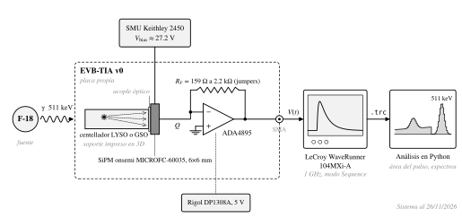
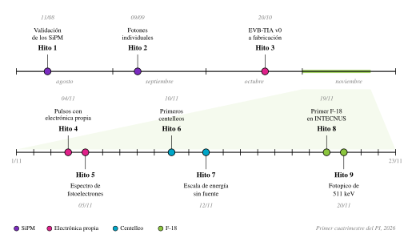

<p align="center">
  
</p>

# Desarrollo de un sistema de detección gamma para cirugía radioguiada

<p>
Sistema de detección de radiación gamma para asistencia en cirugía laparoscópica oncológica, basado en <strong>centellador inorgánico + SiPM</strong>, con electrónica de lectura multicanal e interfaz en tiempo real.
</p>

<!-- IMAGEN PRINCIPAL (pendiente): tira de tres paneles con la EVB-TIA v0, el espectro de fotoelectrones (LOG 17) y el espectro del F-18 con el fotopico de 511 keV (LOG 22).
<p align="center">
  
</p>
-->

<hr>

<p>
<strong>PROYECTO INTEGRADOR</strong><br>
Ingeniería en Telecomunicaciones · Instituto Balseiro · 2026 a 2027
</p>

<p>
<strong>Autor:</strong> Dana E. González<br>
<strong>Director:</strong> José Lipovetzky<br>
<strong>Codirector:</strong> Fabricio Alcalde
</p>

> 🏁 El 26/11/2026 cerró el primer cuatrimestre del PI. El trabajo de laboratorio queda en pausa durante los finales y se retoma en el receso de verano (ver [Trabajo a mediano plazo](#trabajo-a-mediano-plazo)).

---

## Contexto

Este proyecto continúa el trabajo de la tesis *Gamma Tracker* (Torletti, 2025), que demostró la viabilidad de una sonda gamma portátil basada en centellador + SiPM para localizar tejido tumoral marcado con FDG, con un TRL de 4 a 5. Ese dispositivo está en proceso de patentamiento ante el INPI.

El PI busca avanzar hacia un sistema de mayor resolución espacial y espectral, y tiene las siguientes líneas de trabajo:

* **Nuevo fotosensor.** Evaluación de SiPMs de mayor área activa y menor tensión de polarización, con espectroscopía de altura de pulso para discriminar en energía a 511 keV.
* **Acople óptico.** Comparación cuantitativa de técnicas (grasa óptica, adhesivos UV y fibra óptica) para mejorar la transferencia de luz y la estabilidad mecánica.
* **Sistema multipixel.** Matriz de centelladores acoplados a un arreglo de SiPMs con lectura multicanal, para mapear la actividad gamma en tiempo real.
* **Electrónica e interfaz.** Electrónica de adquisición, comunicación inalámbrica y alimentación por baterías aptas para el entorno quirúrgico, con objetivo de TRL 5 a 6.

---

## Estructura del repositorio

```text
logs/               Cuaderno de laboratorio digital (un archivo por sesión) y criterios, guías e instrucciones
scripts/
  ├── read/         Control de instrumentos y lectura
  └── analysis/     Post-procesamiento, comparación y visualización
data/               Datos experimentales organizados por campaña
  └── <campaña>/
      ├── raw/      CSV crudos (inmutables)
      └── graphs/   Curvas de los resultados
hardware/           Diseños de PCB (KiCad), uno por placa
  └── EVB-TIA-v0/
      └── fab/      Archivos de fabricación enviados (Gerber, BOM, CPL)
docs/               Documentación de soporte e imágenes de los logs y del README
```

> Los `.trc` de la campaña de INTECNUS pesan más de 13 GB y no entran en el repositorio. Se guarda la reducción (`reduccion_archivos.csv` y `reduccion_eventos.npz`, de unos 20 MB) y los análisis se hacen sobre ella sin volver a leer los crudos (LOG 22).

---

## 📓 Cuaderno de laboratorio

> El directorio `logs/` funciona como cuaderno de laboratorio digital del proyecto. Cada archivo registra una sesión de trabajo con el objetivo, la configuración experimental, las observaciones, los resultados, las decisiones técnicas y los pendientes. También se incluyen documentos que sustentan las decisiones experimentales.
>
> Los logs priorizan la trazabilidad y la reproducibilidad por sobre la presentación. Todo se registra en el cuaderno, preservando el historial completo del razonamiento experimental.
>
> ```
> logs/
>  ├── 1 LOG — Lunes 3 de agosto de 2026.md
>  ├── 2 LOG — Lunes 10 de agosto de 2026.md
>  ├── ...
>  └── 22 LOG — Viernes 20 de noviembre de 2026.md   ← último LOG del primer cuatrimestre
> ```

---

## El sistema hoy

<p align="center">
  
</p>

El fotón de 511 keV interactúa en el centellador, la luz llega al SiPM a través del acople óptico y la carga de cada avalancha entra al TIA de la EVB-TIA v0, que la convierte en un pulso de tensión. El LeCroy guarda los pulsos en archivos `.trc` y el análisis en Python saca el área de cada pulso y arma los espectros.

---

## Progreso del proyecto

### Hitos

<p align="center">
  
</p>

<details>
<summary>Detalle de los 9 hitos</summary>
<br>

1. **Validación de SiPMs MICROFC-60035-SMT** (11/08/2026). Dispersión de V_br intra-lote σ ≈ 20 mV, ~100× menor que el modelo del prototipo anterior. Los 10 dispositivos son aptos para la matriz multipixel, lo cual habilita la primera propuesta del PI.
2. **Primeros pulsos de fotón individual** (09/09/2026). Dark counts observados con la placa amplificadora BGA614 ×100 (SiPM #09), siendo la primera vez que la cadena SiPM → amplificador → osciloscopio funciona en el proyecto.
3. **EVB-TIA v0 enviada a fabricar** (20/10/2026). Primera placa propia, un TIA de una etapa con ADA4895 sobre la salida estándar del SiPM, con banco de R_F configurable por jumpers de 159 Ω a 2.2 kΩ. 5 placas ensambladas en JLCPCB, con el SiPM soldado por reflujo.
4. **Primeros pulsos con electrónica propia** (04/11/2026). Pulsos del SiPM leídos por la salida estándar con la EVB-TIA v0, cerrando el ciclo diseño → simulación → layout → fabricación → medición (LOG 16).
5. **Espectro de fotoelectrones y validación del modelo** (05/11/2026). Picos de 1, 2 y 3 PE resueltos a tres sobretensiones, con SPE, ruido y SNR que coinciden con la simulación del LOG 9 (LOG 17).
6. **Primeros eventos de centelleo** (10/11/2026). Eventos del Lu-176 intrínseco del LYSO, sin fuente, leídos con la EVB-TIA v0. La forma del pulso coincide con el modelo del LOG 9 dentro de ~2 % (LOG 19).
7. **Primera escala de energía sin fuente** (12/11/2026). Calibración preliminar con la radiactividad propia del LYSO, k ≈ 2.0 avalanchas/keV desde el escalón de 290 keV del Lu-176. Al SiPM llega ~18 % de la luz del cristal, con un gradiente de colección a lo largo del cristal (LOG 20).
8. **Primeros eventos con el radiofármaco objetivo** (19/11/2026). La EVB-TIA v0 detecta los 511 keV del F-18 con LYSO y con GSO, en una medición cualitativa en INTECNUS (LOG 21).
9. **Primeros espectros del F-18 con el fotopico de 511 keV resuelto** (20/11/2026). GSO con la EVB-TIA v0, con FWHM de 11.8 a 18.6 %, en una campaña en INTECNUS con distancia, sensibilidad lateral y angular, blindaje de tungsteno y fantoma NEMA (LOG 22).

</details>

### Registro semanal

<details>
<summary>Trabajo realizado por semana</summary>
<br>

| Semana | Trabajo realizado | Hito |
|---|---|---|
| 03/08 | Validación del setup de medición I-V (Keithley 2450, PyVISA y Python) y protocolo de conexión y seguridad | |
| 10/08 | Caracterización I-V de los 10 SiPM y confirmación del offset de V_br entre lotes | 1 |
| 17/08 | Diseño en KiCad y fresado en CNC de una placa breakout para el SiPM | |
| 24/08 | Corriente oscura de los 10 SiPM, plan del banco térmico y protocolo de soldadura después de perder el SiPM #05 | |
| 31/08 | Verificación de que el 60035 no se puede leer sin amplificación | |
| 07/09 | Pulsos de fotón individual con la placa BGA614 | 2 |
| 14/09 | Validación del Arduino con DS18B20, prueba de la Peltier nueva y comparación de topologías de amplificación | |
| 21/09 | Simulación del TIA de una etapa con ADA4895 y definición del banco de R_F | |
| 05/10 y 12/10 | Diseño de la EVB-TIA v0 en KiCad | |
| 19/10 | Archivos de fabricación y pedido a JLCPCB | 3 |
| 26/10 | Redefinición del banco térmico como BETA, arquitectura v1 y caracterización de la planta térmica | |
| 02/11 | Placa del SiPM para BETA, llegada de la EVB-TIA v0, primeros pulsos, espectro de fotoelectrones y barridos de V_ov y R_F | 4 y 5 |
| 09/11 | Primeros eventos de centelleo con LYSO, estilo gráfico del PI, escala de energía con el Lu-176 y Monte Carlo del cristal | 6 y 7 |
| 16/11 | Mediciones con F-18 en INTECNUS, primero cualitativas y después una campaña con GSO junto con Lara Torletti | 8 y 9 |
| 23/11 | Reducción y análisis exploratorio de la campaña de INTECNUS, cierre del cuatrimestre con el LOG 22 | 🏁 |

</details>

---

### 🏁 Cierre del primer cuatrimestre (agosto a noviembre de 2026)

Con el LOG 22 se cierra la primera parte del PI, con 22 LOGs y 9 hitos.

El cuatrimestre arrancó por el sensor. Se armó un banco I-V automatizado y se caracterizaron los 10 SiPM del lote, que mostraron una dispersión de V_br lo suficientemente chica como para pensar en una matriz multipixel. El 60035 tiene tanta capacidad que no se puede leer sin amplificar, así que después de ver los primeros fotones individuales con una placa comercial se simuló y diseñó una placa propia, la EVB-TIA v0, que se mandó a fabricar en octubre. En paralelo, el banco térmico pasó de ser un setup armado para una medición a un instrumento propio, BETA.

Las placas llegaron a principios de noviembre y en pocos días pasaron de mostrar los primeros pulsos a dar un espectro de fotoelectrones que coincide con la simulación. Después se acopló el LYSO, cuya radiactividad propia sirvió para ver los primeros eventos de centelleo y sacar una escala de energía sin usar fuentes.

El cuatrimestre cerró en INTECNUS, midiendo con el F-18, que es el radiofármaco objetivo del PI. Una primera medición confirmó que la placa lo detecta, y en la segunda hicimos con Lara Torletti, en el marco de su tesis de maestría, una campaña completa con GSO en la que la placa resuelve el fotopico de 511 keV.

#### Resultados principales

| Magnitud | Valor | Fuente | Estado |
|---|---|---|---|
| Dispersión de V_br intra-lote | σ ≈ 20 mV (10 SiPM) | LOG 3 | Medido |
| Offset de V_br entre lotes | ~141 mV | LOG 3 | Medido |
| Tensión de ganancia nula y capacidad de microcelda | V_0 = 24.46 ± 0.08 V, C_cel = 175 fF | LOG 18 | Medido |
| Carga por avalancha (Q_SPE) a 2.5 V nominal | 481 fC | LOG 18 | Provisoria |
| Forma del pulso de centelleo contra el modelo | coincide dentro de ~2 % | LOG 19 | Medido |
| Escala de energía con el Lu-176 | k ≈ 2.0 ± 0.1 avalanchas/keV | LOG 20 | Preliminar, un punto |
| Colección de luz del LYSO | ≈ 18 % (diseño 25 a 50 %) | LOG 20 | Inferencia |
| Resolución del fotopico de 511 keV con GSO | FWHM 11.8 a 18.6 % | LOG 22 | Medido, calibración de un punto |

---

### Trabajo a mediano plazo

Durante los finales el trabajo de laboratorio queda en pausa, y en el receso de verano sigue con lo siguiente:

1. **Escuela ICTP-IAEA (enero 2027).** Voy a usar las herramientas de análisis de datos del curso para el dataset de INTECNUS.
2. **Análisis de los datos de INTECNUS.** El LOG 22 tiene solo un análisis exploratorio preliminar de una parte de la campaña. Queda hacerlo completo, con el fantoma NEMA, los perfiles lateral y angular, la comparación entre largos de cristal y el decaimiento del F-18 en las series.
3. **Estado del arte.** Lectura de papers sobre sondas gamma de alta energía para F-18, sondas beta y de positrones con SiPM, sistemas multipixel y cámaras gamma intraoperatorias, como base del capítulo de estado del arte de la tesis.
4. **Banco óptico.** En el marco de la materia Física de Láseres estoy diseñando un banco óptico para el SiPM con el láser de 840 nm doblado en frecuencia (420 nm, pulsos de 100 fs). La idea es caracterizar la respuesta impulsiva del SiPM y controlar la cantidad de fotones que le llegan, de forma que el SPE se pueda medir con mucha más precisión. Con suerte lo vamos a poder implementar en el laboratorio de óptica de los físicos, y cubriría el banco con luz pulsada de la propuesta.

BETA queda como algo en lo que voy a estar pensando y optimizando durante el receso.

---

## Referencia técnica

<details>
<summary>Convenciones</summary>
<br>

- **Datos.** `{modelo}_{numero}_{YYYYMMDD}.csv`
- **Capturas del LeCroy.** `C1Vov<V_ov>_RF<R_F>_NNNNN.trc`, con V_ov nominal, R_F en Ω y `p` como punto decimal (ej: `C1Vov2p5_RF2200_00000.trc`)
- **Capturas de INTECNUS.** `med_<n>_pd<cristal>_X<cm>_Y<cm>_A<grados>_med`, donde X es la posición lateral, Y la distancia entre la fuente y la placa y A el ángulo, con `p` como punto decimal y `neg` como signo menos. Una `W` después del cristal indica blindaje de tungsteno
- **Logs.** `N LOG — Día D de mes de AAAA.md`
- **Dispositivos.** `MFC60035_XX`, numerados en orden de medición
- **Figuras.** Todas con `estilo_pi.py`, según `GUIA_Estilo_Graficos.md`

</details>

<details>
<summary>Instrumentación</summary>
<br>

| Equipo | Modelo | Interfaz |
| --- | --- | --- |
| Source Measure Unit | Keithley 2450 | USB, SCPI vía PyVISA |
| Fuente de alimentación | Rigol DP1308A | |
| Osciloscopio | Teledyne LeCroy WaveRunner 104MXi-A (1 GHz, 10 GS/s) | Archivos .trc |
| Osciloscopio | Keysight InfiniiVision DSOX3104T (1 GHz) | |
| Osciloscopio | Rigol DS1204B (200 MHz) | |
| Sensor de temperatura | DS18B20 con Arduino UNO | 1-Wire, serial |
| Celda Peltier | TEC1-12706 | |
| SiPMs bajo prueba | onsemi MicroFC-60035-SMT (C-Series, 6×6 mm) | |
| Placa de lectura | EVB-TIA v0 (ADA4895, banco de R_F de 159 Ω a 2.2 kΩ) | Salida SMA |
| Centellador | LYSO 4.5 × 5 × 24 mm | |
| Centelladores | GSO de 4 × 6 mm de sección y 6, 12, 15 y 20 mm de largo | |
| Blindaje | Cilindro de tungsteno con apertura de 8 mm, pared de 5.2 mm y largo de 36.1 mm | |

</details>

<details>
<summary>Dependencias</summary>
<br>

* Python 3.11+
* PyVISA con el backend pyvisa-py, para el control de la SMU
* pyserial, para el registro del Arduino
* NumPy, SciPy y Matplotlib
* xraydb, para los coeficientes de atenuación del Monte Carlo del Lu-176
* Arduino IDE con las librerías OneWire y DallasTemperature
* KiCad 10 para el diseño de PCB y LTspice para la simulación

Los `.trc` del LeCroy se leen con un lector propio (`exploratorio_intecnus.py`), sin librerías extra, y la tipografía de las figuras (STIX) viene con Matplotlib.

</details>

<details>
<summary>Documentación relacionada</summary>
<br>

* Torletti (2025). *Gamma Tracker. Instrumentación para la detección de radiación gamma en cirugía laparoscópica.* Instituto Balseiro.
* Knoll (2010). *Radiation Detection and Measurement.* 4th ed., Wiley.
* Ko et al. (2021). *Sensors* 21, 7040. Espectro intrínseco del Lu-176 en LYSO.
* onsemi. *C-Series SiPM Datasheet*, MicroFC-60035-SMT.
* onsemi. *AND9782/D, Biasing and Readout of onsemi SiPM Sensors.*
* onsemi. *AND9788/D, Handling and Soldering of Molded Leadframe Packaged SiPM Sensors.*
* onsemi. *AND9809/D, Evaluation boards (MICROFC-SMA-60035-GEVB).*
* Analog Devices. *ADA4895-1/-2 Data Sheet.*
* Keithley. *Model 2450 SourceMeter SMU Reference Manual.*

</details>

---

## Contacto

**Dana E. González** · [LinkedIn]([https://www.linkedin.com/in/COMPLETAR](https://www.linkedin.com/in/dana-e-gonzalez/)) · [dana.gonzalez@ib.edu.ar](mailto:dana.gonzalez@ib.edu.ar)

---

### Casualties

Componentes destruidos: `1`  
Días sin quemar algo: `94`

> 🫡
