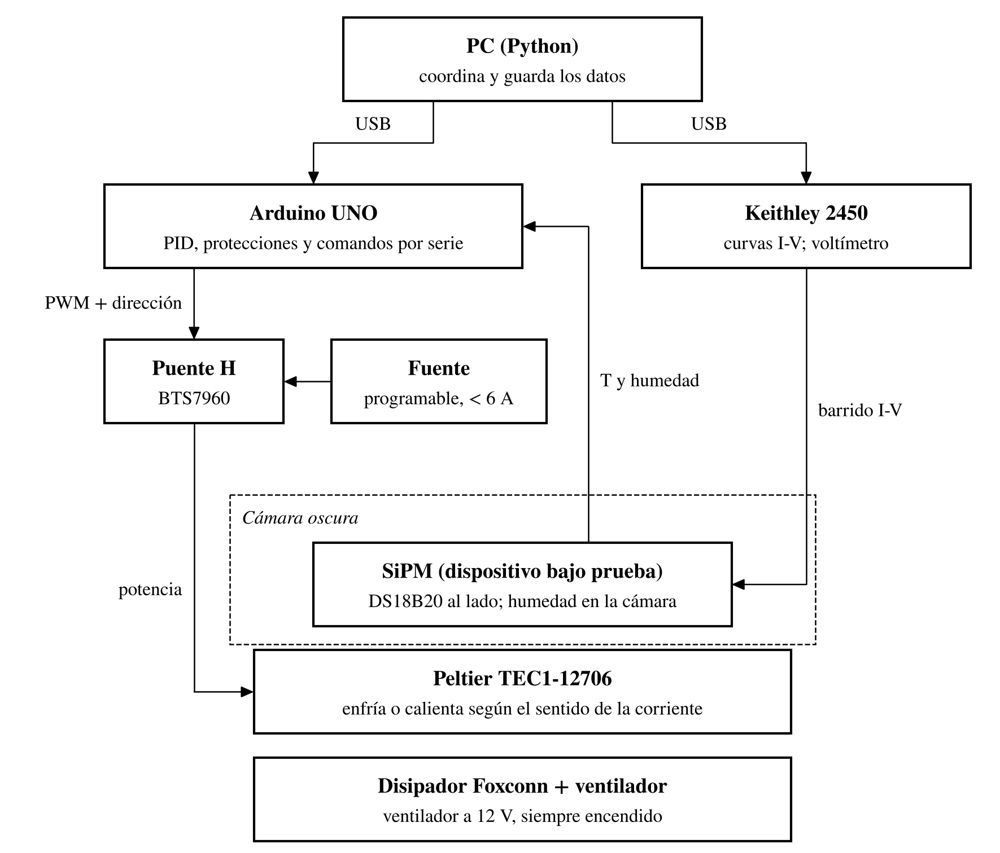
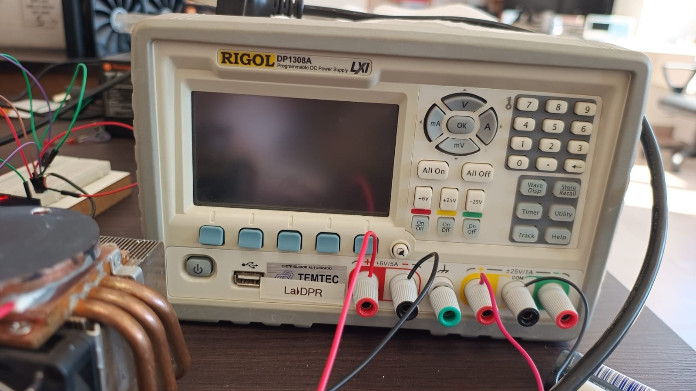
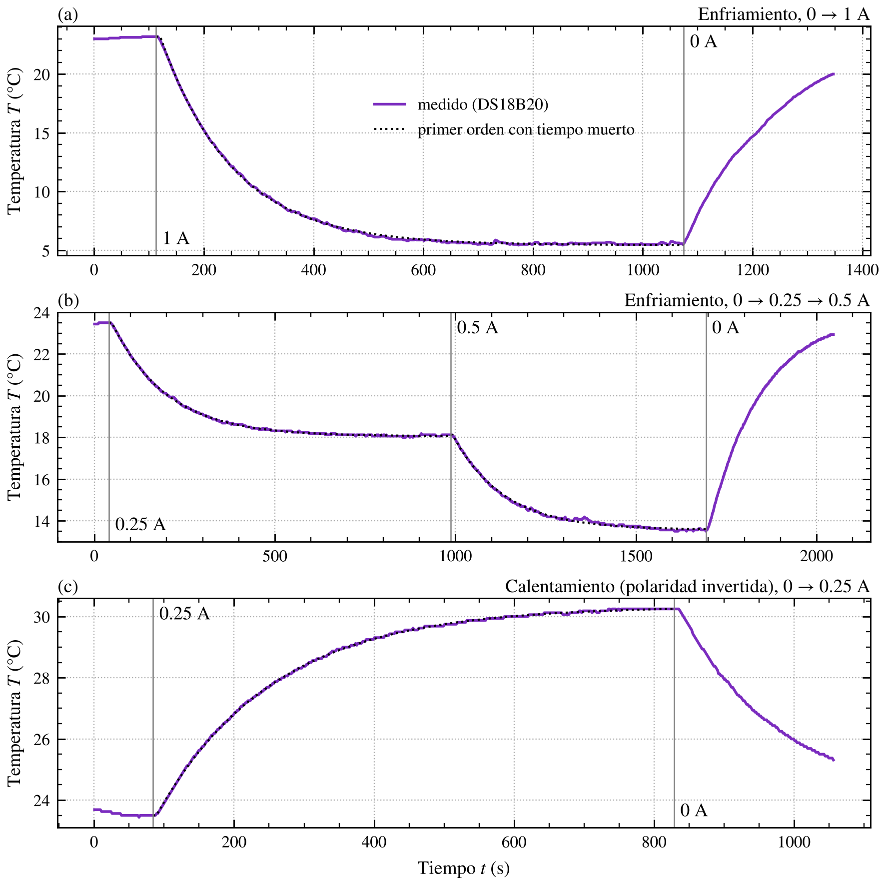
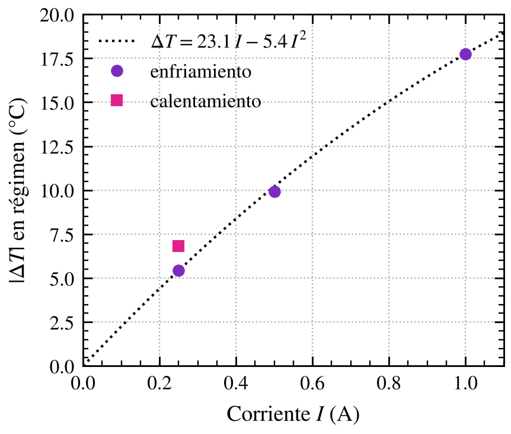

## Sesión de diseño y laboratorio: redefinición del banco térmico (BETA), arquitectura v1 y caracterización en lazo abierto

**Tipo:** diseño y medición.

---

## Objetivo del día

Retomar el banco térmico (Tarea 3, dV_br/dT), parado desde el 14/09: definir sus objetivos y su arquitectura, y caracterizar la planta térmica en lazo abierto para el diseño del control.

---

## Contexto

- **LOG 8 (14/09):** Arduino UNO + DS18B20 validados; Peltier TEC1-12706 nueva funcionando conectada directo a la fuente; la placa conmutadora con IRFZ44N no hacía pasar corriente a la Peltier.
- Desde el 14/09 la atención estuvo en el diseño de la EVB-TIA v0 (LOG 9–12). La parte térmica quedó como camino crítico del póster de EAMTA (marzo 2027).
- Temperatura ambiente de la sesión: **~23.2–23.7 °C**.

---

## Trabajo realizado

### 1. Diagnóstico de la placa conmutadora

Con el multímetro en modo diodo, IRFZ44N soldado en la placa (desconectada de todo):

- Source (punta roja) – Drain (punta negra): **OL**. Lo esperable es 0.3–0.7 V por el diodo body.
- Con el transistor soldado, otros componentes en paralelo sólo podrían bajar la lectura, así que el OL apunta a **D–S abierto** o a un **error de contacto de las puntas**. No se desoldó.
- Además, el IRFZ44N **no es logic-level**: su R_DS(on) está especificada a V_GS = 10 V y el Arduino maneja la gate con 5 V.

**Decisión:** la placa queda descartada (ver §3).

### 2. Redefinición del alcance: BETA

El banco térmico deja de ser un montaje para medir dV_br/dT y pasa a ser un instrumento completo y automático del laboratorio: **BETA — Banco de Ensayo Térmico Automatizado**. Lleva un dispositivo bajo prueba (DUT) a una temperatura programada, la mantiene estable y coordina su medición desde la PC.

**Usos:**

1. **Caracterización de los SiPM:** curvas I-V a distintas temperaturas → dV_br/dT del MICROFC-60035-SMT (datasheet: 21.5 mV/°C; Taggart et al.: 17.7 ± 0.9 mV/°C). Medir N ≥ 3 dispositivos: la dispersión del coeficiente limita lo bien que puede compensar un circuito único.
2. **Electrónica del detector:** diseñar el circuito de compensación térmica del bias del SiPM con el coeficiente medido y ensayarlo barriendo la temperatura (Keithley como voltímetro). Responde al objetivo 3 de la propuesta (polarización basada en referencias de junturas PN en avalancha) y a la fuente compensada en temperatura del primer semestre.
3. **Laboratorio:** el control térmico es independiente de lo que se mide; cualquier ensayo usa los mismos comandos.

**Prueba final (más adelante):** espectroscopía con fuente y centellador dentro del banco, verificando que el fotopico se mantiene constante al barrer la temperatura con la compensación activa.

**Requisitos v1:**

| Requisito | Valor |
|---|---|
| Rango | 10–40 °C (enfría y calienta) |
| Estabilidad | ±0.1 °C durante la medición |
| Operación | Automática desde Python |

**Cronograma tentativo (meta: EAMTA, marzo 2027):**

| Período | Banco | Compensación |
|---|---|---|
| Nov | Potencia bidireccional y lazo cerrado | Elegir referencias candidatas |
| Dic | Automatización e integración con el Keithley; dV_br/dT | Medir el coeficiente de las referencias |
| Ene | (ICTP) | Diseño del circuito |
| Feb | Protecciones, montaje genérico | Fabricación, calibración y validación |
| Mar | EAMTA | EAMTA |

### 3. Arquitectura v1

El Arduino mantiene la temperatura con un PID y la Peltier; la PC (Python) fija cada setpoint, espera la estabilidad y dispara la medición. La evolución del diseño (sensores, carcasa, breakout) sigue en `BETA_Log_de_Diseno.md`.

*Figura 1. Arquitectura v1 de BETA tal como quedó definida el 27/10. La PC coordina; el Arduino mantiene la temperatura con el puente H y la Peltier; el Keithley mide el DUT.*

| Bloque | Componente | Conexión |
|---|---|---|
| Potencia | Rigol DP1308A, canal +6 V / 5 A → puente H BTS7960 (IBT-2) → Peltier TEC1-12706 | B+/B− a la fuente; M+/M− a la Peltier |
| Disipación | Disipador Foxconn 364409-001 + ventilador | Canal +25 V fijado en 12 V, entre (+) y COM; siempre encendido |
| Control | Arduino UNO | D5 → RPWM, D6 → LPWM, D7 → R_EN y L_EN; GND común con la fuente |
| Temperatura | DS18B20 junto al DUT (opcional: otro en el disipador, mismo bus) | D2 + pullup de 4.7 kΩ |
| Humedad | SHT31 o BME280 (I²C) | A4 (SDA), A5 (SCL) |
| Medición | Keithley 2450 (en general, cualquier instrumento) | USB a la PC |
| Orquestación | PC con Python | USB al Keithley y al Arduino |

**Puente H:** cuatro llaves alrededor de la Peltier; cerrando un par diagonal u otro se elige el sentido de la corriente. Reemplaza a la placa con IRFZ44N (conmuta la potencia con el PWM del Arduino) y además permite calentar invirtiendo la corriente desde el firmware.

**Punto de rocío** (fórmula de Magnus, constantes de Sonntag), con T y HR medidas **por el mismo sensor**:

$$
\gamma = \ln\left(\frac{HR}{100}\right) + \frac{b\,T}{c + T}, \qquad T_d = \frac{c\,\gamma}{b - \gamma}, \qquad b = 17.62,\; c = 243.12\ ^\circ\mathrm{C}
$$

Ejemplo: 18 °C y 50 % HR → T_d ≈ 7.4 °C. El firmware rechaza setpoints por debajo de T_d + margen (programable, 3 °C inicial).

**Fuera de la v1:** watercooling AIO, filtro LC a la salida del puente H, montaje genérico de DUT, segundo DS18B20 (opcional).

### 4. Caracterización en lazo abierto (bloque 1)

**Objetivo:** medir la respuesta de la planta sin controlador (ganancia K, constante de tiempo τ, tiempo muerto L) para fijar los valores iniciales del PID.

**Montaje:**

- Peltier **sin carga** (sin placa ni DUT) sobre el Foxconn; DS18B20 pegado a la cara activa.
- Peltier alimentada directo desde el canal +6 V de la DP1308A en modo corriente constante; ventilador en el canal +25 V a 12 V, encendido antes que la Peltier.
- El Arduino sólo registra temperatura (`Temp-PID-PWM_V01.ino`, 9600 baud). Las columnas del PID no tienen significado: el pin de PWM no está conectado.

*Figura 2. Rigol DP1308A: la Peltier en el canal +6 V / 5 A (izquierda) y el ventilador del Foxconn en el canal +25 V, entre (+) y COM (derecha). Abajo a la izquierda, el Foxconn con la placa circular sobre la Peltier.*

**Verificación del sensor:** ~21.75 °C en ambiente, respuesta inmediata al tacto.

**Registro:** script nuevo `logger_temperatura.py` (pyserial, COM6) que guarda en CSV la hora de la PC y las columnas del Arduino. Período de muestreo: **~1.67 s**.

**Polaridad:** con el rojo en (+), la cara del sensor enfría.

#### 4.1 Resultados

| Ensayo | Corriente | Fuente | T inicial | T final (meseta) | ΔT (ajuste) | K | τ (ajuste) | L (ajuste) |
|---|---|---|---|---|---|---|---|---|
| Enfriamiento | 0 → 1 A | 3.6 V (variable), 3.66 W | 23.19 °C | 5.57 °C | 17.75 °C | 17.8 °C/A | 133 s | 7.8 s |
| Enfriamiento | 0 → 0.25 A | 1.04 V, 0.26 W | 23.50 °C | 18.10 °C | 5.44 °C | 21.8 °C/A | 151 s | 8.2 s |
| Enfriamiento | 0.25 → 0.5 A | 2.06 V, 1.03 W | 18.12 °C | 13.57 °C | 9.93 °C (acumulado desde 23.50 °C) | 19.9 °C/A (medio) | 141 s | 5.0 s |
| Calentamiento (polaridad invertida) | 0 → 0.25 A | — | 23.50 °C | 30.25 °C | 6.84 °C | 27.4 °C/A | 167 s | 4.7 s |

ΔT, τ y L salen del ajuste de cada escalón a un modelo de primer orden con tiempo muerto, T(t) = T₀ + ΔT·(1 − e^−(t − t_on − L)/τ), con T₀ el promedio de los 10 s previos al cambio de corriente (`figuras_log13.py`). El modelo sigue a la medición en los cuatro escalones (fig. 3). L incluye la demora entre el cambio en la fuente y su anotación en la consola, así que es una cota superior del tiempo muerto real. T final es el promedio medido de la meseta.

*Figura 3. Respuesta de la Peltier sin carga a escalones de corriente en lazo abierto, con el ajuste de primer orden con tiempo muerto (punteado). (a) Enfriamiento con 1 A. (b) Enfriamiento con 0.25 A y después 0.5 A. (c) Calentamiento con 0.25 A y la polaridad invertida. Las líneas verticales marcan los cambios de corriente.*

La tensión en la fuente varía durante el escalón porque, además de la caída resistiva, la Peltier genera una tensión proporcional al ΔT entre sus caras (efecto Seebeck).

#### 4.2 Observaciones

- **Ganancia de enfriamiento vs corriente:** las tres mediciones siguen **ΔT ≈ 23.1·I − 5.4·I²** (°C, A), obtenido con los puntos de 0.25 y 1 A; predice 10.2 °C a 0.5 A (medido: 9.93 °C) (fig. 4). La ganancia baja con la corriente por el calentamiento Joule.
- **τ prácticamente independiente de la corriente** (133–151 s enfriando, 167 s calentando); L entre 5 y 8 s (fig. 3).
- **Calentar es ~26 % más efectivo que enfriar** a la misma corriente (6.84 °C contra 5.44 °C a 0.25 A): el Joule suma en lugar de restar (fig. 4).
- **Fluctuación en lazo abierto:** en la meseta a 1 A (700–1074 s) la temperatura varía entre 5.44 y 5.88 °C, por encima del requisito de ±0.1 °C → el lazo cerrado es necesario (fig. 3a).
- **Sin condensación** a 5.5 °C (aire seco ese día; no se midió la humedad).
- **Corriente necesaria para el rango** (inferencia, Peltier sin carga): ~0.7 A para 10 °C (con el modelo de la fig. 4) y ~0.5–0.6 A para 40 °C, por debajo de ~2 W. El canal de 6 V alcanza con margen.

*Figura 4. Cambio de temperatura en régimen contra la corriente (Peltier sin carga). El modelo ΔT = a·I − b·I² (efecto Peltier menos calentamiento Joule) pasa por los puntos de 0.25 y 1 A y predice el de 0.5 A. A 0.25 A, calentar da ~26 % más que enfriar.*

#### 4.3 Modelo de la planta para el PID

| Parámetro | Valor |
|---|---|
| K | 16–27 °C/A (según dirección y corriente) |
| τ | 130–170 s |
| L | 5–8 s (cota superior) |

Con L/τ ≈ 0.03–0.06 la planta es fácil de controlar, y la asimetría entre calentar y enfriar es chica: alcanza con **un solo PID** para las dos direcciones. Estos valores son de la Peltier sin carga; con la placa del DUT montada K baja y τ sube, así que hay que repetir los escalones con el montaje real.

### 5. Definición del firmware (bloque 2)

El firmware reemplaza a `Temp-PID-PWM_V01.ino`. El PID vive en el Arduino, así el control y las protecciones siguen funcionando aunque la PC se cuelgue; Python sólo manda comandos.

| Función | Qué hace |
|---|---|
| Sensores | Lee el DS18B20 (12 bits, ~1 lectura/s) y el sensor de humedad; calcula el punto de rocío con T y HR del sensor de humedad |
| PID | Calcula la potencia y su signo a partir del error, con anti-windup |
| Puente H | Signo positivo → PWM en el pin de enfriar; negativo → PWM en el pin de calentar; nunca los dos a la vez |
| Comandos serie | Atiende el protocolo de abajo |
| Estabilidad | Evalúa si T está estable según el criterio programado |
| Protecciones | Deshabilita el puente H (D7 en bajo) por sobretemperatura, por setpoint por debajo de rocío + margen, o con `STOP` |

**Protocolo serie:**

| Comando | Función |
|---|---|
| `SET <T>` | Fija el setpoint |
| `CRIT <tol> <ventana>` | Criterio de estabilidad, p. ej. `CRIT 0.1 120` (±0.1 °C durante 120 s) |
| `MARGIN <°C>` | Margen sobre el punto de rocío |
| `STABLE?` | Sí/no según el criterio vigente |
| `GET` | T, HR, punto de rocío, salida del PID, estado |
| `STOP` | Deshabilita el puente H |

**Puesta en marcha prevista** (tentativa: viernes 30/10, si están los componentes):

1. Conectar el BTS7960 según la tabla de §3 y verificar la masa común.
2. Con PWM bajo en RPWM, verificar con el DS18B20 qué sentido enfría y fijarlo en el firmware.
3. Probar los comandos y las protecciones.
4. Sintonizar el PID con el modelo de §4.3.

---

## Problemas identificados

| Problema | Estado | Acción |
|---|---|---|
| Placa conmutadora con IRFZ44N no funciona (OL en D–S) | **Resuelto** | Descartada; reemplazo por puente H BTS7960 |
| IRFZ44N no es logic-level | **Resuelto** | Mismo reemplazo |
| El sistema sólo podía enfriar | **Resuelto en diseño** | Puente H bidireccional |
| Fluctuación de ±0.15 °C en lazo abierto | **Esperado** | Lazo cerrado con PID |
| Integral windup en el PID | **Conocido** | Incluido en la definición del firmware |

## Hardware verificado

- ✅ Arduino UNO + DS18B20 — lectura correcta (~21.75 °C ambiente)
- ✅ Peltier TEC1-12706 — enfría y calienta según la polaridad
- ✅ Rigol DP1308A — canal +6 V para la Peltier, canal +25 V a 12 V para el ventilador
- ✅ Disipador Foxconn + ventilador — suficiente para el rango de trabajo
- ❌ Placa conmutadora con IRFZ44N — descartada

---

## Decisiones técnicas de la sesión

| Decisión | Justificación | Impacto futuro |
|---|---|---|
| El banco pasa a ser un instrumento (BETA) | Tres usos: SiPM, compensación del bias, laboratorio | Control térmico genérico; capítulo propio en la tesis |
| Puente H BTS7960 en lugar de la placa con IRFZ44N | La placa no funciona, el IRFZ44N no es logic-level y hace falta calentar | La placa vieja queda descartada |
| PID en el Arduino, comandos desde Python | El control y las protecciones no dependen de la PC | Protocolo serie fijo para todos los ensayos |
| Criterio de estabilidad y margen de rocío programables | El banco se usará con DUT y tiempos de estabilización distintos | Comandos `CRIT` y `MARGIN` |
| Sensor de humedad en la v1 | El piso del rango depende del punto de rocío | Protección automática contra condensación |
| dV_br/dT y ensayo de la compensación como experimentos separados | El circuito se diseña con el coeficiente medido | No hace falta conmutar el canal del Keithley; la validación compara contra el V_br(T) ajustado |
| PWM sobre la Peltier respetando sólo los límites del fabricante | Simplicidad | < 6 A y < 15.4 V; sin filtro LC en la v1 |
| Canal +6 V / 5 A de la DP1308A para la Peltier | Alcanzan ~2 W para todo el rango (§4) | No hace falta otra fuente |

---

## Scripts utilizados / generados

| Script | Función | Estado |
|---|---|---|
| `Temp-PID-PWM_V01.ino` | Lectura del DS18B20 por serie (usado sólo como registrador) | Sin cambios |
| `logger_temperatura.py` | Registro serie del Arduino a CSV (pyserial, COM6, 9600 baud) | **Nuevo** |
| `analizar_escalon.py` | Ajuste de primer orden con tiempo muerto (K, τ, L) y gráfico | **Nuevo**, sin usar (reemplazado por `figuras_log13.py`) |
| `figuras_log13.py` | Ajustes de los escalones y figuras 3 y 4 (estilo `estilo_pi.py` v1.0) | **Nuevo** (11/11) |
| `diagramas_beta.py` | Diagramas en bloques de BETA (figura 1 y las del log de diseño) | **Nuevo** (11/11) |

---

## Archivos generados

**Mediciones en lazo abierto:**

- `BETA_prueba_2026-10-27_162546.csv` — escalón de enfriamiento 0 → 1 A (encendido 112.7 s, apagado 1074.6 s)
- `BETA_escalera_2026-10-27_1656*.csv` — escalones de 0.25 A (40.8 s) y 0.5 A (987.2 s); apagado 1693.5 s
- `BETA_calentamiento_2026-10-27_1736*.csv` — escalón de calentamiento 0 → 0.25 A (encendido 84.3 s, apagado 828.7 s)

**Figuras** (`docs/images/logs/`):

- `13_fig1_arquitectura` — diagrama en bloques de la arquitectura v1
- `13_fig2_conexion_fuente.jpg` — conexión de la Peltier y el ventilador a la DP1308A
- `13_fig3_escalones` — respuesta a los escalones con el ajuste
- `13_fig4_ganancia` — ΔT en régimen contra la corriente

**Documentación:**

- *BETA — Banco de Ensayo Térmico Automatizado* — objetivo, arquitectura, diagramas en bloques y relevamiento de componentes para el laboratorio
- `BETA_Log_de_Diseno.md` — decisiones de diseño de BETA

---

## Pendientes del LOG anterior (14/09) — estado

- [x] Diagnosticar el circuito conmutador MOSFET → **completado**: OL en modo diodo; placa descartada y reemplazada por el BTS7960
- [ ] Probar el sistema completo Arduino → potencia → Peltier → pendiente, con el puente H
- [ ] Verificar el control PID con enfriamiento real → pendiente
- [x] Migrar al watercooling AIO → **descartado para la v1**: el Foxconn alcanza
- [ ] Corregir el integral windup del PID → incluido en la definición del firmware

---

## Pendientes

- [ ] Confirmar en el laboratorio o comprar: BTS7960, SHT31 o BME280, cable AWG 18 o más grueso, caja opaca y silica gel
- [ ] Escribir el firmware según §5
- [ ] Puesta en marcha con el puente H (tentativa: viernes 30/10)
- [ ] Driver de Python para el Arduino e integración con el script I-V del Keithley
- [ ] Calibrar el DS18B20 en dos puntos
- [ ] Verificar el gradiente entre el sensor y el dado del SiPM (corrida con un SiPM dummy)
- [ ] Repetir los escalones con la placa del DUT montada
- [ ] Elegir las referencias candidatas para el circuito de compensación

---

## Referencias consultadas

- **Propuesta de PI (Lipovetzky)** — objetivo 3 y cronograma del primer semestre (fuente compensada en temperatura).
- **Plan_Setup_Termico_T3.md (24/08)** — plan original del setup térmico.
- **DataSheet MICROC-SERIES/D** — coeficiente térmico de V_br (21.5 mV/°C).
- **Taggart et al.** — dV_br/dT = 17.7 ± 0.9 mV/°C en SensL MicroFC.
- **TEC1-12706** — I_max = 6 A, V_max = 15.4 V.
- **DS18B20 datasheet** — resolución de 0.0625 °C en 12 bits.
- **Sonntag (1990)** — constantes de la fórmula de Magnus para el punto de rocío.

---

*Log generado al finalizar la sesión del 27 de octubre de 2026.*
