# 14 LOG — Lunes 2 de noviembre de 2026

## Sesión de diseño de PCB: placa del SiPM para BETA (curva I-V y salida estándar), de la GEVB de onsemi a la CNC

**Tipo:** diseño de PCB (KiCad) y análisis de documentación. Sin trabajo experimental.
**Continúa:** LOG 13 (BETA, 27/10).

**Estado al cierre:** placa única para curva I-V y Sout diseñada, con DRC sin errores (sólo advertencias de serigrafía), y enviada a fresar en la CNC del laboratorio. Además quedó verificado que el footprint del SiPM de la EVB-TIA coincide con el de onsemi: la EVB no tiene ánodo y cátodo invertidos.

---

## Objetivo del día

Diseñar la placa que lleva el SiPM dentro de BETA para medir la curva I-V en función de la temperatura (dV_br/dT) y, con la misma placa, los pulsos de la salida estándar (Sout) en función de la temperatura. Dejarla lista para fresar en la CNC del laboratorio.

---

## Contexto

- **LOG 13 (27/10):** BETA quedó definido como instrumento (v1: puente H BTS7960, PID en el Arduino, sensor de humedad) y se caracterizó la planta térmica en lazo abierto.
- En el log de diseño de BETA (§2.1) estaban registradas las decisiones de la breakout para dV_br/dT: fresado en una cara, pistas y aislación de 1.0 mm, nada pasante, fijación con 2 tornillos, lugar libre para el sensor móvil, SiPM del lote #01–#10 y control de fuga con una placa sin SiPM.
- Quedaba pendiente desde el LOG 4 verificar el footprint de SnapEDA contra una referencia de onsemi.
- La EVB-TIA no sirve para medir dV_br/dT (no tiene una salida adecuada para la I-V).

---

## Trabajo realizado

### 1. Referencia de onsemi: Gerbers de la MICROFC-SMA-60035-GEVB

Analicé los Gerbers de la placa de evaluación de onsemi (EAGLE 9.6.2, proyecto *MicroF-SMA-6mm-V4*; 40 × 37 mm, FR-4 de 1.07 mm, 2 capas) con Python (gerbonara + shapely).

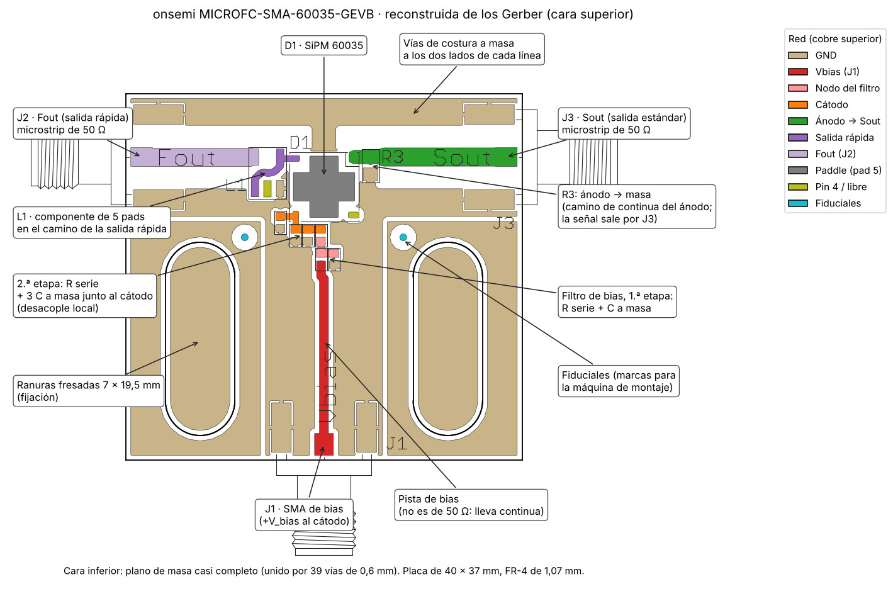

*Figura 1. Cara superior de la MICROFC-SMA-60035-GEVB reconstruida de los Gerbers, con cada red coloreada según la conectividad del cobre: entrada de bias (J1) con el filtro de dos etapas, desacople junto al cátodo, ánodo a la Sout (J3) con R3 a masa, salida rápida a L1 y a la Fout (J2). Las pistas de Fout y Sout son microstrips de 50 Ω ("Matched to 50 ohm" en el plano de fabricación).*

**Footprint del 60035 (hecho, medido en los Gerbers; vista superior, mm desde el centro):**

| Pad | Función | Centro | Tamaño |
|---|---|---|---|
| 1 | Ánodo | (+2.85; +3.00) | 0.6 × 1.1 |
| 2 | Salida rápida | (−3.00; +2.85) | 1.1 × 0.6 |
| 3 | Cátodo | (−2.85; −3.00) | 0.6 × 1.1 |
| 4 | NC | (+3.00; −2.85) | 1.1 × 0.6 |
| 5 | Paddle | cruz de 6.2 × 6.2, brazos de 2.9 | — |

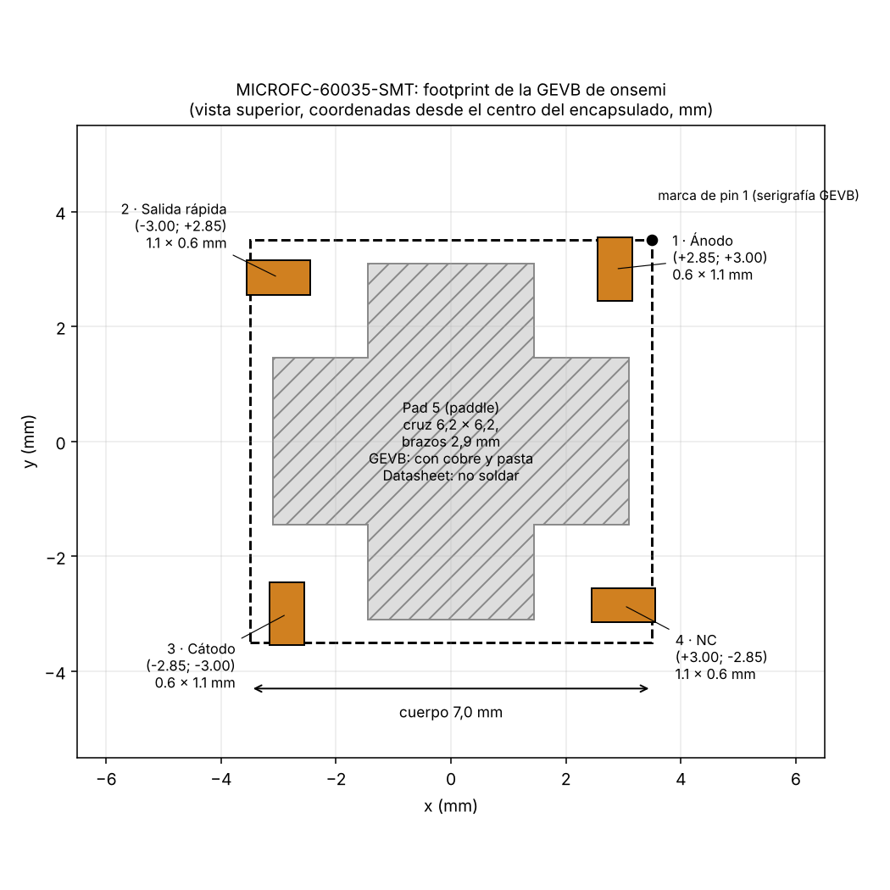

*Figura 2. Footprint del MICROFC-60035-SMT medido en la GEVB (vista superior). Los pads 1–4 están en las esquinas, numerados en sentido antihorario, y salen sólo 0.05 mm fuera del cuerpo de 7.0 mm.*

- Apertura de máscara: +0.075 mm por lado.
- **Identificación de pines por conectividad del cobre** (no sólo por la imagen): la esquina con la marca de pin 1 va a Sout ("standard output (anode)" según el datasheet); la opuesta, a los capacitores de desacople del bias (cátodo); la de arriba a la izquierda, a L1 en el camino de Fout; el pad 4 queda aislado (flotante).
- **La GEVB suelda el paddle** (cobre y pasta en la cruz), aunque el datasheet recomienda no soldarlo. Para nuestra placa se mantiene la recomendación del datasheet.

### 2. Esquemático de la GEVB (AND9809/D, Fig. 4)

| Ref. | Valor | Función |
|---|---|---|
| R1, R2 | 49.9 Ω | Filtro de bias de dos etapas |
| C1 | 10 nF, 50 V | 1.ª etapa del filtro |
| C2, C3, C4 | 100 nF, 10 nF, 10 pF, 50 V | Desacople del cátodo |
| R3 | 10 Ω | Resistencia de sensado de la Sout (ánodo a masa) |
| L1 | RFXF9503 | Transformador de RF 1:1, 50 Ω, 3 MHz–3 GHz (MiniRF), en la salida rápida |

- R3 = 10 Ω coincide con el valor de la AND9782 para el sensor de 6 mm (el mismo de la EVB).
- **Estimación de la amplitud en Sout** (inferencia, no medida): con 10 Ω ∥ 50 Ω ≈ 8.3 Ω, τ_RC ≈ 28 ns; con LYSO (τ = 40 ns) y ~2500 PE, el pico es de ~110 mV a 511 keV y ~30 mV a 140 keV. El fotón individual sigue siendo invisible (~0.14 mV/PE, LOG del 31/08).

### 3. Verificación del footprint de la EVB

Comparé los pads del footprint del SiPM que usa la EVB (SnapEDA, heredado de Lara) con los de la GEVB.

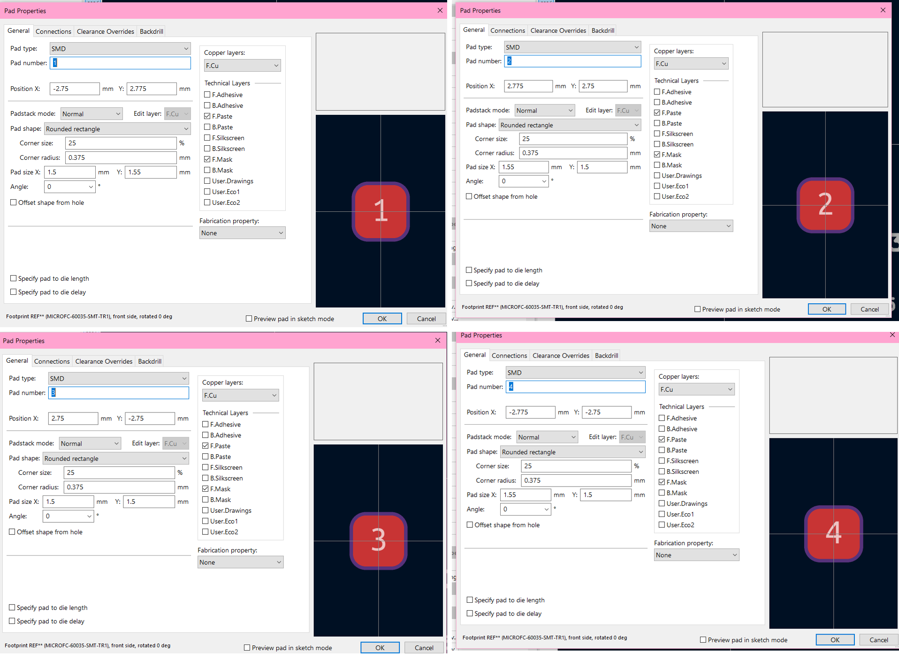

*Propiedades de los pads 1 a 4 del footprint `XDCR_MICROFC-60035-SMT-TR1` de la EVB (KiCad, eje Y hacia abajo).*

| Pad | Footprint de la EVB (KiCad) | Esquina (vista superior) | GEVB |
|---|---|---|---|
| 1 | (−2.75; 2.775), 1.5 × 1.55 | abajo a la izquierda | arriba a la derecha |
| 2 | (2.775; 2.75), 1.55 × 1.5 | abajo a la derecha | arriba a la izquierda |
| 3 | (2.75; −2.75), 1.5 × 1.5 | arriba a la derecha | abajo a la izquierda |
| 4 | (−2.775; −2.75), 1.55 × 1.5 | arriba a la izquierda | abajo a la derecha |

**Conclusión:** es el mismo footprint girado 180°, con la misma numeración y el mismo sentido de giro. **El SiPM de la EVB está bien conectado (sin inversión de ánodo y cátodo).** La diferencia es el tamaño: los pads de SnapEDA son de 1.5 × 1.5 mm y los de onsemi de 0.6 × 1.1 mm.

### 4. Disco frío de BETA

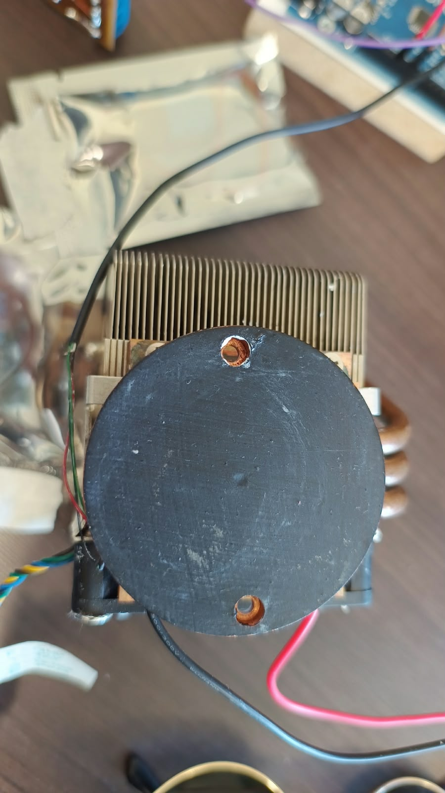

*Vista superior del disco frío (Ø60 mm) montado sobre la Peltier y el disipador, con los dos agujeros roscados.*

- Disco de Ø60 mm con dos agujeros roscados diametralmente opuestos, con los centros a ~25 mm del centro (50 mm entre sí). Lo que medí como 6 mm parece ser el chaflán; por la foto, la rosca es probablemente M3 (inferencia, a confirmar).
- **Consecuencia:** la placa es una tira que cruza el diámetro y se atornilla en los dos agujeros. El SiPM queda en el centro del disco (sobre el centro de la Peltier).

### 5. Evolución del diseño: de dos placas a una

1. Primero planteé dos placas: una breakout sólo para la I-V (SiPM-IV v0) y una placa de Sout basada en la GEVB (SiPM-SOUT v0).
2. **José sugirió hacer una sola placa para la curva I-V y para la Sout.** La adopté.
3. Para la I-V en esta placa:
   - los capacitores del filtro fugan algo y esa fuga depende de la temperatura → se cuantifica con el **control ya previsto: una placa igual, con todos los componentes y sin SiPM**, medida en el mismo barrido térmico;
   - por los ~120 nF en la línea de bias, el barrido tiene que ser fino (`iv_curve_sipm_complete2.py`, LOG 7).

### 6. Entradas y salidas

| Señal | Solución | Motivo |
|---|---|---|
| Bias (HI) y retorno (LO = GND) | Dos pads SMD de 3 × 3 mm (J1, J2). Se suelda un pin a 90° acostado o un cable | Sugerencia de José: nada pasante; desmontable con dupont |
| Sout | SMA de Lara (pasante), en una **pestaña que sale del disco** más allá de un tornillo | Sobre el disco cualquier SMA con patas levanta la placa; en la pestaña las patas quedan en el aire. El cable sale horizontal, sin pasar sobre el cristal ni la fuente |

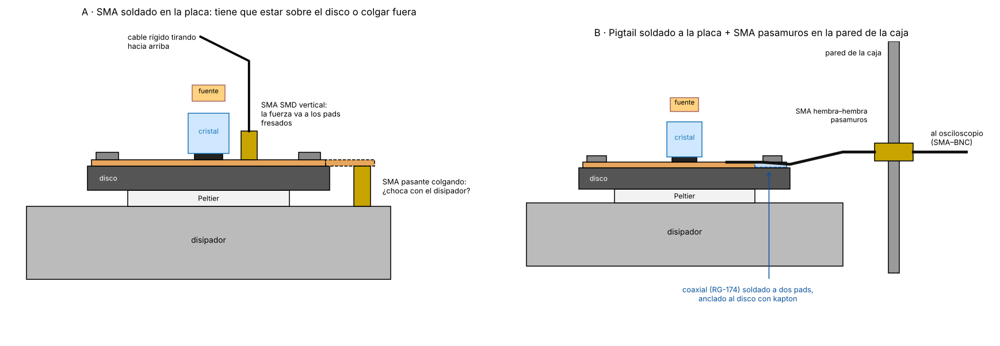

*Figura 3. Vista lateral esquemática (no a escala). (A) SMA en la placa: sobre el disco las patas levantan la placa; en una pestaña fuera del disco quedan en el aire. (B) Alternativa descartada: coaxial soldado a la placa y SMA pasamuros en la pared de la caja.*

Descarté sacar el SMA de la placa (opción B): prefiero el conector en la placa.

### 7. Calor que entra por los cables (análisis térmico)

- Los cables de cobre unen el ambiente (~23 °C) con la placa (hasta 10 °C). El del HI entra por la pista del cátodo directo al SiPM.
- **Estimación de orden de magnitud** (cota superior; cable dupont de ~15 cm, ΔT = 13 K, pista como aleta sobre 1.6 mm de FR-4): el SiPM puede quedar **~0.1–1 K** más caliente que el disco, comparable o mayor que la estabilidad de ±0.1 °C.
- El error crece con la diferencia placa–ambiente: **cambia la pendiente dV_br/dT**, no es un corrimiento fijo. Lo mismo vale para el DS18B20 (el calor entra por sus patas).
- **Mitigación (de montaje):** anclar los cables al disco (3–5 cm con kapton y pasta) antes de que lleguen a la placa; header lejos del SiPM; sensor lejos del header y con sus cables también anclados. El vivo del SMA entra por una pista larga (~30 mm) que descarga el calor al disco antes de llegar al SiPM.
- **Verificación pendiente:** la corrida con un SiPM dummy (LOG 13) mide este efecto.

### 8. Biblioteca: símbolo y footprint del SiPM

**Símbolo:** importado de la biblioteca de la EVB (el de onsemi), con dos cambios:
- **agregué el pin 4 (NC, *Passive*)**, para llevarlo al plano;
- **borré el pin 5 (EP)**: era *Power input* y el footprint nuevo no tiene pad 5.

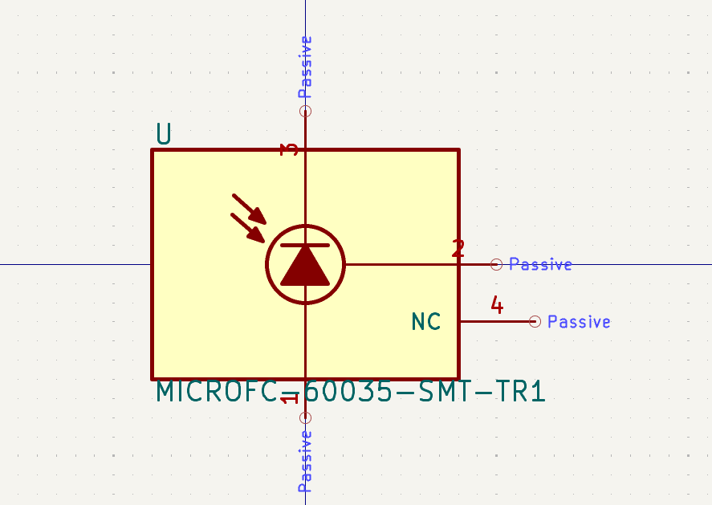

*Símbolo del SiPM: cátodo (pin 3) arriba, ánodo (pin 1) abajo, salida rápida (pin 2) y NC (pin 4) a la derecha, todos Passive.*

**Footprint `SiPM_MICROFC-60035_HandSolder`:** importado del de la EVB (SnapEDA), con estos cambios:
- borré el pad 5 y su apertura de máscara en cruz;
- mantuve los pads 1–4 de SnapEDA (con ellos ya se soldaron el #09 en la placa de Lara y la breakout del LOG 4);
- agregué un ***Rule Area*** de 7 × 7 mm en F.Cu (sólo *Keep out copper fills*): sin plano debajo del cuerpo, porque el paddle no se suelda;
- *Pad connection to zones: Use zone setting* (ya estaba así).

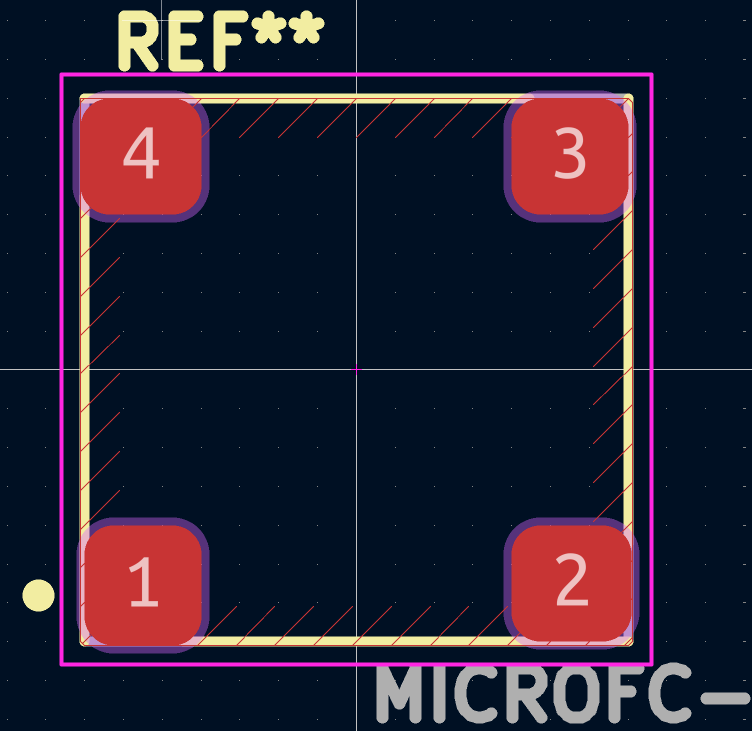

*Footprint final: cuatro pads, sin pad 5, con el área sin cobre (rayada) debajo del cuerpo y la marca de pin 1 junto al pad 1.*

**Soldadura del SiPM:** con pasta y aire caliente en lugar de soldador. Límites de la AND9788: pico de 260 °C durante ≤ 10 s; por encima de 250 °C más de 60 s el encapsulado se puede dañar. Poca pasta en cada pad (el paddle queda flotante y no debe unir pads). Si se consigue, pasta de baja temperatura (SnBi, ~138 °C) y precalentar la placa.

### 9. Esquemático

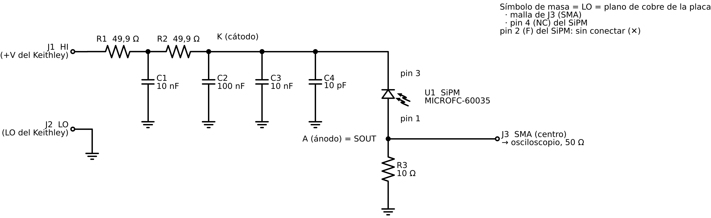

*Figura 4. Esquemático de la placa: el bias entra por J1 y pasa por el filtro R1–C1–R2; C2–C4 desacoplan el cátodo; el ánodo va a R3 (sensado) y al SMA. La masa es el plano de cobre.*

| Ref. | Valor | Conexión |
|---|---|---|
| J1 | Pad HI | +V del Keithley → R1 |
| R1, R2 | 49.9 Ω | Filtro de bias |
| C1 | 10 nF | Nodo R1–R2 a GND |
| C2, C3, C4 | 100 nF, 10 nF, 10 pF | Cátodo a GND |
| U1 | MICROFC-60035 | Pin 3 (K) al cátodo; pin 1 (A) a Sout; pin 4 a GND; pin 2 sin conectar |
| R3 | 10 Ω | Ánodo a GND |
| J3 | SMA | Centro a Sout, malla a GND |
| J2 | Pad GND | LO del Keithley |

- *PWR_FLAG* en GND (el símbolo GND es *power input*). ERC: 0 errores.
- **Uso:** I-V con el Keithley entre J1 y J2; pulsos con el Keithley fijo en V_br + V_ov y el osciloscopio en el SMA con entrada de 50 Ω.

### 10. Footprints

| Ref. | Footprint | Motivo |
|---|---|---|
| R1–R3 | `R_1206_3216Metric_Pad1.30x1.75mm_HandSolder` | Familia HandSolder, como la placa de Lara (que usó 0805). Subí a 1206 porque en 0805 los pads quedan a ~0.8 mm y no cumplen la aislación de 1 mm |
| C1–C4 | `C_1206_3216Metric_Pad1.33x1.80mm_HandSolder` | Ídem |
| J1, J2 | `TestPoint_Pad_3.0x3.0mm` | Pads grandes para pin a 90° o cable |
| J3 | `LPRS_SMA_CONNECTOR_ANCHITO` (de la biblioteca de la EVB) | SMA de Lara, disponible en el laboratorio |
| U1 | `SiPM_MICROFC-60035_HandSolder` | §8 |

### 11. PCB

**Reglas:**
- Clase *Default*: aislación y ancho de pista de 1.0 mm.
- Clase **SOUT** (red `Net-(J3-In)`): aislación de 0.5 mm, más *Pad clearance* de 0.5 mm en J3, y mínimo global de 0.5 mm. **Motivo:** el router no llegaba al pin central del SMA (§Problemas). En SOUT la fuga no importa (10 Ω a masa).

**Mecánica:** agujeros `MountingHole_3.2mm_M3` a ±25 mm del centro del disco, con *Clearance override* de 2.2 mm, para que el plano no quede debajo de la cabeza del tornillo y el tornillo no conecte el plano con el disco.

**Ubicación:**
- SiPM en el centro del disco, rotado con el cátodo hacia el filtro y el ánodo hacia R3;
- filtro R1–C1–R2 a la izquierda;
- C4, C3 y C2 en fila sobre el cátodo;
- R3 debajo del SiPM;
- J1 y J2 sobre el borde superior izquierdo;
- SMA en la pestaña;
- zona libre al costado del SiPM para el sensor T_DUT.

**Plano:** zona GND en F.Cu, aislación de 1.0 mm, conexión *Solid*, *Remove islands: Always*. Como en la breakout del LOG 4, la fresa sólo corta los surcos de aislación: menos tiempo de fresado y menos desgaste.

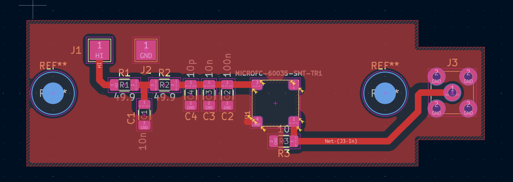

*PCB final con el plano relleno. La placa se agrandó para que una franja de plano corra por debajo de la pista de SOUT (§Problemas).*

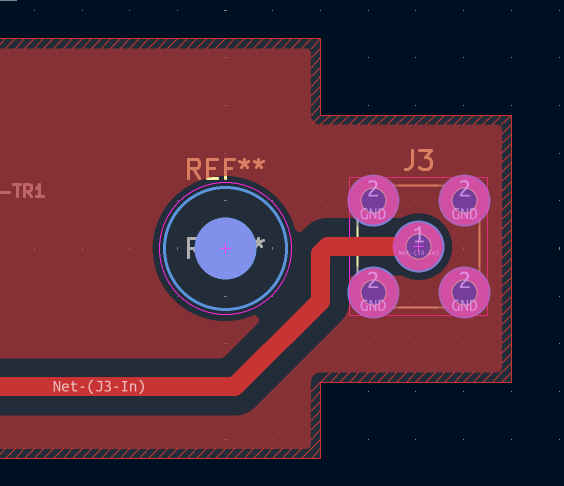

*Detalle de la pestaña: la franja de plano de abajo pasa por debajo de la diagonal de SOUT, rodea las patas inferiores del SMA y se une con las superiores por la derecha del pin central.*

### 12. Archivos de fabricación

Gerber de F.Cu y Edge.Cuts (*Plot on All Layers* vacío) y taladros Excellon con origen absoluto (PTH para el SMA, NPTH para los tornillos). Los verifiqué en el *Gerber Viewer* de KiCad.

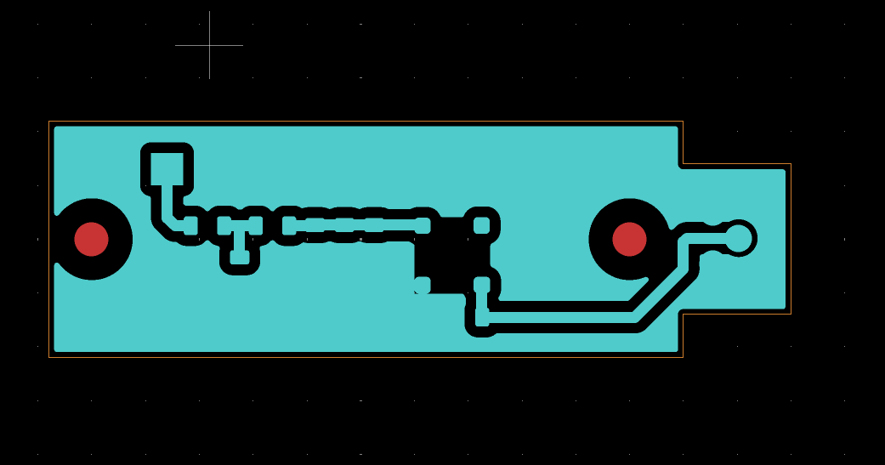

*Gerber de cobre (cian) y contorno (naranja), con los agujeros de los tornillos (rojo) en el centro de sus círculos sin cobre.*

*Taladros: los dos de los tornillos (NPTH, rojo) a 50 mm entre sí y los cinco del SMA (PTH, verde) a ~10 mm del tornillo derecho.*

Envié el zip con los cuatro archivos (`…-F_Cu.gbr`, `…-Edge_Cuts.gbr`, `…-PTH.drl`, `…-NPTH.drl`) a la CNC.

---

## Problemas identificados

| Problema | Causa | Solución |
|---|---|---|
| El router no conectaba el pin central del SMA | Aislación de 1 mm; KiCad toma la mayor de las dos aislaciones entre dos objetos | Clase de red SOUT con 0.5 mm, override de J3 y mínimo global de 0.5 mm |
| DRC: "Missing connection between items" (zona GND partida en dos) | En una sola capa, la cadena HI (J1 en el borde → R1 → R2 → cátodo) y la cadena SOUT (ánodo → R3 → SMA) forman una pared que corta el plano | Bajé J1 para que el plano pase por arriba |
| Retorno de la señal del SMA dando toda la vuelta a la placa | Por debajo de la pista de SOUT no había plano; la espira de la señal encerraba casi toda la placa (antena, como en el LOG del 31/08) | Agrandé la placa: ahora corre una franja de plano por debajo de la pista de SOUT hasta las patas del SMA. Espira chica |
| Advertencias de serigrafía en el DRC | Textos y contorno de U1 | Irrelevantes: la CNC no imprime serigrafía |

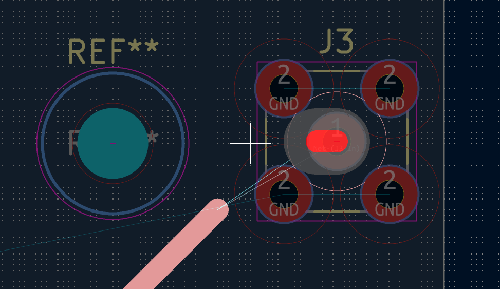

*El router no deja llegar al pin central del SMA: los círculos rojos son la aislación de 1 mm alrededor de las patas de masa.*

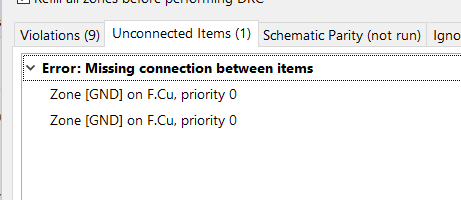

*DRC: la zona GND quedó en dos pedazos sin conexión.*

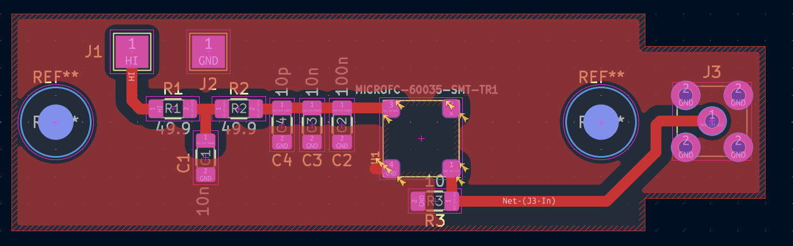

*Después de bajar J1, el plano quedó unido sólo por la izquierda (por arriba de J1); por debajo de la pista de SOUT no había plano.*

---

## Decisiones técnicas de la sesión

| Decisión | Justificación | Impacto futuro |
|---|---|---|
| Una sola placa para I-V y Sout | Sugerencia de José | La I-V se valida con la placa de control sin SiPM y barrido fino |
| Circuito de la GEVB (AND9809 Fig. 4) sin la salida rápida | Referencia de onsemi; la salida rápida no se usa | Pin 2 sin conectar, sin L1 |
| Pads 3 × 3 mm para el bias | Nada pasante; pin a 90° o cable | Desmontable con dupont |
| SMA de Lara en una pestaña fuera del disco | La placa apoya plana; el cable sale horizontal | Hay que resolver cómo se suelda el SMA pasante en simple faz |
| Placa en tira a lo largo del eje de los tornillos | Agujeros roscados del disco a ±25 mm | Montaje reversible (girando 180°) |
| Símbolo con pin 4 y sin pin 5 | Pin 4 al plano; sin cobre bajo el paddle | Símbolo reutilizable para futuras placas |
| Pads de SnapEDA en el footprint nuevo | Ya probados (placa de Lara, breakout del LOG 4); proceso simple | Poca pasta para no unir pads con el paddle flotante |
| Sin cobre debajo del cuerpo del SiPM (*Rule Area* en el footprint) | Datasheet: paddle sin soldar; placa sin máscara | Viaja con el footprint a cualquier placa |
| Pasta + aire caliente para el SiPM | Pads bajo el cuerpo; el soldador destruyó el #05 (LOG 6) | Respetar 260 °C / ≤ 10 s (AND9788) |
| 1206 HandSolder | Soldadura a mano y aislación de 1 mm | — |
| Marcas de polaridad con fibrón | Simplicidad | Marcar "+" en J1 antes de conectar el Keithley |
| Anclaje térmico de los cables al disco | El calor por los cables puede cambiar la pendiente dV_br/dT | Verificar con la corrida del SiPM dummy |

---

## Archivos generados

- **Proyecto KiCad de la placa:** esquemático, PCB y biblioteca `SiPM` (símbolo `MICROFC-60035-SMT-TR1` con pin 4, footprint `SiPM_MICROFC-60035_HandSolder`, SMA `LPRS_SMA_CONNECTOR_ANCHITO`).
- **Fabricación (zip enviado a la CNC):** `…-F_Cu.gbr`, `…-Edge_Cuts.gbr`, `…-PTH.drl` (SMA) y `…-NPTH.drl` (tornillos).
- **Figuras y capturas** (`docs/images/logs/`):
  - `14_fig1_GEVB_redes.png`, `14_fig2_footprint_GEVB.png`, `14_fig3_SMA_opciones.png`, `14_fig4_esquematico.png`;
  - `14_foto_disco_frio.png`;
  - `14_captura_pads_footprint_EVB.png`, `14_captura_simbolo_SiPM.png`, `14_captura_footprint_SiPM.png`;
  - `14_captura_router_SMA.png`, `14_captura_DRC_zona_partida.png`, `14_captura_plano_unido_por_izquierda.png`;
  - `14_captura_PCB_final.png`, `14_captura_PCB_retorno_SMA.png`, `14_captura_gerber_cobre.png`, `14_captura_gerber_taladros.png`.

Las figuras 1–4 son anteriores a la guía de estilo gráfico (10/11) y quedan como están.

---

## Pendientes del LOG anterior (27/10) — estado

- [ ] Confirmar o comprar BTS7960, sensor de humedad, cable AWG 18, caja opaca y silica gel → pendiente
- [ ] Escribir el firmware → pendiente
- [ ] Puesta en marcha con el puente H → pendiente
- [ ] Driver de Python para el Arduino e integración con el script I-V → pendiente
- [ ] Calibrar el DS18B20 en dos puntos → pendiente
- [ ] Verificar el gradiente entre el sensor y el dado del SiPM (SiPM dummy) → pendiente; ahora además mide el efecto del calor que entra por los cables (§7)
- [ ] Repetir los escalones con la placa del DUT montada → pendiente; la placa se está fabricando
- [ ] Elegir las referencias para el circuito de compensación → pendiente
- [x] Verificar el footprint de SnapEDA contra una referencia de onsemi (pendiente desde el LOG 4) → **completado**: coincide con la GEVB (girado 180°); la EVB está bien conectada

---

## Pendientes

- [ ] Recibir la placa fresada; definir cómo se suelda el SMA pasante en simple faz (cuerpo abajo con soldadura arriba, o cuerpo arriba soldando por el borde de los pads)
- [ ] Elegir el SiPM del lote #01–#10 y soldarlo con pasta y aire caliente; curva I-V con barrido fino antes y después, para comparar con el LOG 3
- [ ] Fresar y armar la placa de control (todos los componentes, sin SiPM) para la fuga en función de la temperatura
- [ ] Marcar con fibrón "+" en J1 y "−" en J2
- [ ] Confirmar la rosca de los agujeros del disco (M3) y el largo de tornillo: no debe atravesar el disco y tocar el disipador (puente térmico)
- [ ] Anclar al disco los cables del bias, el coaxial y los del DS18B20
- [ ] Actualizar el log de diseño de BETA (§2.1): una sola placa (I-V + Sout), plano GND, pads de bias y SMA en la pestaña

---

## Referencias consultadas

- **onsemi, MICROFC-SMA-60035-GEVB:** Gerbers de la placa de evaluación (EAGLE 9.6.2, *MicroF-SMA-6mm-V4*).
- **onsemi, AND9809/D Rev. 3** (marzo 2024): esquemáticos de las placas SMA y SMTPA (Fig. 4, MicroFC-SMA-600XX).
- **onsemi, MICROC-SERIES/D Rev. 9:** pines 4 y 5 del 60035 (p. 10), tabla de parámetros, placas de evaluación (p. 9).
- **onsemi, AND9788/D:** límites de reflujo y retrabajo.
- **onsemi, AND9782/D:** salida rápida sin uso (dejarla flotante); R_S de 10 Ω para el sensor de 6 mm.
- **MiniRF, RFXF9503:** transformador de RF 1:1, 3 MHz–3 GHz (fichas de everything RF y RFMW).
- **LOG 4** (breakout, plano en F.Cu), **LOG 6** (SiPM destruido por soldadura), **LOG 7** (barrido fino en placas con capacitores), **LOG del 31/08** (ruido por espiras), **LOG 10–12** (EVB: footprint del SiPM, HandSolder de Lara, AND9788), **LOG 13** (BETA).

---

*Log generado al finalizar la sesión del 2 de noviembre de 2026.*
