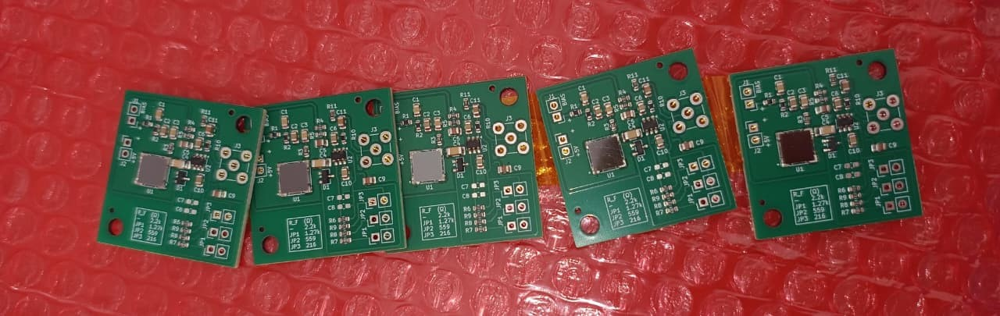
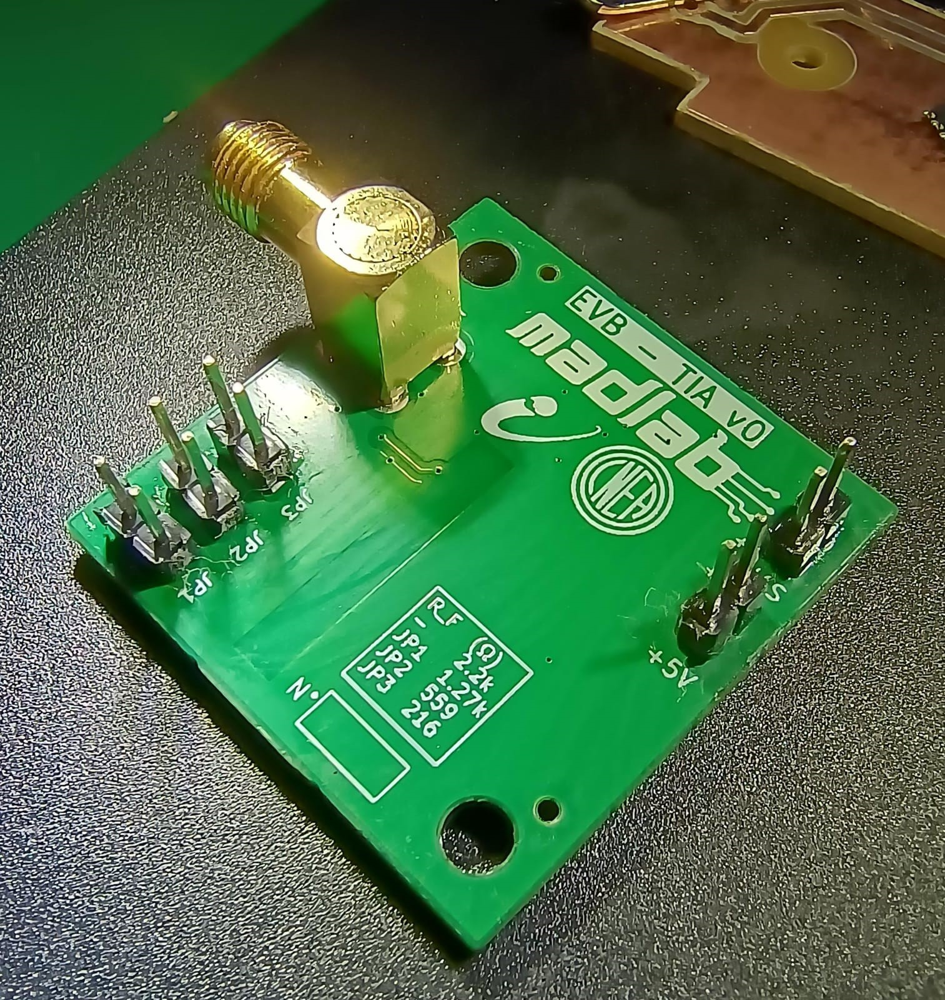
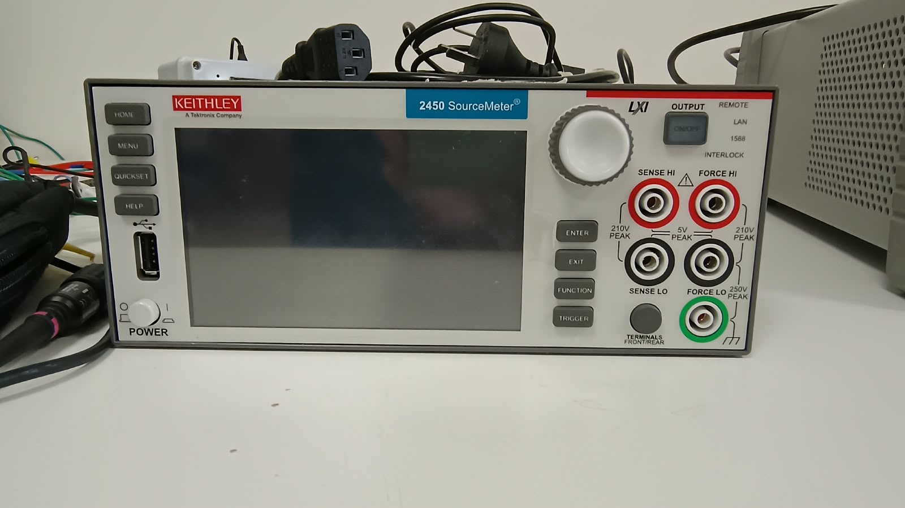
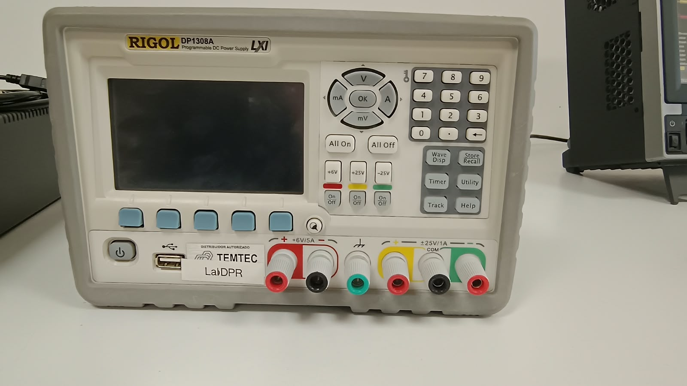
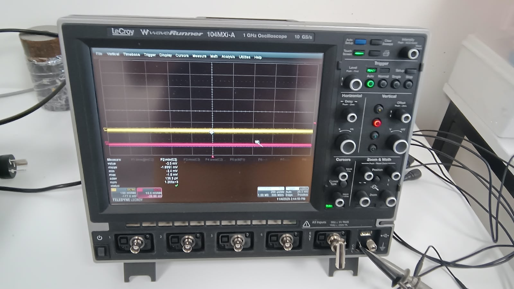
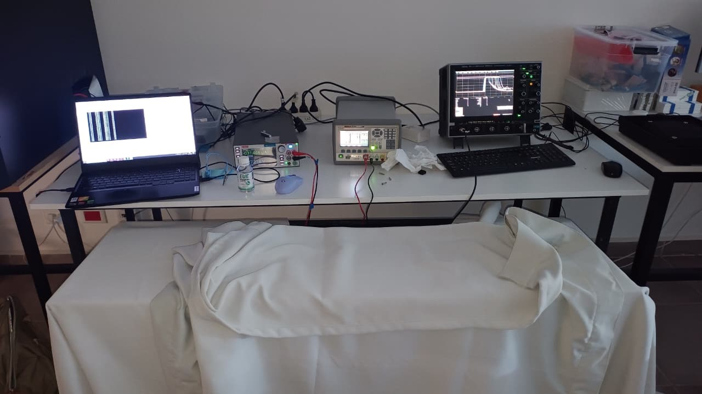
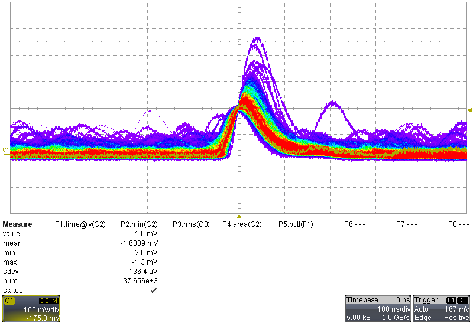
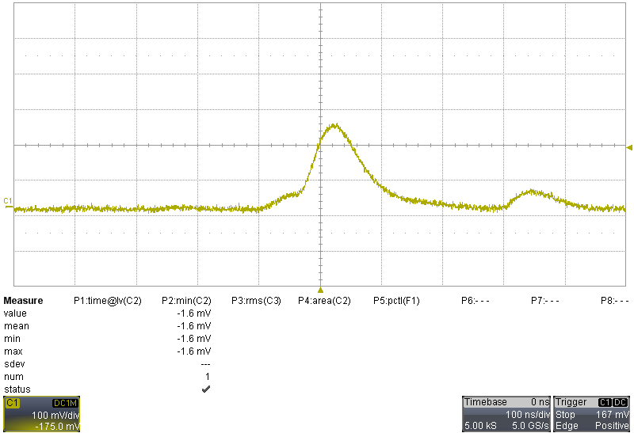
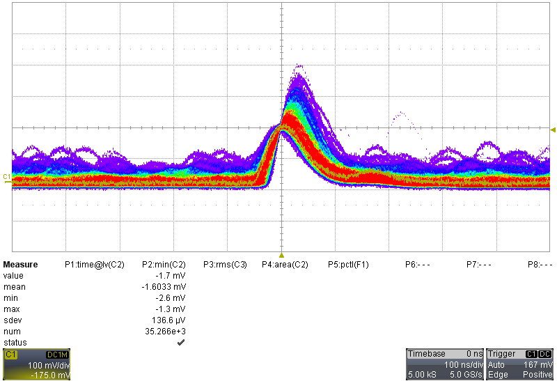

# 16 LOG — Miércoles 4 de noviembre de 2026

## Recepción de la EVB-TIA v0 y primeros pulsos del SiPM con electrónica propia

**Tipo:** recepción de PCB ensamblada, soldadura de conectores y primera prueba eléctrica (pulsos en oscuridad).
**Continúa:** LOG 12 (diseño de la EVB-TIA v0 y pedido a JLCPCB, 20/10).

**Estado al cierre:** placa 2 con conectores y medida: **se observan pulsos del SiPM a V_ov ≈ 5 V**. Placa 1 con conectores, sin verificar. Placas 3–5 sin conectores.

> [!NOTE]
> **Correcciones posteriores (LOG 17, 05/11).** Con el espectro de fotoelectrones del día siguiente, tres afirmaciones de este log quedaron corregidas:
>
> | Dónde | Acá dice | Corrección (LOG 17) |
> |---|---|---|
> | §6.1, §6.2 | Subida de ~60–70 ns, coincidente con el ancho de banda estimado (~5.6 MHz) | **Medida: 31–32 ns** en la forma promedio del pulso de 1 PE (LOG 17, fig. 2). La lectura de la grilla y la inferencia del §6.2 eran incorrectas |
> | §6.3 | Hipótesis: SPE de ~50 mV | **Descartada.** El SPE a V_ov ≈ 5 V es de ~22 mV (LOG 17, fig. 1c); los pulsos de 50 mV eran eventos de varios PE |
> | Pendientes | Simulación de estabilidad del lazo antes de cerrar jumpers | **Descartada** (05/11): la estabilidad de cada R_F se verifica en la placa |
>
> Este log no tiene datos crudos: los pulsos quedaron registrados solo como capturas de pantalla, que van tal cual. No hay gráficos generados por script.

---

> [!IMPORTANT]
> ## HITO 4 — PRIMEROS PULSOS DEL SiPM CON ELECTRÓNICA PROPIA
>
> **Primera observación de pulsos del MICROFC-60035-SMT leídos por la salida estándar con la electrónica diseñada en este proyecto:** EVB-TIA v0, TIA de una etapa con ADA4895-1 en Configuración C (capturas del §6).
>
> Se cierra el ciclo completo **diseño → simulación → layout → fabricación → medición**, iniciado el 15/09 (8a LOG).
>
> | Hito | Fecha | Resultado |
> |---|---|---|
> | 1 | 11/08 | Dispersión de V_br dentro de un lote ~20 mV (LOG 3) |
> | 2 | 09/09 | Primeros pulsos de fotón individual, con la placa BGA614 ×100 de Lara por la salida rápida (LOG 7) |
> | 3 | 20/10 | EVB-TIA v0 diseñada, verificada y enviada a fabricar (LOG 12) |
> | **4** | **04/11** | **Primeros pulsos con la EVB-TIA v0, por la salida estándar** |

---

## 1. Recepción de las placas

- **Fabricante:** JLCPCB, 5 placas ensambladas, pedido SMT026102064336. El SiPM (C905854) viene soldado por reflujo.
- **Componentes que se sueldan en el laboratorio:** los que no van en la BOM (J1, J2, J3, JP1–JP3).



## 2. Soldadura de conectores

Con Lara soldamos los conectores de dos placas.

**Criterio de montaje:** todos los conectores van del **lado de abajo** (la cara opuesta al SiPM). La cara del SiPM tiene que quedar despejada, porque el centellador apoya sobre el sensor y no puede tocar nada.

| Placa | Historia | Estado |
|---|---|---|
| **Placa 1** | La soldamos primero del **lado equivocado** (conectores en la cara del SiPM). La desoldamos y la volvimos a soldar, tuvimos problemas y la dejamos para después. Al final conseguimos soldarla correctamente | Conectores del lado correcto. **Sin verificar** |
| **Placa 2** | La soldamos correctamente desde el principio | **Medida en esta sesión** |

**Problema al resoldar la placa 1:** el agujero del pin de +5V de J2 quedó lleno de estaño y no pudimos vaciarlo.

- Todos los demás agujeros los desoldamos y soldamos en minutos.
- Ese pin nos llevó **una hora entera**.
- No sabemos la causa.

> [!WARNING]
> La placa 1 tuvo **desoldadura y resoldadura** de conectores, y **una hora de calor** sobre un mismo pin. La AND9788 no recomienda retrabajar el SiPM y limita la cantidad de reflujos. Antes de usarla hay que verificar que el SiPM sigue funcionando.

La numeración (placa 1 y placa 2) sigue el orden de soldadura.



## 3. Setup experimental

### 3.1 Instrumentos

| Función | Instrumento | Conexión |
|---|---|---|
| Bias del SiPM | Keithley 2450 SourceMeter (USB a la PC) | FORCE HI → J1 + / FORCE LO → J1 GND (2 hilos, terminales frontales) |
| Alimentación +5 V | Rigol DP1308A, canal +6V/5A | Rojo (+) → J2 +5V / negro (−) → J2 GND. Borne de tierra (verde) sin conectar |
| Lectura de pulsos | LeCroy WaveRunner 104MXi-A (1 GHz, 10 GS/s) | J3 (SMA) → CH1, con cable de RF SMA–BNC |

Las masas se unen solo en la placa.







**Antes de energizar la placa 2 no hice verificaciones con multímetro.** La conecté y funcionó.




### 3.2 Configuración de la placa (placa 2)

| Parámetro | Estado |
|---|---|
| Jumpers JP1–JP3 | Abiertos → **R_F = 2.2 kΩ** (configuración de fábrica) |
| C_F (C7/C8) | Sin soldar |
| Condición de luz | Dentro de la caja del envío, cubierta por otra caja de cartón y, encima, telas blackout |

### 3.3 Configuración de los instrumentos

**Keithley 2450**: script `bias_sipm_needles.py`, sin cambios (LOG 7, 31/08). La polaridad es la misma que en la placa de Lara: tensión positiva al cátodo, ánodo a GND.

| Parámetro | Valor |
|---|---|
| Fuente | Tensión, rango 200 V |
| Compliance | 100 µA |
| Medición | Corriente, autorango, NPLC = 1 |
| Rampa | 1 V/paso, 0.3 s/paso |
| V_BR del script | 24.719 V (constante del SiPM #05) |
| V_ov ingresada | 5.0 V → **V_source = 29.719 V** |

Con 100 µA de compliance, la corriente que entra al TIA en cada escalón de la rampa (carga de C_c) queda limitada a ~100 µA. Eso da un corrimiento de la salida de ~0.22 V con 2.2 kΩ y queda muy por debajo del límite de los diodos internos del ADA4895 (< 10 mA).

> [!NOTE]
> La V_ov real de este SiPM no se conoce: no tiene curva I-V. Rango del datasheet: V_br = 24.2–24.7 V a 21 °C.

**Rigol DP1308A, canal +6V/5A**

| Parámetro | Valor |
|---|---|
| Tensión | 5.00 V |
| Límite de corriente | 0.030 A |

El consumo esperado es de ~5.5 mA: ~3 mA del ADA4895 (típico del datasheet) más 2.5 mA del divisor de Uref. El límite deja ~5× de margen y, ante un corto, limita la potencia a 150 mW. El consumo medido fue de 6 mA (§5.1).

**LeCroy WaveRunner 104MXi-A** (configuración de las capturas, visible en los recuadros de las capturas del §6)

| Parámetro | Valor |
|---|---|
| Canal | C1, acople **DC1M** (1 MΩ) |
| Escala vertical | 100 mV/div, offset −175 mV |
| Base de tiempo | 100 ns/div, 5.0 GS/s, 5.00 kS |
| Trigger | Edge, C1, DC, pendiente positiva, **167 mV**, modo **Auto** (captura simple en Stop) |
| Display | Persistencia (capturas 1 y 3) |

> [!WARNING]
> La tabla *Measure* que aparece en las capturas del osciloscopio mide los canales C2, C3 y F1, no C1 (donde estaba la señal). Sus valores (min ≈ −1.6 mV) no corresponden a los pulsos y no se usan.

## 4. Secuencia de encendido

1. Rigol (canal +6V) encendida, sin bias.
2. Línea de base en el osciloscopio.
3. Bias con el script, V_ov = 5.0 V.
4. Apagado: Ctrl+C (rampa a 0 V y salida OFF) y después la Rigol.

El control con V_bias por debajo de V_br (~20 V, sin avalancha) **no se hizo**.

## 5. Incidentes

### 5.1 J2 conectado invertido

Lecturas del display de la Rigol:

| | Rigol |
|---|---|
| Con J2 invertido | **0.7 V / 0.030 A** (en límite de corriente) |
| Con J2 corregido | **5.00 V / 0.006 A** |

- **Causa:** invertí la conexión de la Rigol en J2.
- **Inferencia:** los 0.7 V a 30 mA son la firma de diodos en directa, no de un corto. Con +5 V y GND cruzados conducen los dos Schottky en serie de D1 (BAT54S) y los diodos ESD del ADA4895.
- **Exposición:** algunos segundos a 30 mA (~21 mW), limitados por la fuente.
- **Estado de U2:** el consumo posterior (6 mA, el esperado) y los pulsos (§6) indican que el ADA4895 sobrevivió.

### 5.2 Corriente de 1.32 µA a 0 V

Al encender la salida a 0 V, el script advirtió una corriente anormal de **1.32 µA**.

A 0 V la Keithley no aplica tensión, y en la EVB el único camino DC desde J1 es el SiPM (C_c aísla el cátodo del TIA). La corriente era **fotocorriente**: el SiPM sin bias funciona como un fotodiodo de 36 mm².

Tapé mucho más la placa y **la advertencia no volvió a aparecer**.

## 6. Resultados: pulsos del SiPM

**Condiciones:**

| Parámetro | Valor |
|---|---|
| Placa | Placa 2 |
| R_F | 2.2 kΩ |
| V_ov | ≈ 5 V nominal (V_source = 29.719 V) |
| Corriente de bias | **No registrada** |
| Luz | Placa tapada |
| Temperatura | No registrada |







### 6.1 Observaciones (hechos)

Valores leídos de la grilla de las capturas, aproximados (100 mV/div):

| Evento | Amplitud aprox. | Captura |
|---|---|---|
| Pulsos chicos sobre la línea de base (persistencia; "hombro" antes del pulso disparado en la captura 2) | ~50 mV | 1, 2 y 3 |
| Pulso secundario a +700 ns | ~115 mV | 2 |
| Pulso disparado | ~235 mV | 2 |
| Envolvente máxima | ~450 mV | 1 |

- **Polaridad:** pulsos positivos, como en el diseño (Configuración C + TIA).
- **Línea de base:** ≈ 0 V, como se espera después de C11.
- **Forma:** subida de ~60–70 ns, vuelta a la base en ~250 ns, con algo de cola. *(Subida corregida en el LOG 17: 31–32 ns.)*
- **Estabilidad:** sin oscilación, sin ringing y sin undershoot visible (capturas 1 a 3).

### 6.2 Inferencias

- **Estabilidad:** el TIA es estable en la placa real con R_F = 2.2 kΩ y sin C_F, como en la simulación (LOG 9).
- **Tiempo de subida:** coincide con el ancho de banda esperado del TIA limitado por la capacidad del SiPM *(incorrecta: ver la nota del principio)*:

```
f ≈ √( GBW / (2π · R_F · C_SiPM) ) = √( 1.5 GHz / (2π · 2.2 kΩ · 3.4 nF) ) ≈ 5.6 MHz
t_r ≈ 0.35 / f ≈ 60 ns
```

- **SiPM:** el de la placa 2 está funcional después del reflujo de JLCPCB (opera en modo Geiger).

### 6.3 Hipótesis (sin verificar)

El SPE podría ser el escalón de **~50 mV**, y 115, 235 y 450 mV serían eventos de varios PE (crosstalk). Eso sería **~2–5× más** que los ~10–20 mV estimados en la simulación (LOG 9: SNR ≈ 7 con 1.33 mV rms de ruido a V_ov = 2.5 V).

No se puede confirmar con estas capturas: el trigger en 167 mV selecciona eventos grandes y no hay histograma de amplitudes. *(Descartada en el LOG 17: el SPE a 5 V es de ~22 mV.)*

---

## Significado del resultado

La medición valida en la placa real:

1. **La topología:** Configuración C, TIA de una etapa, Uref = 2.5 V y alimentación simple de 5 V (capturas del §6).
2. **La fabricación y el ensamblado en JLCPCB:** el SiPM de la placa 2 funciona después del reflujo, el consumo es el de diseño (§5.1) y la polaridad de la salida es la correcta.
3. **La estabilidad del TIA** con R_F = 2.2 kΩ.

Desbloquea la caracterización del SPE, el barrido del banco de R_F y la espectroscopía con centellador.

---

## Problemas identificados

| Problema | Causa | Solución |
|---|---|---|
| Placa 1 soldada del lado equivocado | Los conectores van del lado opuesto al SiPM y la placa no lo indica | Desoldar y resoldar. Verificar el SiPM antes de usarla |
| Agujero del pin de +5V de J2 (placa 1) imposible de vaciar durante una hora | Desconocida | Pendiente |
| J2 invertido: 0.7 V / 30 mA | Conexión de la Rigol invertida | Corregir la conexión → 5.00 V / 6 mA |
| 1.32 µA a 0 V | Fotocorriente por luz | Tapar mejor la placa |
| Mediciones del LeCroy sobre C2/C3/F1 | Configuración previa del equipo | Pasarlas a C1 |
| Corriente de bias no registrada | No la anoté | Registrarla en cada V_ov |

---

## Decisiones técnicas y lecciones

| Decisión / lección | Justificación | Impacto futuro |
|---|---|---|
| Conectores siempre del lado de abajo | La cara del SiPM tiene que quedar libre para el centellador | **EVB v1:** indicar en la serigrafía el lado de montaje de los conectores |
| Verificar la polaridad de J1 y J2 antes de energizar | La inversión de J2 se detectó solo por el límite de corriente de la Rigol | Marcar "+" con fibrón en todas las placas |
| Usar la advertencia de corriente a 0 V del script como chequeo de oscuridad | A 0 V la única corriente posible en la EVB es la fotocorriente | Aplicar en cada sesión de pulsos |
| Límite de corriente de la Rigol en 30 mA | ~5× el consumo normal; limitó el daño cuando J2 estuvo invertido | Mantenerlo en todas las placas |

---

## Pendientes

- [ ] **Placa 1:** inspección con lupa, encendido de +5 V (consumo esperado ~6 mA) e I-V del SiPM antes de medir pulsos, por el retrabajo cerca del SiPM
- [ ] Marcar "+" en J1 y J2 de todas las placas
- [ ] Soldar los conectores de las placas 3–5, del lado de abajo
- [ ] Medir la curva I-V del SiPM de la placa 2 por J1 (barrido fino, lección del LOG 7) para conocer V_br y fijar V_ov. Después, cargar ese V_br en una copia del script de bias (LOG 18: la I-V con la EVB no da V_br por el autorange del Keithley)
- [ ] Repetir los pulsos con el control a ~20 V y la corriente de bias registrada
- [x] **Histograma del SPE** a V_ov = 5 y 2.5 V: 20 mV/div, trigger Normal en ~25 mV, P1 = `max(C1)`, F1 = Histogram(P1). Comparar con la simulación del LOG 9 → hecho en el LOG 17 (también a 3.75 V)
- [x] ~~Simulación de estabilidad del lazo (tarea J1 de la Trazabilidad) antes de cerrar jumpers hacia R_F bajas y antes de soldar C_F~~ → descartada el 05/11 (LOG 17)
- [ ] Agregar las fotos a este log

---

## Scripts

| Script | Función | Estado |
|---|---|---|
| `bias_sipm_needles.py` | Bias fijo | Sin cambios (LOG 7, 31/08) |

## Referencias

- **LOG 17 (05/11):** correcciones a este log (subida del pulso y SPE).
- **7 LOG (31/08 y 09/09):** script `bias_sipm_needles.py` y primeros pulsos con la placa BGA614 de Lara (Hito 2).
- **LOG 9 (23/09):** simulación del TIA (SPE, ruido, SNR).
- **LOG 12 (20/10):** diseño y pedido de la EVB-TIA v0.
- **Trazabilidad_Diseno_Amplificacion_EVB-TIA.md:** protección del opamp (§5.2) y simulación de estabilidad (§6.4, J1; descartada el 05/11).
- **AND9788/D** (onsemi): soldadura y manipulación de SiPM.
- **DataSheet MICROC-SERIES/D** (onsemi): V_br, corriente oscura, capacidad del 60035.
- **ADA4895-1** (Analog Devices): GBW y corriente de reposo.
- **Torletti (2025):** no se usó directamente en esta sesión. La comparación con su placa es por el Hito 2 (LOG 7).

---

*Log generado al finalizar la sesión del 4 de noviembre de 2026. Revisado el 10 de noviembre (punto decimal, capturas, correcciones del LOG 17).*
