# 17 LOG — Jueves 5 de noviembre de 2026

## Primer espectro de fotoelectrones con la EVB-TIA v0: amplitud, carga y forma del SPE a tres sobretensiones

**Tipo:** caracterización en oscuridad (cuentas oscuras, sin fuente ni centellador) de la placa 2 con R_F = 2.2 kΩ. Adquisición en modo Sequence y análisis offline en Python.
**Continúa:** LOG 16 (primeros pulsos con la EVB-TIA v0, 04/11).

**Estado al cierre:** el SPE se resuelve a V_ov ≈ 2.5, 3.75 y 5 V, con picos de 1, 2 y 3 PE. La respuesta es lineal con la sobretensión, la ganancia por volt coincide con el datasheet y el SPE, el ruido y la SNR coinciden con la simulación del LOG 9. M4 (ruido con V_bias < V_br) no se hizo.

> [!NOTE]
> **Correcciones posteriores (LOG 18, 06/11).** Rehice el análisis de estos datos con el algoritmo de área v2.0. Cambian cuatro resultados de este log:
>
> | Dónde | Acá dice | Con v2.0 (LOG 18) |
> |---|---|---|
> | §5.4, §6.1 | V_br ≈ 25.0 V (± 0.3 V) | V_0 = 24.15 ± 0.15 V con estos datos; 24.46 ± 0.08 V con los 7 puntos del LOG 18 |
> | §5.4 | Capacidad de microcelda 192 fF | 161 fF con estos datos; 175 fF con los del LOG 18 |
> | §8 | Hombro a ~180 ns: hipótesis de afterpulsing | Con eventos limpios es igual a todas las V_ov: es parte de la respuesta (inferencia) |
> | §3.2 | Base a 5 V = −I_bias × R_F | Se confirma: la base queda corrida en tasa × área media por pulso por el acople AC |
>
> El resto de los resultados se mantiene. Las figuras de este log se regeneraron el 10/11 con `estilo_pi.py` v1.0, a partir de los mismos datos y del mismo análisis del 05/11 (`figuras_log17.py`). Los valores de las figuras son los de las tablas.

---

> [!IMPORTANT]
> ## HITO 5 — ESPECTRO DE FOTOELECTRONES Y VALIDACIÓN DEL MODELO DE LA ELECTRÓNICA
>
> **Primera medición cuantitativa del SPE con la electrónica propia.** Picos de 1, 2 y 3 PE resueltos a tres sobretensiones (fig. 1), y tres comparaciones que cierran:
>
> - **SPE, ruido y SNR medidos ≈ simulados** (LOG 9): el modelo con el que se elige R_F para 511 keV está bien escalado (figs. 1 y 6).
> - **La carga del SiPM llega al TIA sin pérdidas apreciables:** la ganancia por volt coincide con la del datasheet (fig. 3c).
> - **Tasa de cuentas oscuras ≈ valor típico del datasheet** (fig. 4).
>
> | Hito | Fecha | Resultado |
> |---|---|---|
> | 1 | 11/08 | Dispersión de V_br dentro de un lote ~20 mV (LOG 3) |
> | 2 | 09/09 | Primeros pulsos de fotón individual, con la placa BGA614 ×100 de Lara (LOG 7) |
> | 3 | 20/10 | EVB-TIA v0 diseñada, verificada y enviada a fabricar (LOG 12) |
> | 4 | 04/11 | Primeros pulsos con la EVB-TIA v0 (LOG 16) |
> | **5** | **05/11** | **Espectro de fotoelectrones y validación del modelo** |

---

## 1. Objetivo de la sesión

La pregunta central: **¿cuánto vale el SPE y coincide con lo esperado?** De esa respuesta dependen:

- **la elección de R_F (y C_F) para 511 keV**, que sale del modelo (LTspice y cascada). Si el SPE real no coincide con el simulado, el modelo está mal escalado;
- **la calibración en fotoelectrones**: con el SPE, la posición del fotopico se pasa a número de PE. Es la forma confiable de comparar acoples ópticos (J7), porque no depende de la ganancia ni de R_F.

Mediciones planificadas (todas con R_F = 2.2 kΩ, en oscuridad):

| # | Medición | Qué da |
|---|---|---|
| M1 | Espectro de carga y amplitud del SPE | Q_SPE, ganancia, crosstalk |
| M2 | M1 a tres sobretensiones | V_br y capacidad de microcelda |
| M3 | Forma promedio del SPE | Subida, ancho, constante de la cola |
| M4 | Ruido de la línea de base con V_bias < V_br | SNR del SPE |

Quedan fuera de esta sesión, a propósito: la espectroscopía con fuente, el barrido del banco de R_F, la I-V, la placa 1 y la dependencia con la temperatura (BETA).

**Decisión (05/11):** no hago la simulación de estabilidad del lazo (tarea J1 de la Trazabilidad). La estabilidad de cada R_F la verifico directamente en la placa, al cerrar cada jumper.

## 2. Setup

El mismo del LOG 16, sin cambios: la placa quedó conectada desde ayer (fotos del setup en el LOG 16).

| Función | Instrumento | Configuración |
|---|---|---|
| Bias | Keithley 2450, script `bias_sipm_needles.py` (sin cambios) | Compliance 100 µA, rampa 1 V/paso |
| +5 V | Rigol DP1308A, canal +6V/5A | 5.00 V / límite 0.030 A. **Consumo: 6 mA** |
| Lectura | LeCroy WaveRunner 104MXi-A, CH1 | DC1M, 100 ns/div, 5 GS/s, trigger Edge positivo en C1 |

- **Placa:** placa 2, jumpers abiertos (R_F = 2.2 kΩ), sin C_F.
- **Oscuridad:** la de ayer (caja del envío, otra caja de cartón y telas blackout).
- **Temperatura ambiente:** no medida.

Para M4 armé el script `bias_ruido_evb.py`, basado en el de needles: bias fijo por debajo de V_br (por defecto 20 V), con bloqueo duro en 22.2 V, chequeo de fotocorriente a 0 V y registro de la corriente en CSV. **No lo usé en esta sesión: M4 queda pendiente.**

## 3. Desarrollo de la medición en el osciloscopio

### 3.1 Primeros histogramas en pantalla: dos problemas de configuración

Configuré P1 = `max(C1)` y F1 = Histogram(P1).

**Problema 1: una columna aislada en el histograma (~70 mV).**
- **Causa:** el gate de P1 cubría casi toda la ventana (0.33–10 div). El máximo tomaba cualquier pulso en 1 µs, y los pulsos que superaban el borde de pantalla quedaban todos registrados con el mismo valor (recorte).
- **Solución:** gate de 4.9 a 5.9 div (100 ns desde el trigger), trigger en Normal y Accept de P1 por debajo del borde de pantalla.

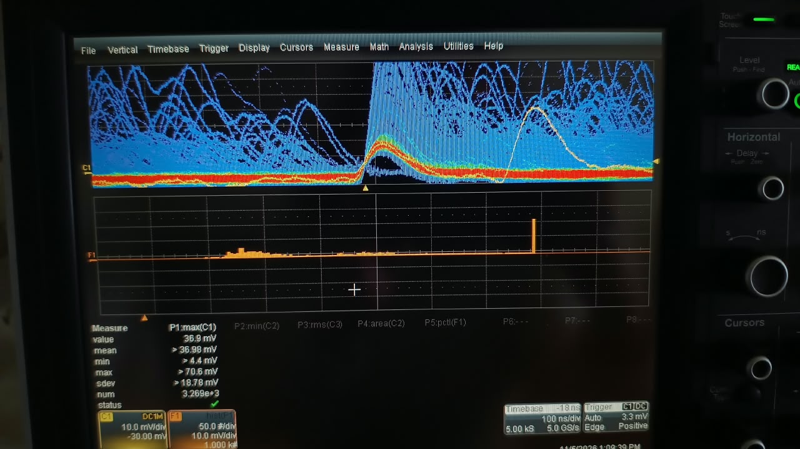

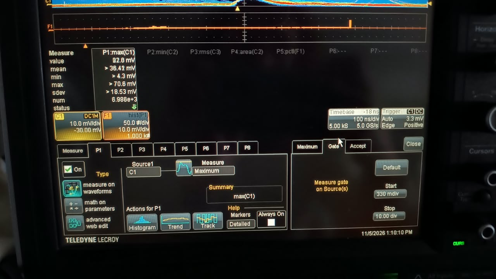

**Problema 2: el pico de 2 PE se veía y se borraba al acumular.**
- **Causa:** `max(C1)` mide desde 0 V, y la base no está en 0 V (§3.2); los pulsos que caen sobre la cola de otro salen inflados.
- **Solución:** medir desde la base local. En pantalla: P3 = `mean(C1)` justo antes del trigger y P4 = P1 − P3. Offline, el análisis del §5.

### 3.2 La línea de base no está en 0 V

A V_ov ≈ 5 V, `mean(C1)` antes del trigger da **≈ −5 mV** (P3 en la captura de abajo).

**Inferencia:** la salida está acoplada en AC (C11), así que se pierde la componente DC de la corriente oscura que pasa por el TIA. El valor esperado es −I_bias × R_F = −2.46 µA × 2.2 kΩ = **−5.4 mV**, y el análisis da **−5.5 mV** (fig. 6a).

A 2.5 y 3.75 V la base da −0.6 y −0.5 mV (fig. 6a), menos de lo esperado (§8).

**Consecuencia:** todas las amplitudes se miden desde la base local de cada evento.

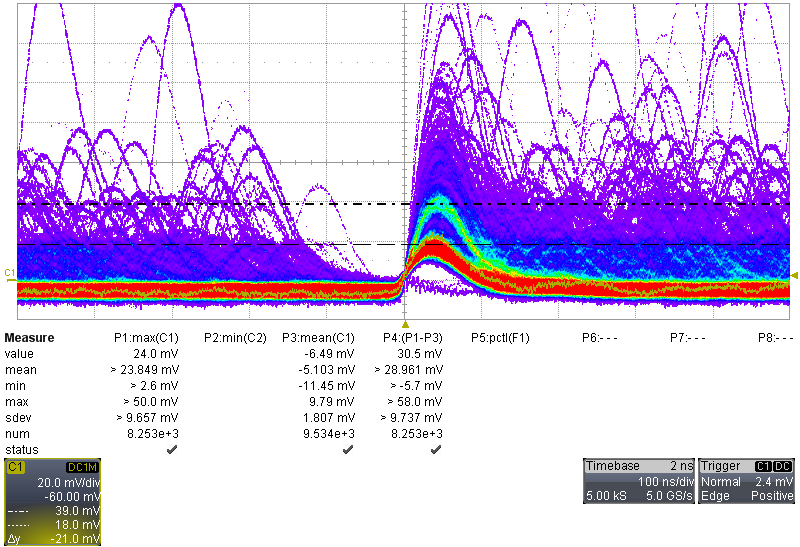

### 3.3 Valores leídos en pantalla (cursores, V_ov ≈ 5 V)

Separación entre los picos de 1 y 2 PE: **21.9, 21.1, 21.0 y 23.0 mV** en cuatro lecturas (21.0 mV en la captura del §3.2; las otras tres, abajo).

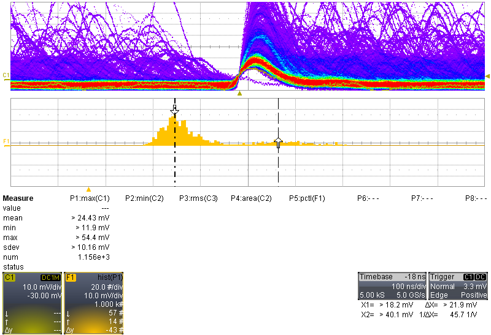

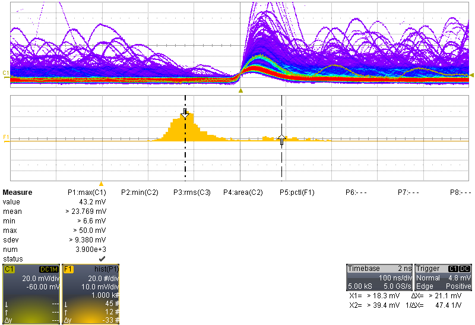

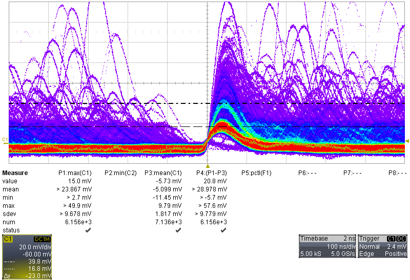

El valor de 18 mV que leí primero era la posición del pico de 1 PE desde 0 V, sesgada por la base. No es el SPE.

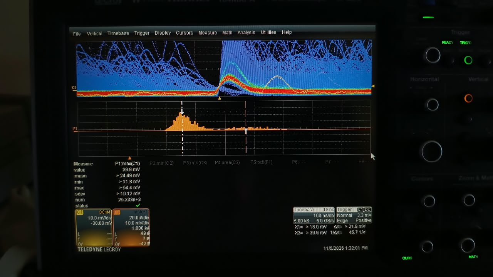

### 3.4 Corriente de bias

| V_source | Tiempo desde el inicio del monitoreo | I_bias |
|---|---|---|
| 29.719 V (V_ov ≈ 5 V) | 14:43–15:02 min | 2.40–2.47 µA (media 2.44 µA, 10 lecturas) |
| 29.719 V | 61:47–62:15 min | 2.45–2.55 µA (media 2.48 µA, 14 lecturas) |
| 28.469 V (V_ov ≈ 3.75 V) | — | No registrada |
| 27.219 V (V_ov ≈ 2.5 V) | — | No registrada |

**Inferencia:** a 5 V la corriente subió 1.8 % en ~47 min (fig. 7), compatible con un calentamiento de unas décimas de °C. A bias fijo, eso mueve la ganancia menos del 1 %.

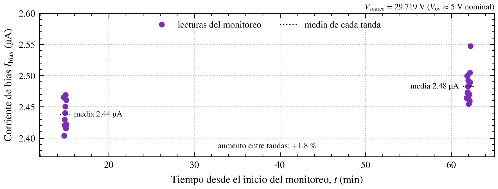

## 4. Datos adquiridos

**Modo Sequence:** 1000 segmentos de 1 µs por archivo (5002 muestras, 500 ns antes y 500 ns después del trigger), con el instante de cada trigger. Cada segmento es una cuenta oscura.

| Archivo | V_source | V_ov nominal | Escala | Hora | Uso |
|---|---|---|---|---|---|
| `C1SEQ_Vov500001.trc` | 29.719 V | 5 | 20 mV/div | 14:21 | Análisis |
| `C1SEQ_Vov37500000.trc` | 28.469 V | 3.75 | 20 mV/div | 14:29 | Análisis |
| `C1SEQ_Vov2500000.trc` | 27.219 V | 2.5 | 10 mV/div | 14:35 | Análisis |
| `C1M1_Vov500000.trc`, `C1M4_Vov500000.trc` | 29.719 V | 5 | 10 y 20 mV/div | — | Trazas individuales |
| `C1M3_Vov37500000.trc` | 28.469 V | 3.75 | 5 mV/div | — | Traza individual |
| `C1M2_Vov2500000.trc` | 27.219 V | 2.5 | 5 mV/div | — | Traza individual (fig. 8) |

Son las únicas secuencias guardadas: una por V_ov. **No anoté el nivel de trigger de cada secuencia.**

**Inferencia sobre el umbral** (a partir de los datos, fig. 1): a V_ov ≈ 5 V no hay eventos por debajo de ~15 mV respecto de la base, así que el umbral estaba en ~0.7 PE. A 2.5 y 3.75 V, ~6 % de los disparos son de ruido (el grupo cerca de 0–6 mV en las figs. 1a y 1b), así que el umbral estaba dentro del ruido.

Las V_ov nominales salen de la V_br del SiPM #05 (24.719 V), cargada en el script de bias. La V_br de este SiPM se estima en el §5.4.

> [!WARNING]
> Los archivos `C1M*` tienen **un solo segmento**: los guardé antes de activar el modo Sequence. Sirven como ejemplos de forma de pulso, no como estadística.

## 5. Análisis

Script: **`analisis_spe_evb.py`** (05/11). Todos los cortes y ventanas están documentados al principio del script, y se exporta un CSV por evento para poder rehacer cualquier selección. Las figuras salen de `figuras_log17.py`, que usa ese mismo análisis.

### 5.1 Método

1. **Base local de cada evento:** promedio entre −60 y −15 ns, sobre la señal suavizada (media móvil de 5 ns).
2. **Amplitud:** máximo entre 0 y 100 ns menos la base local.
3. **Evento limpio:** en los 300 ns previos al trigger no hay nada mayor a 0.4 SPE, y la base no deriva más de 0.3 SPE. Quedan 79–88 % de los eventos.
4. **Espectro de fotoelectrones:** ajuste del histograma de amplitudes con tres gaussianas equiespaciadas, μ_n = μ₀ + n·Δ y σ_n² = σ₀² + n·σ₁². **Δ es la amplitud del SPE**: sale de la separación entre picos, así que no depende de la base ni del sesgo del máximo.
5. **Crosstalk aparente:** P(> 1.5 PE) / P(> 0.5 PE).
6. **Tasa de disparos:** a partir de los tiempos entre triggers. El mínimo (~1.32 µs) es el tiempo muerto del osciloscopio y el resto se ajusta con una exponencial.
7. **Forma promedio del SPE:** promedio de los eventos de 1 PE limpios antes y después del pulso (230–293 eventos por V_ov).
8. **Carga y ganancia:** integral de la forma promedio entre −15 y 250 ns. Como el TIA vale R_F en baja frecuencia, **Q = área / R_F** y **G = Q / e**.
9. **Ruido:** desvío estándar de la señal cruda entre −300 y −15 ns en eventos limpios.
10. **V_br y capacidad de microcelda (M2):** recta de G (y de la amplitud) contra V_source.

### 5.2 Resultados por sobretensión

| | V_ov ≈ 2.5 V | V_ov ≈ 3.75 V | V_ov ≈ 5 V |
|---|---|---|---|
| V_source | 27.219 V | 28.469 V | 29.719 V |
| Eventos limpios / 1000 | 788 | 883 | 845 |
| **SPE (Δ)** | **9.86 ± 0.47 mV** | **15.43 ± 0.35 mV** | **21.90 ± 0.46 mV** |
| Ancho del pico de 1 PE (σ₁) | 1.98 mV | 2.56 mV | 3.35 mV |
| Carga del SPE | 421 fC | 669 fC | 901 fC |
| **Ganancia G** | **2.63×10⁶** | **4.18×10⁶** | **5.62×10⁶** |
| Crosstalk aparente | 14.8 ± 1.3 % | 22.7 ± 1.4 % | 31.2 ± 1.6 % |
| Tasa de disparos | 1.10 ± 0.03 MHz | 1.30 ± 0.04 MHz | 1.60 ± 0.05 MHz |
| Ruido rms de la base | 1.33 mV | 1.45 mV | 1.38 mV |
| **SNR del SPE** | **7.4** | **10.7** | **15.9** |
| Base absoluta | −0.61 mV | −0.50 mV | −5.54 mV |

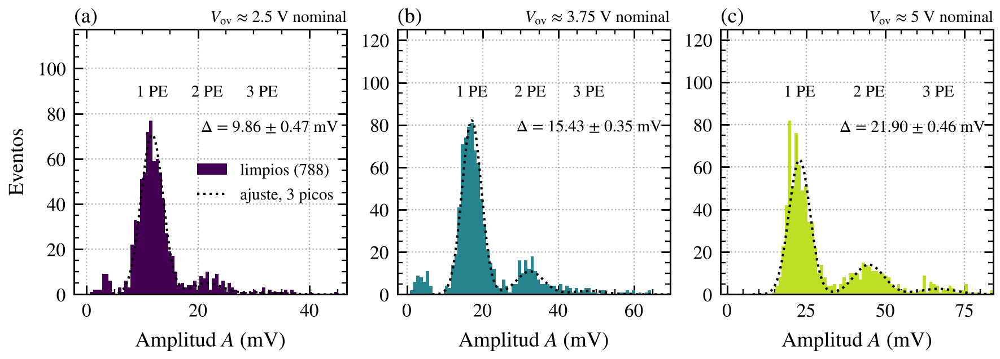

**Hecho (fig. 1):** los picos de 1, 2 y 3 PE se separan a las tres sobretensiones. A 5 V el flanco izquierdo del pico de 1 PE está cortado por el umbral de trigger.

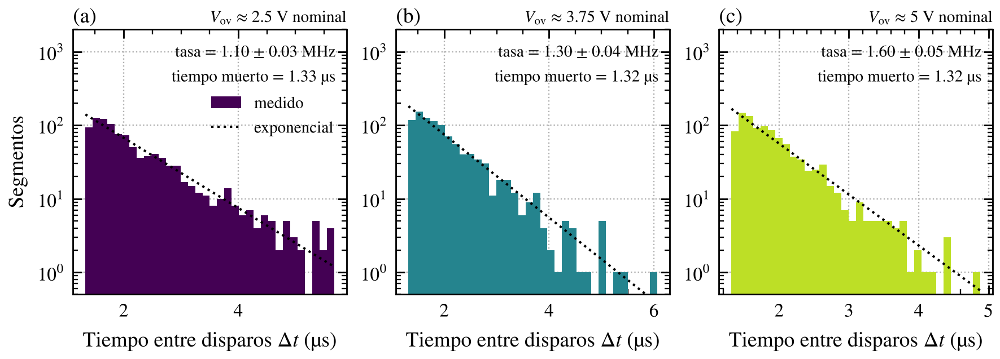

**Hecho (fig. 4):** el tiempo entre disparos sigue una exponencial, como corresponde a cuentas oscuras al azar, sin ráfagas ni interferencia periódica.

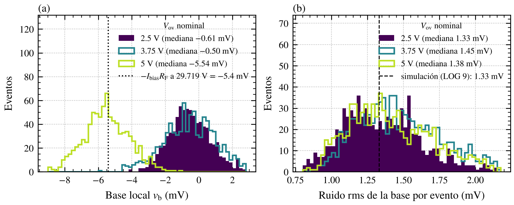

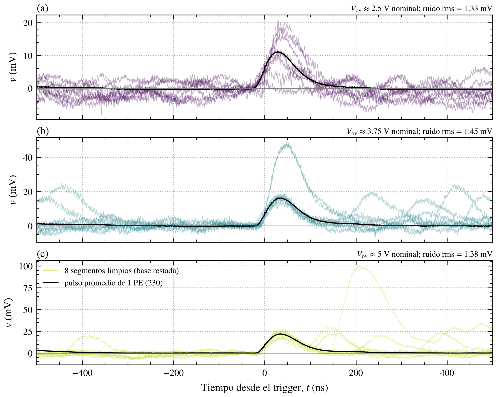

**Hecho (fig. 5):** el SPE se distingue a simple vista del ruido en segmentos individuales, incluso a 2.5 V.

### 5.3 Forma del SPE (M3)

| | V_ov ≈ 2.5 V | V_ov ≈ 3.75 V | V_ov ≈ 5 V |
|---|---|---|---|
| Amplitud de la forma promedio | 11.1 mV | 16.3 mV | 21.9 mV |
| Pico (desde el trigger) | 29 ns | 37 ns | 35 ns |
| Subida 10–90 % | 31 ns | 32 ns | 32 ns |
| FWHM | 74 ns | 78 ns | 79 ns |
| Constante de la cola | 66 ± 1 ns | 53 ± 1 ns | 63 ± 1 ns |

**Hecho (fig. 2b):** normalizadas al pico, las tres formas casi se superponen. La forma no depende de la sobretensión; solo cambia la altura.

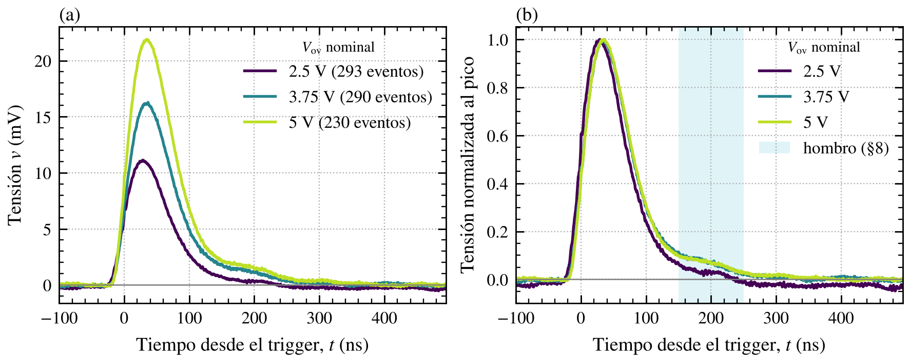

### 5.4 Linealidad y V_br (M2)

| Recta de | Pendiente | V_br (intersección) |
|---|---|---|
| G (carga) | 1.197×10⁶ /V | **25.01 V** |
| Amplitud de la forma promedio | 4.31 mV/V | 24.65 V |
| Δ (separación entre picos) | 4.81 mV/V | 25.20 V |

**Capacidad efectiva de microcelda** (pendiente de G × e): **192 fF**.

Los tres puntos caen sobre una recta en las tres magnitudes, con residuos menores al 2 % del valor (fig. 3).

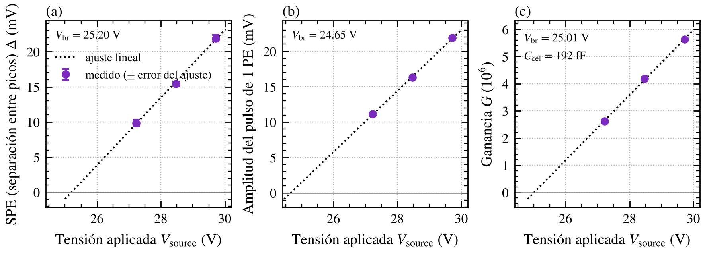

---

## 6. Comparación con la simulación y el datasheet

| Magnitud | Medido | Referencia | Lectura | Figura |
|---|---|---|---|---|
| Ruido rms | 1.33 mV | 1.33 mV (LOG 9) | Coincide | 6b |
| SNR a V_ov ≈ 2.5 V | 7.4 | ≈ 7 (LOG 9) | Coincide | 1a, 6b |
| Capacidad de microcelda | 192 fF | 192 fF (G = 3×10⁶ a 2.5 V); 179 fF (3400 pF / 18 980 celdas) | Coincide | 3c |
| Cuentas oscuras a ~2.5 V | 1.10 MHz | 1.2 MHz típ. (máx. 3.4 MHz) | Coincide | 4a |
| Constante de la cola | 53–66 ns | Hipótesis de 60 ns (`cascada_temporal.py`) | La sostiene | 2 |
| Crosstalk a ~2.5 V | 14.8 % | 7 % (35 µm) | Mayor (§8) | 1a |

### 6.1 Inferencias

- **El modelo de simulación está bien escalado.** El SPE, el ruido y la SNR coinciden con el LOG 9 (figs. 1 y 6b). Puedo seguir usando ese modelo para elegir R_F y C_F para 511 keV.
- **La carga llega al TIA sin pérdidas apreciables.** La pendiente de G no depende de V_br ni de la temperatura, y da la capacidad que implica el datasheet (fig. 3c). Si una parte de la carga se fuera por la red de bias (R3 y el filtro), la pendiente sería menor.
- **V_br ≈ 25.0 V**, tomando la recta de carga como estimador principal, con **±0.3 V de sistemático** por la dispersión entre estimadores (fig. 3). Con ese valor, las V_ov reales son ~2.2, 3.5 y 4.7 V, y la ganancia a V_ov = 2.5 V real sería ~3.0×10⁶, el valor del datasheet. Es compatible con el datasheet (24.2–24.7 V a 21 °C) si el lab estaba unos grados más caliente. **Sin la temperatura y sin la I-V no puedo cerrarlo.** *(Corregido en el LOG 18: ver la nota del principio.)*
- **Chequeo con la corriente a 5 V:** tasa × G × e × (1 + CT) = 1.89 µA, contra 2.46 µA medida (77 %). Cierra en orden de magnitud, y la diferencia va en la dirección esperada: la tasa por trigger subestima las cuentas oscuras (tiempo muerto, umbral, apilamiento).

---

## 7. Qué validan estas mediciones

En una frase: **la EVB-TIA v0 funciona como la diseñé, y el modelo con el que la diseñé describe bien a la placa real.**

| # | Qué | Evidencia | Peso |
|---|---|---|---|
| 1 | **La electrónica resuelve el fotoelectrón individual** | Picos de 1, 2 y 3 PE separados a las tres sobretensiones; SNR de 7 a 16 (figs. 1 y 5) | Hecho |
| 2 | **El modelo de simulación está bien escalado** | SPE (~10 mV a 2.5 V nominal), ruido (1.33 mV) y SNR (7.4) iguales a los del LOG 9 (figs. 1 y 6b) | Hecho (comparación directa) |
| 3 | **La carga del SiPM llega completa al TIA** | Capacidad de microcelda medida igual a la que implica el datasheet (fig. 3c) | Inferencia fuerte: no depende de V_br ni de la temperatura |
| 4 | **La respuesta es lineal con la sobretensión** | Amplitud y carga del SPE sobre una recta, residuos < 2 % (fig. 3) | Hecho |
| 5 | **La forma del pulso no depende de la sobretensión** | Formas normalizadas superpuestas; subida ~31 ns, FWHM ~77 ns (fig. 2b) | Hecho |
| 6 | **La cola del pulso es de ~60 ns**, como suponía el modelo de cascada | τ = 53–66 ns (fig. 2) | Hecho; sostiene la hipótesis |
| 7 | **El SiPM soldado por JLCPCB está sano** | Ganancia y cuentas oscuras dentro del datasheet (figs. 3c y 4) | Inferencia |
| 8 | **El método de medición** (Sequence + base local + análisis offline) | Reproducible, con trazabilidad por evento | Procedimiento establecido |

### 7.1 Qué implica para el PI

- **La elección de R_F (y C_F) para 511 keV puede hacerse con el modelo del LOG 9.** Era la pregunta central de la sesión.
- **Ya tengo la unidad de calibración en fotoelectrones** (el SPE en mV y en carga), necesaria para convertir el fotopico en número de PE y comparar acoples ópticos (J7).
- **Es material directo para EAMTA:** el paper de electrónica (validación del modelo, SNR, forma) y el póster de caracterización (ganancia, V_br, crosstalk, cuentas oscuras).

### 7.2 Qué no queda validado

- **V_br de este SiPM:** ~25.0 V con ±0.3 V de sistemático. Para cerrarla hacen falta la I-V y la temperatura.
- **El crosstalk real:** el 15–31 % es una cota superior.
- **El ruido del amplificador solo (M4):** el medido es con el SiPM en Geiger.
- **Todo es con R_F = 2.2 kΩ:** las otras R_F del banco y la espectroscopía con fuente siguen pendientes.

El detalle de cada limitación está en el §8.

---

## 8. Limitaciones y observaciones abiertas

| Tema | Detalle | Cómo cerrarlo |
|---|---|---|
| **Crosstalk aparente (cota superior)** | Incluye coincidencias aleatorias (~3 % a 1.1 MHz) y pulsos retardados dentro de la ventana de 100 ns. A 5 V el umbral de trigger (≈ 0.75 PE) cortó el flanco izquierdo del pico de 1 PE (fig. 1c) | Ventana de amplitud más corta y umbral más bajo a 5 V |
| **V_br por estimador** | 24.65–25.20 V (fig. 3) | I-V por J1 y temperatura medida |
| **Base a 2.5 y 3.75 V** | −0.5/−0.6 mV, menos que −I × R_F esperado. A 5 V cierra (fig. 6a) | Registrar la corriente en cada V_ov |
| **Tasa de cuentas oscuras** | Depende del umbral de trigger, que no quedó anotado | Anotar el umbral en cada secuencia |
| **Hombro en la forma a ~180 ns** | ~8 % del pico, mayor a V_ov alta (fig. 2b). **Hipótesis:** afterpulsing sobre celdas parcialmente recargadas (pulsos chicos que pasan el corte de 0.4 SPE). *Descartada en el LOG 18* | Estudiar la distribución de tiempos de pulsos posteriores |
| **Una secuencia por V_ov** | No permite evaluar deriva entre adquisiciones | Varias secuencias por V_ov en la próxima sesión |
| **Ruido medido con el SiPM en Geiger** | No es M4 (con V_bias < V_br) | M4 con `bias_ruido_evb.py` |
| **Ráfaga de interferencia** | En `C1M2` (2.5 V) aparece una oscilación de alta frecuencia de ±4 mV entre −400 y −340 ns, sin forma de pulso (fig. 8). **Hipótesis:** interferencia externa | Ver si se repite en otras trazas |

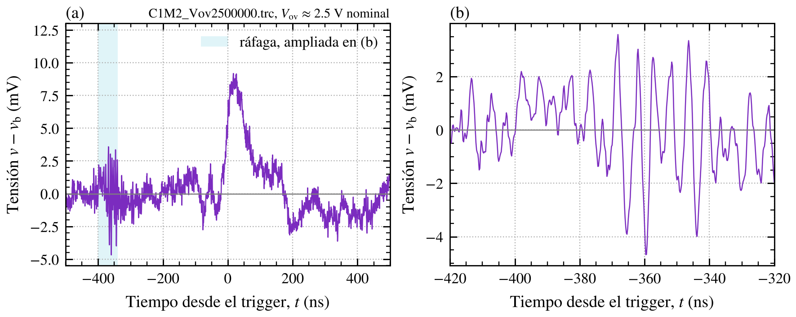

---

## Correcciones al LOG 16

| Dónde | Decía | Corrección |
|---|---|---|
| §6.1 y §6.2 | Subida de ~60–70 ns, coincidente con el ancho de banda estimado (~5.6 MHz) | **Medida: 31–32 ns** (forma promedio, fig. 2). La inferencia del §6.2 era incorrecta. La comparación válida es contra la forma simulada en LTspice (LOG 9) |
| §6.3 | Hipótesis: SPE de ~50 mV | **Descartada.** El SPE a V_ov ≈ 5 V es de ~22 mV (fig. 1c); los pulsos de 50 mV eran eventos de varios PE |
| Pendientes | Simulación de estabilidad del lazo antes de cerrar jumpers | **Descartada** (decisión del 05/11): la estabilidad se verifica en la placa |

---

## Decisiones técnicas y lecciones

| Decisión / lección | Justificación | Impacto futuro |
|---|---|---|
| **Medir la amplitud desde la base local de cada evento** | La salida acoplada en AC corre la base con la tasa de cuentas (fig. 6a) | Aplica a toda medición de pulsos con la EVB, incluida la espectroscopía gamma |
| **El SPE se define por la separación entre picos (o por la carga)**, no por la posición del pico de 1 PE | No depende de la base ni del sesgo del máximo | Calibración en PE para J7 y para el fotopico |
| **Adquirir en Sequence y analizar offline** | El histograma en pantalla no deja rehacer la selección ni corregir la base | Protocolo para todas las mediciones de la EVB |
| No hacer la simulación de estabilidad (J1) | La estabilidad de cada R_F se verifica directamente en la placa | Al cerrar cada jumper: mirar la base y la forma del pulso |
| **El modelo del LOG 9 queda validado** con R_F = 2.2 kΩ | SPE, ruido y SNR coinciden (figs. 1 y 6b) | La elección de R_F para 511 keV puede hacerse con ese modelo |

---

## Pendientes

- [ ] **Corriente de bias en cada V_ov** (faltan 2.5 y 3.75 V) y **temperatura ambiente** en cada sesión
- [ ] **I-V del SiPM de la placa 2 por J1**: V_br independiente, para comparar con los 25.0 ± 0.3 V de este análisis (LOG 18: la I-V con la EVB no da V_br por el autorange del Keithley)
- [ ] **M4: ruido con V_bias = 20 V** (`bias_ruido_evb.py`, Sequence apagado, trigger Auto, 20 µs/div, 3 trazas)
- [ ] Varias secuencias por V_ov, con el umbral de trigger anotado, para evaluar deriva y mejorar la estadística del 2 PE
- [ ] Comparar la forma promedio medida con la forma simulada en LTspice (LOG 9) y recalibrar `cascada_temporal.py` con la forma medida
- [ ] Corregir los §6.1–6.3 del LOG 16 (o referir a este log)
- [ ] Placa 1: inspección, consumo e I-V (pendiente del LOG 16)
- [x] Agregar las figuras a `docs/images/logs/` (regeneradas el 10/11 con `estilo_pi.py` v1.0)

---

## Scripts

| Script | Función | Estado |
|---|---|---|
| `bias_sipm_needles.py` | Bias fijo | Sin cambios |
| `bias_ruido_evb.py` | Bias fijo por debajo de V_br, para M4 | **Nuevo** (05/11), sin usar |
| `analisis_spe_evb.py` | Análisis de este log: espectro de amplitudes, forma, carga, tasa, ruido y rectas contra V_source | **Nuevo**, v1.0 (05/11). Reemplazado por `area_pulsos_evb.py` v2.0 para el área (LOG 18) |
| `figuras_log17.py` | Figuras 1–8 de este log, a partir de los .trc y del mismo análisis, con el estilo del PI. Uso: `python figuras_log17.py <carpeta con los .trc del 05/11> <carpeta de salida>` (necesita `analisis_spe_evb.py` y `estilo_pi.py`) | **Nuevo** (10/11) |

## Referencias

- **LOG 18 (06/11):** correcciones a este log con el algoritmo de área v2.0.
- **LOG 16 (04/11):** setup, primeros pulsos con la EVB-TIA v0.
- **LOG 9 (23/09):** simulación del TIA (SPE, ruido 1.33 mV rms, SNR ≈ 7).
- **LOG 7 (31/08 y 09/09):** script `bias_sipm_needles.py`; V_br del SiPM #05 (24.719 V a 16 °C).
- **Trazabilidad_Diseno_Amplificacion_EVB-TIA.md:** tarea J1 (simulación de estabilidad), descartada.
- **`cascada_temporal.py`:** hipótesis de la cola de 60 ns.
- **DataSheet MICROC-SERIES/D** (onsemi), MICROFC-60035: ganancia 3×10⁶, cuentas oscuras 1.2 MHz típ., crosstalk 7 % (35 µm), τ de recarga 95 ns, capacidad 3400 pF, 18 980 microceldas, todo a V_ov = 2.5 V; dV_br/dT = 21.5 mV/°C.

---

*Log generado al finalizar la sesión del 5 de noviembre de 2026. Figuras regeneradas el 10 de noviembre con `estilo_pi.py` v1.0.*
