# 18 LOG — Viernes 6 de noviembre de 2026

## Barrido de sobretensión y del banco de R_F en la placa 2, y un algoritmo de área robusto

**Tipo:** caracterización en oscuridad (cuentas oscuras, sin fuente ni centellador) de la placa 2: curva I-V, barrido de V_ov con R_F = 2.2 kΩ y barrido del banco de R_F a V_ov = 5 V nominal. Análisis offline en Python, que siguió hasta la madrugada del 07/11.
**Continúa:** LOG 17 (primer espectro de fotoelectrones con la EVB-TIA v0, 05/11).

**Estado al cierre:** la ganancia es lineal con la tensión (χ²_red = 1.3) con **V_0 = 24.46 ± 0.08 V** y **C_cel = 175 fF**. La carga del SPE no depende de R_F (2200, 1269 y 559 Ω, dentro de ~4 %). El algoritmo de área quedó robusto (v2.0). La I-V con la EVB no da V_br: el autorange del Keithley no funciona con ~1.1 µF en la línea de bias.

---

## 1. Objetivo de la sesión

El SiPM bien caracterizado es la base para calibrar el sistema multipíxel. El parámetro de referencia para comparar todas las mediciones es **el área (carga) del SPE**. Primero había que asegurar que el algoritmo que la calcula es correcto, y después medirla en función de las variables de la placa.

Plan de la sesión, en orden:

1. **Curva I-V** de la placa 2 → V_br de la sesión. V_ov se define respecto de ese V_br (decisión del 05/11).
2. **Barrido de V_ov** con R_F = 2.2 kΩ: recta de ganancia → V_0 y capacidad de microcelda.
3. **Barrido de R_F** a V_ov fija: ¿la carga del SPE es la misma con todas las R_F? ¿Hasta qué R_F se resuelve el SPE?

## 2. Setup

El mismo del LOG 17, con la placa 2 tapada.

| Función | Instrumento | Configuración |
|---|---|---|
| Bias / I-V | Keithley 2450 | `iv_curve_sipm_complete2.py` y `bias_sipm_needles.py`, sin cambios. Compliance 100 µA |
| +5 V | Rigol DP1308A, canal +6V/5A | 5.00 V, límite 0.030 A |
| Lectura | LeCroy WaveRunner 104MXi-A, CH1 | DC1M, 100 ns/div, 5 GS/s, modo **Sequence** (1000 segmentos de 1 µs), trigger Edge positivo en Normal |

- **Placa:** placa 2. Los jumpers del banco de R_F se cambiaron solo en el barrido de R_F (§5).
- **Nombres de los archivos:** el título del LeCroy lleva la V_ov nominal y R_F, `Vov<V_ov>_RF<R_F>_` (por ejemplo `C1Vov2p5_RF2200_00000.trc`). Así el script de análisis lee R_F del nombre.
- **Temperatura:** solo la registrada en las curvas I-V (22.0 °C a las 15:36 y 20.8 °C a las 16:30).

## 3. Curva I-V: no se pudo extraer V_br

Hice dos barridos con `iv_curve_sipm_complete2.py` (0–30 V, paso de 10 mV, NPLC 1, ~24 min cada uno). La conexión es la misma que para los pulsos: Keithley a J1, sin cambios en la placa.

| Archivo | Inicio | Temperatura | V_br del script |
|---|---|---|---|
| `IV_EVB_02_20261106_153647.csv` | 15:36 | 22.0 °C | −9.633 V (R² = 0.258) |
| `IV_EVB_02_m2_20261106_163056.csv` | 16:30 | 20.8 °C | −8.954 V (R² = 0.263) |

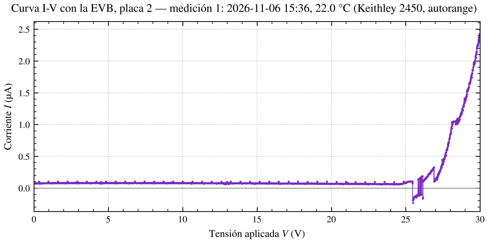

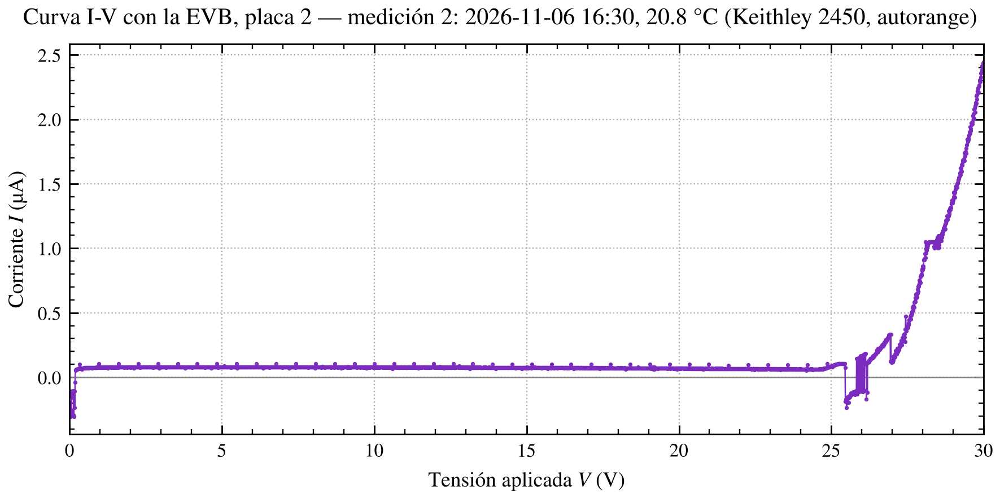

### 3.1 Lo que se ve (hechos)

- **Piso plano de ~64 nA** desde 0.01 V hasta ~24.5 V. No es una fuga resistiva: no crece con la tensión.
- **Picos periódicos de un solo punto** cada ~0.645 V (~64–65 puntos), todos en ~1.04 × 10⁻⁷ A. Son los mismos que vi el 09/09 en la placa de Lara (LOG 7).
- **Mesetas recortadas** en ~105 nA (25.0–25.45 V) y en ~1.0–1.05 µA (28.0–28.6 V). El datasheet del 2450 da *"Overrange: 105% of range"*: en esos tramos el Keithley está saturado en un rango demasiado chico.
- **Lecturas negativas** entre 25.46 y 26.15 V (55–56 puntos en cada medición) y **un salto** en 26.9 V (de 0.32 a 0.11 µA de un punto al siguiente).
- **Los artefactos se repiten punto por punto en las dos mediciones**: aparecen al cruzar los 100 nA y el 1 µA.
- En la medición 2, además, los primeros 18 puntos (0–0.17 V) son negativos (−0.04 a −0.30 µA).

### 3.2 Interpretación

**Inferencia:** desde J1 la placa tiene ~1.1 µF a masa: C_c (1 µF hacia la tierra virtual del TIA) más el filtro de bias. Es ~9 veces más que la placa de Lara. Cada cambio de rango del autorange produce un transitorio en la salida (datasheet: *"Range change overshoot: 250 mV typical"*), y sobre esa capacidad eso se traduce en corrientes grandes de carga y descarga, en los dos sentidos. La lectura queda corrida después de cada cambio de rango.

Ajusté √I contra V en los tramos limpios, con y sin restar el piso:

| Tramo | V_br (medición 1) | V_br (medición 2) |
|---|---|---|
| 28.65–30 V | 25.85–25.98 V | 25.87–26.00 V |
| 27.05–27.95 V | 26.37–26.58 V | 26.34–26.54 V |
| Rodilla, 24.9–25.2 V, con el piso restado (R² = 0.94) | 24.46 V | 24.46 V |

Los tramos de arriba dan V_br ≈ 26 V, lo que es imposible: hay corriente sobre el piso desde ~24.8 V y pulsos con 26.2 V aplicados. Los tramos están corridos entre sí. **Con estos datos no hay un V_br confiable.** Tampoco se ve el corrimiento de ~26 mV que deberían producir los 1.2 °C de diferencia entre las dos mediciones.

**Decisión:** para el barrido de V_ov seguí como en el LOG 17: V_ov nominal respecto del V_BR del script (24.719 V, el del SiPM #05). V_source = 24.719 V + V_ov nominal. V_0 sale después, del ajuste de la ganancia.

Preparé `iv_curve_sipm_complete3.py` (mide solo de 23 a 30 V, con rampa sin medir hasta 23 V; 701 puntos en lugar de 3001). No lo usé hoy.

## 4. Excursiones espurias en la salida

Durante los barridos I-V, por debajo de V_br, aparecieron en el osciloscopio excursiones de la salida que no había registrado. Las había visto también el 05/11 a la tarde, en esta misma placa, con `bias_sipm_needles.py` (bias fijo).

**Condiciones de las capturas:** DC1M, 50 mV/div, 100 ns/div, 5 GS/s, trigger Auto en 100 mV, persistencia.

**Lo que se ve (hechos):**
- excursiones de hasta ~+100 mV, lentas comparadas con un SPE (suben en ~300–500 ns y duran del orden del µs); algunas van a negativo (~−30 a −50 mV);
- en una captura, un flanco rápido (~20–30 ns) hasta ~+190 mV, seguido de una joroba y una caída de ~600 ns: no tiene la forma de un SPE;
- son esporádicas: pueden pasar varios minutos entre una y otra;
- no coinciden con los picos de la curva I-V;
- no las vi mientras medía pulsos (con ~1 MHz de cuentas oscuras, un evento cada varios minutos pasaría desapercibido).

**Hipótesis descartada:** que fueran la respuesta a los escalones del barrido. Aparecieron también con el bias fijo.

**Causa: sin determinar.** No afectan las mediciones de hoy (un evento cada varios minutos frente a secuencias de 1000 segmentos que se adquieren en menos de un segundo, y el corte de eventos limpios los rechaza). Sí importan para la espectroscopía con fuente: un evento espurio de 100 mV parece un gamma.

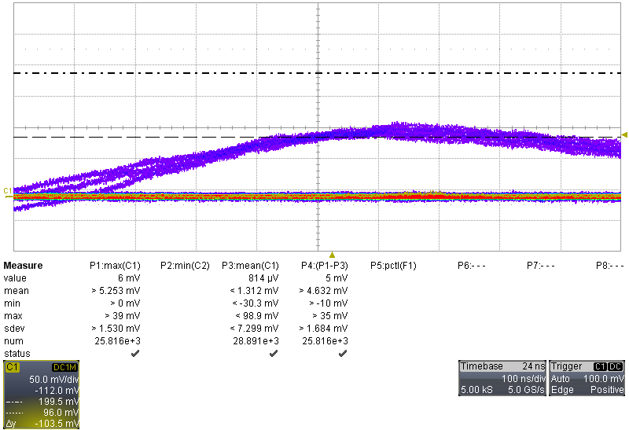
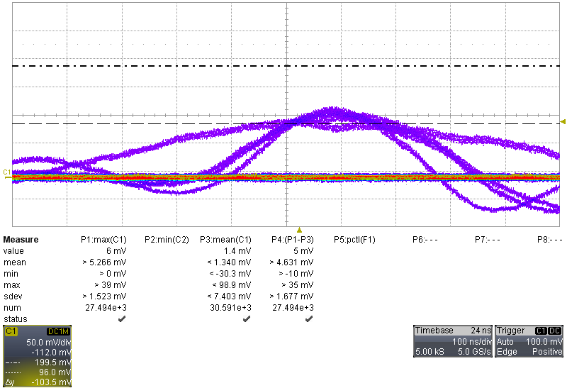
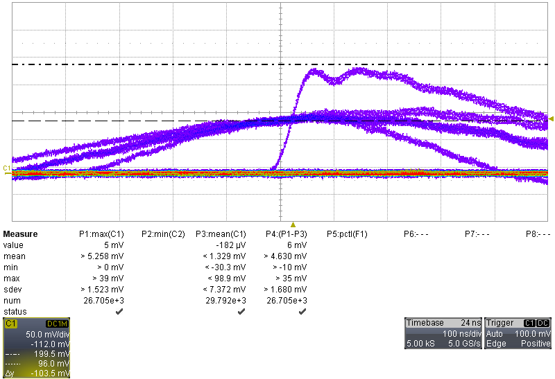
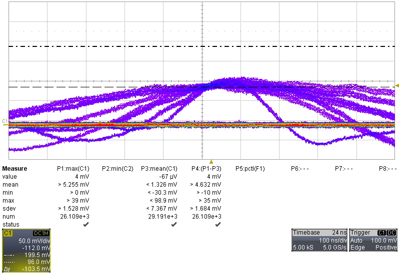

## 5. Mediciones de pulsos

### 5.1 Barrido de V_ov (R_F = 2.2 kΩ)

V_ov nominal de 1.5 a 5 V en pasos de 0.5 V, una secuencia de 1000 segmentos por punto. A 1.5 V al principio no veía pulsos; ajustando la escala aparecieron.

| Archivo | V_ov nominal | V_source |
|---|---|---|
| `C1Vov1p5_RF2200_00000.trc` | 1.5 | 26.219 V |
| `C1Vov2_RF2200_00000.trc` | 2.0 | 26.719 V |
| `C1Vov2p5_RF2200_00000.trc` | 2.5 | 27.219 V |
| `C1Vov3_RF2200_00000.trc` | 3.0 | 27.719 V |
| `C1Vov3p5_RF2200_00000.trc` | 3.5 | 28.219 V |
| `C1Vov4_RF2200_00000.trc` | 4.0 | 28.719 V |
| `C1Vov4p5_RF2200_00000.trc` | 4.5 | 29.219 V |
| `C1Vov5_RF2200_00000.trc` | 5.0 | 29.719 V |

**No hice el punto de 2.5 V repetido al final** (control de deriva).

### 5.2 Barrido de R_F (V_ov = 5 V nominal)

Un jumper cerrado por vez. La referencia de 2.2 kΩ es el punto de 5 V del barrido de V_ov.

| Archivo | Jumper | R_F |
|---|---|---|
| `C1Vov5_RF2200_00000.trc` | ninguno | 2200 Ω |
| `C1Vov5_RF1269_00001.trc` | JP1 | 1269 Ω |
| `C1Vov5_RF559_00000.trc` | JP2 | 559 Ω |
| `C1Vov5_RF216_00000.trc` | JP3 | 216 Ω |

En las cuatro configuraciones el TIA es **estable**: sin oscilación, ringing ni undershoot.

### 5.3 Saturación de la pantalla (hecho)

| Secuencias | Tope de pantalla | Consecuencia |
|---|---|---|
| 1.5 a 3 V | no se alcanza | — |
| 3.5 a 5 V | 63.0 mV | A 5 V el pico de 3 PE (~66.5 mV sobre la base) cae justo en el recorte: se ve su flanco de subida y ~100 eventos apilados contra el tope |
| Barrido de R_F | 31.5 mV | Con 1269 Ω el pico de 2 PE (~30 mV) toca el tope: 155 de 1000 eventos saturan dentro de la ventana |

### 5.4 Datos que faltan en este log

I_bias, temperatura y nivel de trigger de cada secuencia (completar si se anotaron).

## 6. Análisis: un algoritmo de área robusto

### 6.1 El algoritmo v1.0 no era robusto

Corrí `area_pulsos_evb.py` v1.0 (área del SPE = separación entre picos del espectro de áreas) primero sobre los datos del LOG 17 y después sobre los de hoy.

- **El pulso promedio no volvía a la base:** quedaba una meseta de 1.2–4.2 mV. Coincide con las cuentas oscuras que caen después del pulso disparado: tasa × área del SPE = 1.08 mV contra 1.15 mV medidos a 2.5 V (LOG 17).
- **El resultado dependía del análisis:** con cambios razonables (ajustar 2 o 3 picos, incluir o no los eventos saturados), el área del SPE cambiaba hasta ~10 %, más que su error estadístico (~4 %). V_0 salía entre 24.53 y 25.17 V según la variante, con ±0.18–0.44 V.
- **El espectro de áreas tiene poca resolución:** el área de una ventana sin pulso tiene σ ≈ 370 mV·ns. El ruido tiene mucha componente lenta: el error de la base (70 ns) multiplicado por el largo de la ventana (290 ns) domina. Por eso los picos de áreas casi no se separan.

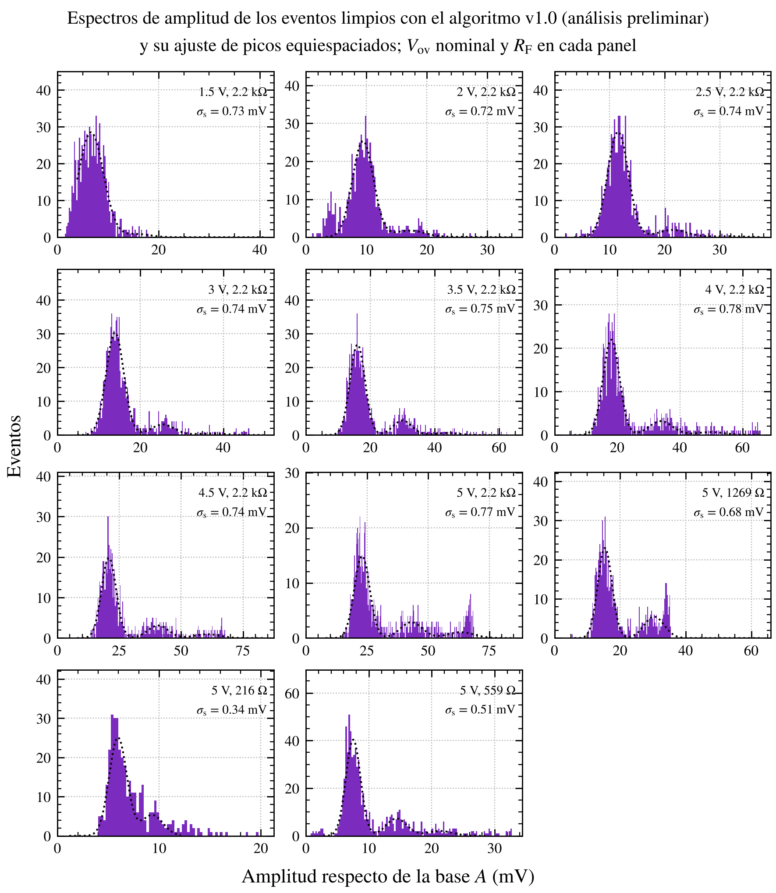

### 6.2 Algoritmo v2.0

`area_pulsos_evb.py` v2.0 (06/11):

1. **Ventanas medidas desde t_cf** (cruce del 50 % de la amplitud de cada pulso), como en v1.0.
2. **Evento limpio:**
   - sin pulsos antes y sin deriva de la base;
   - **sin un segundo pulso dentro de la ventana de integración**: se busca un flanco de subida después del pico, v(t) − v(t − 30 ns);
   - **sin saturar la pantalla** dentro de la ventana.

   Cada corte compara el estadístico con su propia distribución en el archivo (mediana + K·σ robusta, σ = 1.4826·MAD). No dependen de una estimación previa del SPE. (Un primer intento con cortes en unidades de la σ de 60 ns rechazaba la mitad de los eventos limpios: esa σ subestima el ruido real.)
3. **Eventos de 1 PE elegidos por amplitud** (el espectro de amplitudes separa mucho mejor los picos): banda |amp − μ1| < σ1 alrededor del pico de 1 PE.
4. **Área del SPE = media del área de esos eventos.** El ruido tiene media cero, así que la media no depende de la resolución en área.
5. **Controles:**
   - el área de una ventana de igual largo sin pulso tiene que dar ≈ 0 (aviso si se aparta más de 3σ);
   - aviso si el pico de 1 PE no está separado del ruido (σ1/μ1 > 0.30).

**Prueba de robustez** (variando un parámetro por vez):

| Parámetro variado | Cambio del área del SPE |
|---|---|
| K de los cortes (pre, deriva, segundo pulso) y ancho de la banda de 1 PE | 1–3 % (~1–2σ) |
| Fin de la integración: 200 ns | −1 a −5 % |
| Fin de la integración: 300 ns | 0 a +4 % |

El fin de la ventana es una cuestión de definición (cuánto de la cola se cuenta), no de ruido. Mientras la ventana sea la misma en todas las mediciones, no afecta las comparaciones; sí el valor absoluto de C_cel en unos pocos %.

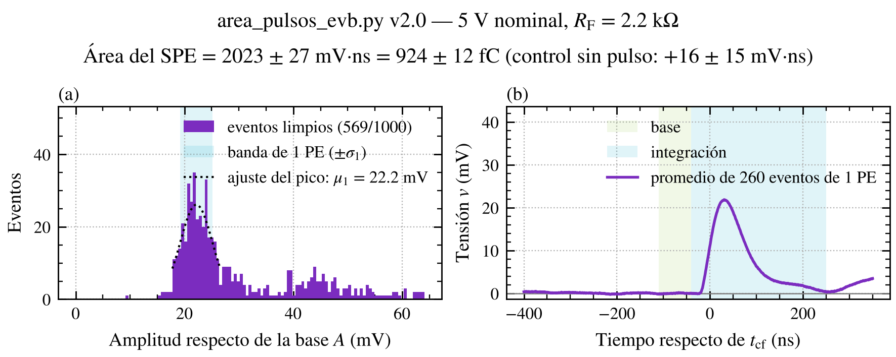

### 6.3 Análisis de picos

`analisis_picos_evb.py` v1.0 (07/11), sobre los eventos limpios de v2.0:

- **Ajuste conjunto del espectro de amplitudes por máxima verosimilitud** (sin histograma), en el rango que no recorta el trigger ni la pantalla: μ_n = μ0 + n·Δ, σ_n² = σ0² + n·σ1². σ0 es el ruido de la amplitud, medido aparte en la zona sin pulso (~1.7 mV con 2.2 kΩ, no 0.74 mV como da la σ en 60 ns). Da la dispersión de la ganancia (σ1/Δ) y la fracción de eventos en cada pico (crosstalk = 1 − w1).
- **Bandas por pico:** media del área de los eventos de 1 PE y de 2 PE → linealidad del área.
- **Tasa de cuentas oscuras** desde los tiempos de trigger del .trc, descontando los disparos de ruido y corrigiendo el 1 PE que quedó debajo del trigger.
- **Forma del pulso de 1 PE** con eventos limpios.

Intenté medir el afterpulsing con la distribución de retardos de los segundos pulsos. No se puede con estos datos: la eficiencia de detección cae justo después del pulso (un segundo pulso sobre la cola que baja da un flanco más chico) y el "exceso" daba negativo en todas las tensiones. Lo saqué del script.

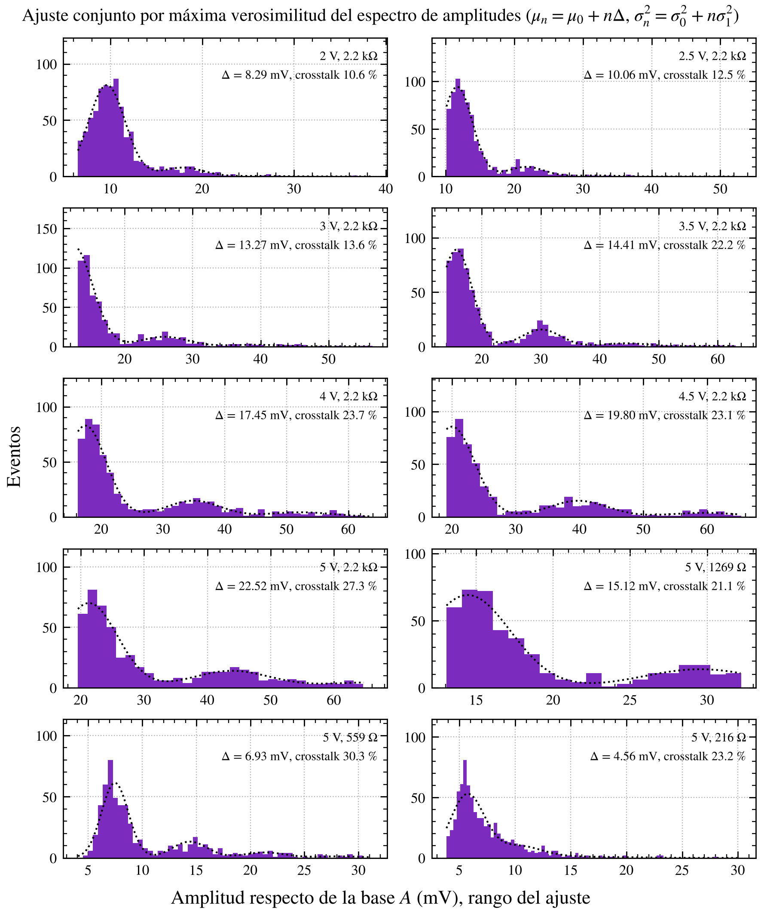

## 7. Resultados

### 7.1 Ganancia contra la tensión

| V_ov nominal | Carga del SPE | Ganancia G | Eventos de 1 PE / limpios |
|---|---|---|---|
| 1.5 | 256 ± 6 fC (no confiable*) | — | 679 / 946 |
| 2.0 | 397 ± 7 fC | 2.48 × 10⁶ | 489 / 910 |
| 2.5 | 481 ± 8 fC | 3.00 × 10⁶ | 463 / 853 |
| 3.0 | 579 ± 8 fC | 3.61 × 10⁶ | 399 / 800 |
| 3.5 | 644 ± 9 fC | 4.02 × 10⁶ | 412 / 747 |
| 4.0 | 735 ± 9 fC | 4.59 × 10⁶ | 348 / 702 |
| 4.5 | 844 ± 10 fC | 5.27 × 10⁶ | 331 / 667 |
| 5.0 | 924 ± 12 fC | 5.77 × 10⁶ | 260 / 569 |

\* A 1.5 V el pico de 1 PE no se separa del ruido (σ1/μ1 = 0.44) y la base sale sesgada (área sin pulso = −52 ± 12 mV·ns, −9 % del SPE). El script lo avisa. Queda fuera del ajuste.

**Ajuste lineal pesado, 2 a 5 V nominal (7 puntos):**

| | Valor |
|---|---|
| **V_0** | **24.46 ± 0.08 V** (error escalado por √χ²_red) |
| **C_cel** | **175 fF** |
| χ²_red | 1.3 (residuos < 2.2 %) |
| Con 2.5–5 V | V_0 = 24.49 ± 0.12 V, C_cel = 176 fF |

Con ese V_0, la V_ov real es la nominal + 0.26 V (por ejemplo, 2.5 V nominal = 2.76 V real).

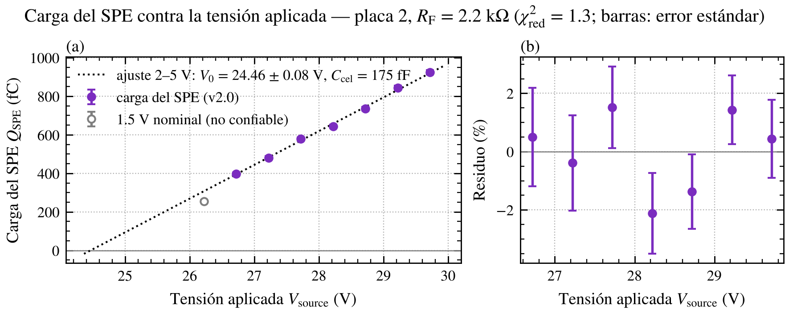

### 7.2 Banco de R_F (V_ov = 5 V nominal)

| R_F | Carga del SPE | Amplitud del pulso de 1 PE | Ruido rms | SNR | Subida 10–90 % | FWHM | τ de la cola |
|---|---|---|---|---|---|---|---|
| 2200 Ω | 924 ± 12 fC | 22.2 mV | 1.42 mV | ~15 | 31 ns | 79 ns | 51 ns |
| 1269 Ω | 888 ± 11 fC | 14.8 mV | 1.09 mV | ~14 | 24 ns | 60 ns | 47 ns |
| 559 Ω | 912 ± 13 fC | 7.1 mV | 0.75 mV | ~9 | 17 ns | 47 ns | 62 ns |
| 216 Ω | 1876 ± 42 fC (*) | — | 0.62 mV | — | — | — | — |

\* Con 216 Ω la carga da el doble que con las otras R_F. El espectro de amplitudes empieza en ~4 mV: el trigger cortó el pico de 1 PE, y el pico usado es casi seguro el de 2 PE (inferencia). El script no puede detectarlo desde el archivo. Si el pico de ~6 mV es el de 2 PE, el SPE en amplitud sería ~3.4 mV.

- **La carga del SPE es la misma con 2200, 1269 y 559 Ω** (dentro de ~4 %): el TIA recoge la misma carga en las tres configuraciones. **Valida la transferencia del banco de R_F.**
- **El SPE se resuelve hasta 559 Ω** (SNR ~9).
- **Al bajar R_F el pulso se angosta** (FWHM de 79 a 47 ns), así que la amplitud baja menos que R_F.

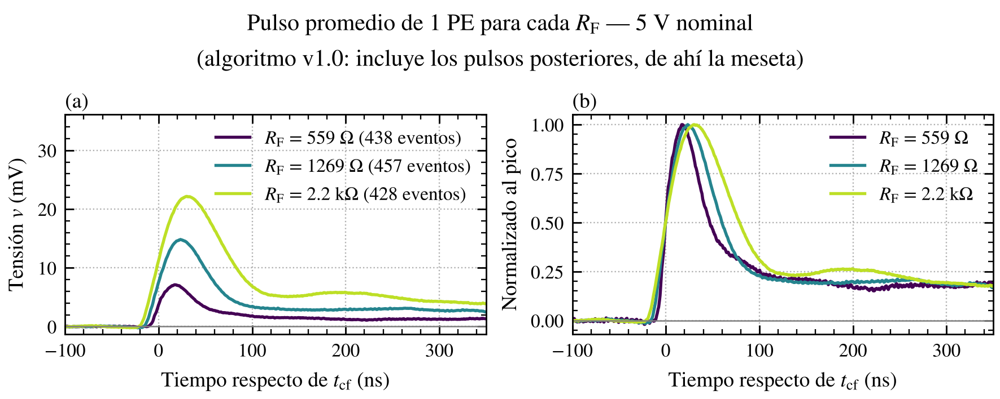

**Resolución entre los picos de 1 y 2 PE.** Durante la medición me pareció que al bajar R_F mejoraba la resolución del 2 PE. Separación entre picos en unidades de σ, sep = (μ2 − μ1)/√(σ1² + σ2²):

| R_F | sep (todos los eventos) | sep (eventos limpios) |
|---|---|---|
| 2200 Ω | 3.2 | 4.4 |
| 1269 Ω | 3.9 (no válido: 2 PE recortado) | 4.5 (no válido) |
| 559 Ω | 2.3 | 3.2 |

Entre 2200 y 559 Ω, que son comparables, **la resolución empeora al bajar R_F**: el ruido baja menos que el SPE. La secuencia de 1269 Ω no sirve para esto, porque la mitad superior del pico de 2 PE quedó recortada. **Hipótesis:** lo que se veía mejor en pantalla es la persistencia: con pulsos más angostos se superponen menos y las bandas se ven más limpias.

### 7.3 Base y meseta después del pulso

| R_F | Base absoluta | Meseta después del pulso (300–400 ns) | Suma | Meseta / pico |
|---|---|---|---|---|
| 2200 Ω | −3.67 mV | +3.94 mV | +0.27 mV | 0.18 |
| 1269 Ω | −2.65 mV | +2.43 mV | −0.22 mV | 0.17 |
| 559 Ω | −1.50 mV | +1.30 mV | −0.19 mV | 0.18 |

**Hecho:** la base y la meseta son iguales y opuestas. **Interpretación:** la salida está acoplada en AC (C_c y C11), así que su promedio es cero. Las cuentas oscuras aportan un valor medio igual a tasa × área media por pulso, y en los intervalos sin pulsos (como antes del trigger) la base queda por debajo de cero en esa cantidad. Después del pulso siguen llegando pulsos al azar y la señal vuelve, en promedio, a cero. La meseta es el cero real de la salida. Escala con R_F en mV y se mantiene en ~0.18 del pico. En el análisis v2.0 esos pulsos se rechazan.

### 7.4 Crosstalk, cuentas oscuras, dispersión de la ganancia y linealidad (R_F = 2.2 kΩ)

| V_ov nominal | Crosstalk | Tasa de cuentas oscuras | σ1/Δ | Área 2 PE / área 1 PE |
|---|---|---|---|---|
| 2.0 | 10.6 ± 1.2 % | 0.72 MHz | 0.12 | 1.95 ± 0.07 |
| 2.5 | 12.5 ± 1.2 % | 0.78 MHz | 0.14 | 1.96 ± 0.05 |
| 3.0 | 13.6 ± 2.0 % | 1.09 MHz | 0.16 | 2.09 ± 0.05 |
| 3.5 | 22.2 ± 1.7 % | 1.11 MHz | 0.14 | 2.09 ± 0.05 |
| 4.0 | 23.7 ± 2.0 % | 1.24 MHz | 0.16 | 2.19 ± 0.05 |
| 4.5 | 23.1 ± 2.2 % | 1.52 MHz | 0.15 | 2.12 ± 0.05 |
| 5.0 | 27.3 ± 2.5 % | 1.72 MHz | 0.19 | 2.11 ± 0.05 |

Con 559 Ω a 5 V: crosstalk 30.3 ± 1.9 %, compatible con el de 2200 Ω (el crosstalk no depende de la electrónica).

- **Crosstalk:** sube de ~11 % a ~27 %. Incluye las coincidencias al azar de dos cuentas oscuras (estimo ~1–3 %) y el crosstalk retardado que cae dentro de la subida. El salto entre 3 y 3.5 V es mayor que los errores; a 3 V el ajuste dio μ0 = −0.75 mV, distinto del resto. Sin explicar.
- **Tasa de cuentas oscuras: aproximada.** El trigger quedó en ~0.7 PE en casi todos los puntos y cortó parte del 1 PE; la corrijo con el modelo ajustado. Los saltos (3 y 4.5 V) probablemente vienen de que el umbral cambió entre puntos (inferencia).
- **Dispersión de la ganancia σ1/Δ ≈ 0.12–0.19,** sin tendencia clara. Es una cota superior: incluye todo lo que varía la amplitud de un evento a otro además del ruido.
- **Linealidad del área:** a 2–2.5 V el 2 PE tiene el doble de área que el 1 PE. Desde 3 V da 2.1–2.2: los eventos de 2 PE tienen ~5–10 % más área por PE. **Sin explicar.** Si se repite en eventos de muchos PE, la conversión carga → número de PE en el fotopico estaría sesgada en esa magnitud.

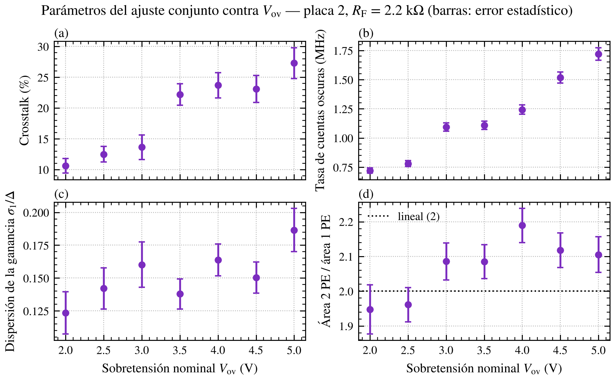

### 7.5 Forma del pulso de 1 PE

Con los eventos limpios, **las formas a las 7 tensiones se superponen exactamente**: subida 30–32 ns, FWHM 76–79 ns, τ de la cola 49–55 ns. La forma no depende de V_ov.

Aparece una **componente lenta de ~10 % del pico entre 150 y 250 ns**, igual a todas las tensiones. Como el afterpulsing crecería con V_ov, esa componente es parte de la respuesta y no afterpulsing (inferencia). Explica por qué el área sigue creciendo un poco al alargar la ventana.

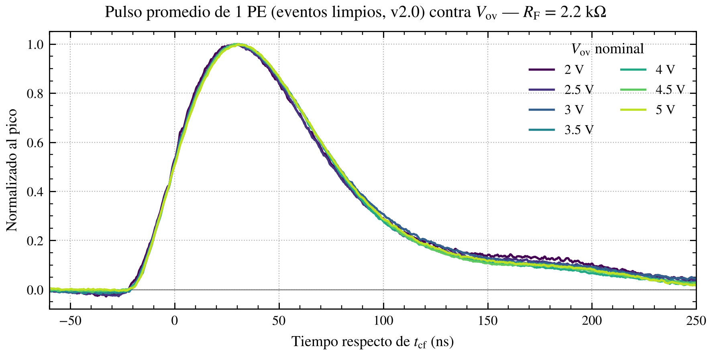

## 8. Comparación con el LOG 17 y el datasheet

| Magnitud | Hoy | Referencia | Lectura |
|---|---|---|---|
| Carga del SPE (v2.0) a 2.5 V nominal | 481 ± 8 fC | 491 ± 9 fC (datos del LOG 17, v2.0) | Coincide |
| Carga del SPE (v2.0) a 5 V nominal | 924 ± 12 fC | 892 ± 11 fC (datos del LOG 17, v2.0) | ~3.5 % de diferencia |
| V_0 | 24.46 ± 0.08 V (7 puntos) | 24.15 ± 0.15 V (datos del LOG 17 con v2.0, 3 puntos) | ~2σ de diferencia; el 05/11 no se registró la temperatura |
| V_0 | 24.46 ± 0.08 V | V_br = 24.2–24.7 V a 21 °C (datasheet) | Compatible |
| V_0 | 24.46 ± 0.08 V | Rodilla de la I-V con el piso restado: 24.46 V | Compatible (la estimación de la I-V es débil) |
| C_cel | 175 fF | ~179 fF (3400 pF / 18 980 celdas) | Coincide |
| Crosstalk a 2.5 V nominal | 12.5 ± 1.2 % | 7 % (35 µm, datasheet) | Mayor (incluye coincidencias al azar y crosstalk retardado) |
| Tasa de cuentas oscuras a 2.5 V nominal | ~0.8 MHz | 1.2 MHz típ. (datasheet); 1.10 MHz (LOG 17) | Menor; aproximada, umbral y temperatura no comparables |

## 9. Qué valida esta sesión

| # | Qué | Evidencia | Peso |
|---|---|---|---|
| 1 | **La ganancia es lineal con la tensión** entre ~2.3 y ~5.3 V reales | 7 puntos, χ²_red = 1.3, residuos < 2.2 % | Hecho |
| 2 | **V_0 = 24.46 ± 0.08 V y C_cel = 175 fF** para este SiPM | Ajuste pesado; C_cel igual a la del datasheet | Hecho (V_0 con V_BR nominal como referencia de V_source) |
| 3 | **La transferencia del banco de R_F**: la carga del SPE no depende de R_F | 2200, 1269 y 559 Ω dentro de ~4 % | Hecho |
| 4 | **El TIA es estable** en las configuraciones medidas | Sin oscilación, ringing ni undershoot | Hecho |
| 5 | **El SPE se resuelve hasta R_F = 559 Ω** a V_ov alta | SNR ~9 | Hecho |
| 6 | **El algoritmo de área v2.0 es robusto** | Cambios de 1–3 % con los cortes; ~2 % de error estadístico por punto | Procedimiento establecido |
| 7 | **La forma del pulso no depende de V_ov** | Formas superpuestas con eventos limpios | Hecho |
| 8 | **La base corrida es efecto del acople AC** (tasa × área), y explica también la base del LOG 17 | Base y meseta iguales y opuestas en tres R_F | Hecho / inferencia fuerte |
| 9 | **Reproducibilidad entre días** | Puntos del LOG 17 y de hoy dentro de ~3 % | Hecho |

---

## 10. Avance de la caracterización del SiPM

### 10.1 Variables del plan (05/11), en la placa 2

| Variable | Estado | Qué falta |
|---|---|---|
| **V_ov** | ✅ Hecho: 2 a 5 V nominal, recta de ganancia | Punto repetido (deriva). Temperatura registrada. 1.5 V queda fuera (SNR) |
| **Banco de R_F** | 🟡 Parcial: 3 de 8 configuraciones válidas (2200, 559 Ω; 1269 Ω solo la carga) | 1269 Ω con el 2 PE dentro de pantalla. 216 Ω con el trigger debajo del 1 PE. Combinaciones de 471, 202, 168 y 159 Ω |
| **Capacitores de realimentación (C_F)** | ⬜ Sin empezar | Depende del centellador |
| **Temperatura** | ⬜ Sin empezar | BETA |
| **Centellador** | ⬜ Sin empezar | — |
| **Energía del isótopo** | ⬜ Sin empezar | Fuentes; forma de adquirir espectros gamma (abierto) |
| **Tasa de cuentas (distancia)** | ⬜ Sin empezar | — |
| **Acople óptico** | ⬜ Sin empezar | Necesita la calibración en PE (ya disponible) |
| **Láser** | ⬜ Sin empezar | Conseguir el láser (Teleco, comunicaciones ópticas) |
| **Variabilidad entre placas** | ⬜ Sin empezar (queda para el final) | Placas 1, 3, 4 y 5 |

### 10.2 Parámetros del SiPM

| Parámetro | Estado | Valor actual / comentario |
|---|---|---|
| V_0 (cero de la ganancia) | ✅ | 24.46 ± 0.08 V |
| V_br por I-V | ❌ Bloqueado | El autorange del Keithley no funciona con la capacidad de la EVB |
| Capacidad de microcelda | ✅ | 175 fF |
| Carga del SPE vs V_ov | ✅ | Tabla del §7.1 (algoritmo v2.0) |
| Forma del pulso | ✅ | No depende de V_ov; componente lenta de ~10 % |
| Crosstalk vs V_ov | 🟡 Preliminar | 11–27 %; salto 3→3.5 V sin explicar; incluye coincidencias al azar |
| Tasa de cuentas oscuras vs V_ov | 🟡 Aproximada | 0.7–1.7 MHz; depende del umbral, que no quedó registrado |
| Dispersión de la ganancia | 🟡 Cota superior | σ1/Δ ≲ 0.15–0.19 |
| Linealidad del área (2 PE / 1 PE) | 🟡 Anomalía | 2.1–2.2 desde 3 V, sin explicar |
| Afterpulsing | ❌ No medible con la adquisición actual | Segmentos de ~460 ns después del pulso y detección ineficiente a retardos cortos |
| Dependencia térmica (dV_br/dT, dG/dT) | ⬜ | BETA |
| PDE | ⬜ | Necesita luz calibrada |
| Linealidad y saturación con señales grandes | ⬜ | Láser o fuente |

---

## 11. Limitaciones y observaciones abiertas

| Tema | Detalle |
|---|---|
| **V_br por I-V** | El autorange del Keithley con ~1.1 µF en la línea de bias recorta, da negativos y corre la lectura |
| **Excursiones espurias** | ~100 mV, µs, separadas por minutos, con bias fijo. Causa sin determinar |
| **Saturación de pantalla** | 2 PE con 1269 Ω; 3 PE a 5 V con 2200 Ω |
| **216 Ω** | El trigger cortó el pico de 1 PE; la carga sale el doble |
| **Área 2 PE / 1 PE > 2 desde 3 V** | ~5–10 % de exceso, sin explicar |
| **Salto del crosstalk entre 3 y 3.5 V** | Mayor que los errores |
| **Tasa de cuentas oscuras** | Depende del umbral de trigger, que no quedó registrado |
| **Trigger en ~0.7 PE** | Corta el flanco del 1 PE: sesga la tasa y el crosstalk (se corrige con el modelo) |
| **Sin el punto repetido de 2.5 V** | No se puede evaluar la deriva dentro de la sesión |
| **Temperatura** | Solo en las I-V (bajó 1.2 °C en una hora) |
| **V_0 entre días** | 24.46 V hoy contra 24.15 V con los 3 puntos del LOG 17 (~2σ) |

## Correcciones al LOG 17

| Dónde | Decía | Corrección |
|---|---|---|
| §5.4, §6.1 | V_br ≈ 25.0 V (± 0.3 V), desde la recta de carga | Con el algoritmo v2.0, los datos del LOG 17 dan V_0 = 24.15 ± 0.15 V. El valor de 25.0 V venía del método anterior (integral de la forma promedio con la meseta de cuentas oscuras dentro de la ventana) |
| §5.4 | Capacidad de microcelda 192 fF | Con v2.0: 161 fF con los datos del LOG 17 (3 puntos) y 175 fF con los de hoy (7 puntos) |
| §8 | Hombro a ~180 ns: hipótesis de afterpulsing | Con eventos limpios, la componente lenta es igual a todas las V_ov: es parte de la respuesta, no afterpulsing (inferencia) |
| §3.2, §8 | Base de −5.5 mV a 5 V = −I_bias × R_F | Se confirma con otra forma de verlo: la base queda corrida en tasa × área media por pulso por el acople AC (es lo mismo, porque I = tasa × carga) |

---

## Decisiones técnicas y lecciones

| Decisión / lección | Justificación | Impacto futuro |
|---|---|---|
| **Algoritmo de área v2.0**: rechazo de segundo pulso, cortes por la distribución de cada estadístico, área = media de los eventos de 1 PE elegidos por amplitud | v1.0 cambiaba ~10 % con el análisis; v2.0, 1–3 % | Es el estimador de referencia para todas las mediciones (calibración en PE del fotopico y de los acoples) |
| **V_ov respecto del V_BR nominal del script** (24.719 V) mientras la I-V no dé V_br | La I-V con la EVB no es confiable con autorange | V_0 sale del ajuste de la ganancia |
| **Título del LeCroy `Vov<V_ov>_RF<R_F>_`** | El script lee R_F del nombre | Mantenerlo en todas las mediciones |
| **El autorange del Keithley no sirve con la EVB** | ~1.1 µF en la línea de bias | Cualquier I-V sobre placas con C_c grande |
| **La escala del osciloscopio tiene que dejar al menos el 3 PE dentro de pantalla** | Se perdió el 2 PE con 1269 Ω y el 3 PE a 5 V | Revisar la escala en cada configuración |
| **El trigger tiene que quedar por debajo del pico de 1 PE** | Con 216 Ω se perdió el 1 PE; a ~0.7 PE se corta su flanco | Anotar el umbral y verificarlo contra el espectro |
| **El espectro de áreas no sirve para separar picos**; el de amplitudes sí | Ruido de área ~370 mV·ns por la componente lenta del ruido | Elegir eventos por amplitud y medir área |
| **El ruido de la amplitud es ~1.7 mV** (2.2 kΩ) | La σ en 60 ns (0.74 mV) no incluye el error de la base | Para modelos de resolución |

---

## Pendientes

- [ ] Completar en este log: I_bias, temperatura y nivel de trigger de cada secuencia (si se anotaron)
- [ ] Repetir 1269 Ω con el 2 PE dentro de pantalla, y 216 Ω con el trigger debajo del 1 PE
- [ ] Combinaciones restantes del banco de R_F (471, 202, 168, 159 Ω)
- [ ] V_br por I-V con la EVB (el autorange no sirve)
- [ ] Origen de las excursiones espurias
- [ ] Causa del exceso de área en los eventos de 2 PE
- [ ] Afterpulsing (no medible con la adquisición actual)
- [ ] Estudiar el modelo de Borel para el crosstalk (conversión carga → fotones del fotopico y presupuesto de resolución)
- [ ] Placa 1: la rosca del SMA no deja enroscar hasta el final
- [ ] Placa 1: inspección, consumo e I-V (pendiente del LOG 16)
- [x] Agregar las figuras a `docs/images/logs/` (regeneradas el 10/11 con `estilo_pi.py` v1.0)

---

## Scripts

| Script | Función | Estado |
|---|---|---|
| `iv_curve_sipm_complete2.py` | Curva I-V, barrido uniforme de 10 mV | Sin cambios; usado en las dos I-V |
| `iv_curve_sipm_complete3.py` | I-V solo de 23 a 30 V, con rampa sin medir hasta 23 V | **Nuevo**, sin usar |
| `bias_sipm_needles.py` | Bias fijo | Sin cambios |
| `area_pulsos_evb.py` | Área del SPE por archivo (consola y figura) | **v1.0 (05/11) → v2.0 (06/11)**; expone los datos por evento para otros análisis |
| `analisis_picos_evb.py` | Ajuste conjunto por verosimilitud, crosstalk, tasa de oscuras, linealidad 2 PE/1 PE, forma | **Nuevo**, v1.0 (07/11) |
| `figuras_log18.py` | Figuras 1–9 de este log, a partir de los .trc y de los CSV de la I-V, con el estilo del PI. Uso: `python figuras_log18.py <carpeta V_ov> <carpeta R_F> <carpeta I-V> <carpeta de salida>` (necesita `estilo_pi.py`, `area_pulsos_evb.py`, `analisis_picos_evb.py` y `area_pulsos_evb_v1.py`) | **Nuevo** (10/11) |
| `area_pulsos_evb_v1.py` | Copia de `area_pulsos_evb.py` v1.0, solo para regenerar las figuras 3 y 7 | **Nuevo** (10/11) |

## Referencias

- **LOG 17 (05/11):** primer espectro de fotoelectrones con la EVB-TIA v0.
- **LOG 16 (04/11):** setup de la EVB-TIA v0; pendientes de la placa 1.
- **LOG 9 (23/09):** simulación del TIA y banco de R_F.
- **LOG 7 (09/09):** picos periódicos en la I-V con la placa de Lara; barrido fino en placas con capacidades.
- **Keithley 2450, datasheet:** overrange 105 % del rango; overshoot por cambio de rango 250 mV típico.
- **DataSheet MICROC-SERIES/D** (onsemi), MICROFC-60035: V_br 24.2–24.7 V a 21 °C, ganancia 3×10⁶, cuentas oscuras 1.2 MHz típ., crosstalk 7 %, 3400 pF, 18 980 microceldas (V_ov = 2.5 V).

---

*Log generado al finalizar la sesión del 6 de noviembre de 2026 (análisis completado el 7 de noviembre). Figuras regeneradas el 10 de noviembre con `estilo_pi.py` v1.0.*
