# 19 LOG — Martes 10 de noviembre de 2026

## Inicio de la espectroscopía gamma: primeros eventos de centelleo con la EVB-TIA v0 (LYSO, sin fuente)

**Tipo:** primera sesión con centellador. LYSO acoplado al SiPM de la placa 2, **sin fuente**: los eventos vienen de la radiactividad intrínseca del cristal (Lu-176). Adquisición con el LeCroy y análisis offline en Python.
**Continúa:** LOG 18 (barrido de V_ov y del banco de R_F en la placa 2, algoritmo de área v2.0, 06/11).

**Estado al cierre:** con **R_F = 216 Ω a V_ov = 2,5 V nominal** los eventos del Lu-176 (~100/s) quedan dentro del rango lineal de la salida (hasta ~2,3 V, que equivale a ~3 000 avalanchas). Según la estimación del LOG 9, el fotopico de 511 keV entraría en ese rango. Es la configuración para medir con fuente. **La forma medida del pulso de LYSO coincide con la que predice el modelo del LOG 9** (duración al 10 % y al 1 %, dentro de ~2 %). La amplitud es proporcional a la carga, pero varía ~2 % de evento a evento. **La oscuridad no fue suficiente:** I_bias de ~31 µA y después ~3,9 µA, contra ~0,4–0,5 µA esperados. Por eso la calibración en PE con el cristal montado no se pudo hacer, y la referencia sin cristal también tiene más pulsos que en el LOG 18. Hipótesis registrada: los eventos raros que saturan son muones cósmicos (3,0 ± 0,5 por minuto).

> [!NOTE]
> Los campos marcados como **[completar]** son datos que no quedaron registrados. Las figuras 1 a 7 salen de `figuras_log19.py` (§Scripts).

---

> [!IMPORTANT]
> ## HITO 6 — PRIMEROS EVENTOS DE CENTELLEO CON LA ELECTRÓNICA PROPIA
>
> **Primeros pulsos de un centellador (LYSO) leídos con la EVB-TIA v0.** Sin fuente: son eventos del Lu-176 del propio cristal. Con R_F = 2,2 kΩ a V_ov = 2,5 V nominal saturan la salida, como preveía el LOG 9. Con 216 Ω quedan en el rango lineal y se obtiene el primer espectro de carga. La forma del pulso valida el modelo de cascada del LOG 9.
>
> | Hito | Fecha | Resultado |
> |---|---|---|
> | 1 | 11/08 | Dispersión de V_br dentro de un lote ~20 mV (LOG 3) |
> | 2 | 09/09 | Primeros pulsos de fotón individual, con la placa BGA614 ×100 de Lara (LOG 7) |
> | 3 | 20/10 | EVB-TIA v0 diseñada, verificada y enviada a fabricar (LOG 12) |
> | 4 | 04/11 | Primeros pulsos con la EVB-TIA v0 (LOG 16) |
> | 5 | 05/11 | Espectro de fotoelectrones y validación del modelo (LOG 17) |
> | **6** | **10/11** | **Primeros eventos de centelleo (LYSO, Lu-176), primer espectro de carga y validación de la forma del pulso con la EVB-TIA v0** |

---

## 1. Objetivo de la sesión

Empezar la caracterización de espectroscopía gamma. El objetivo de largo plazo es el objetivo 1 de la propuesta del PI: **espectros de altura de pulso que separen los gammas de 511 keV de los dispersados**. Las preguntas que tiene que responder la caracterización:

| # | Pregunta | Qué decisión alimenta |
|---|---|---|
| G1 | ¿Dónde cae el fotopico de 511 keV, en PE? | LCE real (supuesto J7: 25–50 %), validación del escalado del LOG 9, R_F para 511 keV |
| G2 | ¿Qué resolución en energía hay a 511 keV? | Discriminación de dispersados |
| G3 | ¿La respuesta es lineal con la energía? | Calibración en energía; saturación del SiPM |
| G4 | ¿Qué C_F conviene para cada centellador? | J5 |

El fotopico en PE es además la métrica para comparar acoples ópticos.

**Objetivo de hoy:** el primer paso, **LYSO sin fuente**. Busca dejar definida la configuración (escala, trigger, R_F, largo del segmento) antes de usar fuentes, y separar lo que cambia por el cristal y el acople de lo que cambia por la radiación. Tiene dos partes:

- **Captura de SPE con el cristal montado** (R_F = 2,2 kΩ, V_ov = 2,5 V nominal): ¿el cristal cambia la oscuridad? Es además la calibración en PE de la sesión.
- **Eventos del Lu-176 con R_F baja:** forma, amplitud y saturación de un evento de centelleo.

**Decisión (10/11): V_ov de trabajo = 2,5 V nominal.** Motivos:

1. A 2–2,5 V la relación de áreas 2 PE / 1 PE es 1,95–1,96; desde 3 V da 2,1–2,2 (LOG 18). A V_ov alta esa anomalía podría sesgar la conversión del fotopico a N_PE.
2. El datasheet y las ventanas de R_F del LOG 9 (S4 y S5) están a 2,5 V.
3. Hay menos crosstalk: ~12 % contra ~27 % a 5 V.

Qué V_ov da la mejor resolución queda como pregunta abierta (es una variable del plan del 05/11).

## 2. Setup

El de los LOGs 17 y 18, **movido a una caja oscura con trampa de luz** y reconectado.

| Función | Instrumento | Configuración |
|---|---|---|
| Bias | Keithley 2450, `bias_sipm_needles.py` | Compliance 100 µA, rampa 1 V/paso. El 2450 estuvo prestado a la mañana y se recuperó para la sesión: es el mismo SMU de los LOGs 17 y 18 |
| +5 V | Rigol DP1308A, canal +6V/5A | 5,00 V, límite 0,030 A |
| Lectura | LeCroy WaveRunner 104MXi-A, CH1 | DC1M, 5 GS/s, segmentos de 1 µs (486 ns antes del trigger); escala y trigger según cada medición |

- **Placa:** placa 2. R_F = 2,2 kΩ (jumpers abiertos), salvo donde se indica 216 Ω (JP3).
- **Centellador:** LYSO de 4,5 × 5 mm de sección y 24 mm de largo, **parado sobre la cara de 4,5 × 5 mm** y centrado sobre el SiPM. El área activa es de ~6 × 6 mm, así que toda la luz que sale por esa cara cae sobre el sensor. Reflector o encapsulado: [completar].
- **Acople óptico:** vaselina líquida pura densa 180, usada como grasa óptica. Es el **acople de referencia**: las comparaciones de acople posteriores van contra esta condición.
- **Sujeción del cristal: ninguna.** La placa quedó lo más horizontal posible y el cristal se sostiene sobre la vaselina. Es una fuente de variabilidad del acople entre mediciones, porque el cristal se puede deslizar o inclinar.
- **Oscuridad:** la caja no cierra del todo porque los cables no tienen paso por el costado; la tapé con mantas. No alcanzó (§3.4).
- **Temperatura:** no medida.

> **Sobre la vaselina (referencia, sin medir):** es aceite mineral, con n ≈ 1,47–1,48, igual que las grasas ópticas de silicona (~1,46–1,47). Lo que importa es reemplazar el aire (n = 1) entre el LYSO (n ≈ 1,82) y la ventana del SiPM. Es líquida y escurre. Para limpiar el SiPM: papel sin pelusa, **sin IPA concentrado** (AND9788/D, LOG 12).

**Soporte:** mandé a imprimir en 3D un sujetador para la placa y el centellador (lo hace Nacho, del taller), para no depender del equilibrio del cristal sobre la vaselina. La primera versión considera solo el LYSO y el GSO.

## 3. Desarrollo

### 3.1 Chequeo del setup a 5 V nominal, sin cristal

Después de mover todo a la caja, chequeé el SPE a V_ov = 5 V nominal con 2,2 kΩ.

**Lo que vi:** el pico de 1 PE aparecía cortado en la persistencia y en el histograma de P4 = P1 − P3.

**Causa:** el nivel de trigger estaba cerca del pico de 1 PE. Con trigger Edge positivo, todas las trazas cruzan el nivel en t = 0 (por eso convergen en un punto) y quedan dos cuñas vacías: arriba antes de t = 0 y abajo después. Solo se guardan los eventos de 1 PE que superan el umbral. Es el mismo problema del LOG 18. La flechita amarilla abajo al centro marca la posición horizontal del trigger (t = 0) y la del borde derecho, el nivel. Ninguna de las dos recorta la imagen.

**Corrección:** bajé el trigger a **4,4 mV**. Con la base en −2,2 mV (media de P3), el umbral efectivo queda en ~6,6 mV ≈ **0,3 PE** a 5 V (SPE ~22 mV).

### 3.2 Referencia sin cristal a 2,5 V nominal (15:40)

`C1Vov2p5_RF2200_00000.trc`: 1000 segmentos, 10 mV/div, trigger en **3,5 mV**, sin cristal y en la caja nueva.

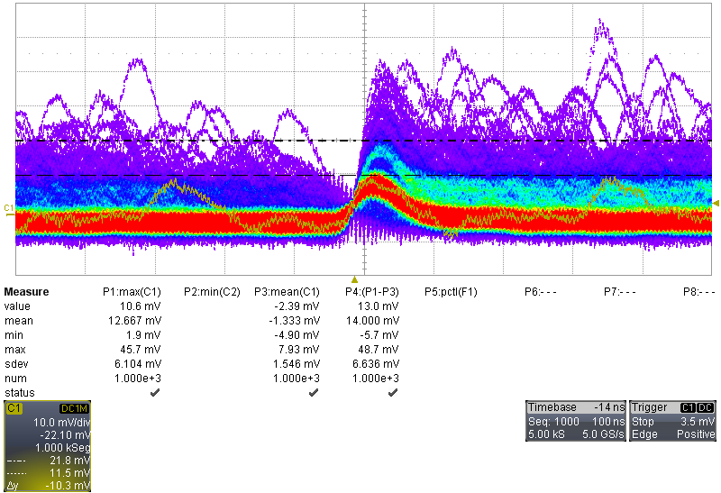

**Resultados** (`area_pulsos_evb.py` v2.0, sin cambios):

| Magnitud | Hoy | LOG 18 (2,5 V nominal) |
|---|---|---|
| Amplitud del pico de 1 PE (μ1) | **11,7 mV** | ~11,6 mV (22,2 mV a 5 V × 481/924; la forma no depende de V_ov) |
| Área del SPE | 1252 ± 25 mV·ns = **572 ± 12 fC** | 481 ± 8 fC |
| Control: área sin pulso | **+126 ± 20 mV·ns (+10 % del SPE)**: el script avisa de una base sesgada | ≈ 0 |
| σ1/μ1 | 0,23 | 0,14 |
| Ruido rms de la base | 1,65 mV | ~1,33 mV (LOG 17) |
| Base absoluta | −2,1 mV | — |

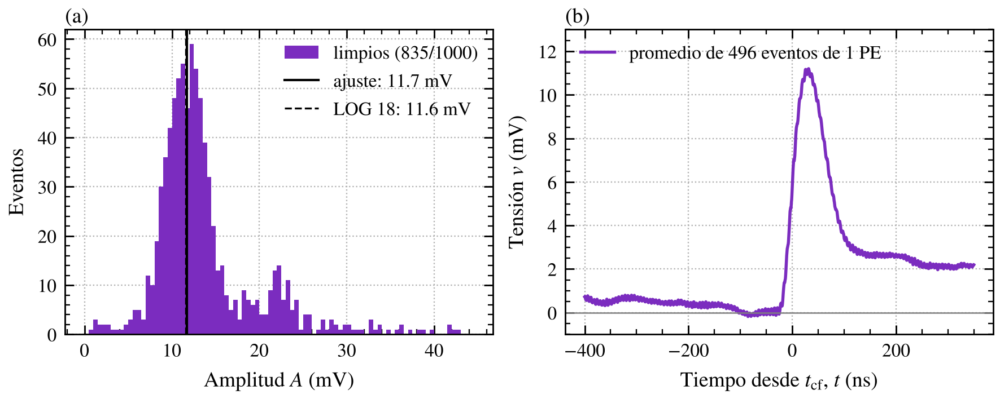

*Figura 1. (a) Espectro de amplitudes de los eventos limpios: el pico de 1 PE ajustado (11,7 mV) coincide con el esperado por el LOG 18 (11,6 mV). (b) Pulso promedio de 1 PE: después del pulso queda una meseta de ~2,2–2,7 mV.*

**Hechos:**
- La **amplitud** del 1 PE coincide con la del LOG 18 dentro de ~1,5 % (fig. 1a).
- El **área** da ~19 % más, y el control de la base no da cero.
- El pulso promedio de 1 PE tiene una meseta de ~2,2–2,7 mV después del pulso (fig. 1b).
- En la captura de pantalla aparecen pulsos lentos y anchos (~150–200 ns, 20–45 mV) que no tienen la forma de un SPE.

**Interpretación:**
- La base está corrida por la tasa de pulsos multiplicada por el área media por pulso (LOG 18, §7.3). Una base de −2,1 mV implica del orden del doble de pulsos que en el LOG 18 (~0,9 mV esperados con 0,78 MHz). **La luz extra del §3.4 probablemente ya estaba en esta captura** (inferencia).
- Con más pulsos por ventana, los cortes de v2.0 se adaptan a la distribución de cada archivo (mediana + K·σ) y dejan pasar eventos con un segundo pulso. Eso sesga el área hacia arriba y explica la meseta (inferencia). La amplitud es mucho menos sensible a esto.
- Que la amplitud coincida indica que la ganancia es la misma que en el LOG 18 dentro de ~2 % (inferencia).

**Calibración de la sesión (provisoria):** la conversión a avalanchas de este log usa **Q_SPE = 481 fC (LOG 18)**, porque el área de hoy está sesgada y la amplitud muestra la misma ganancia. Queda por confirmar.

### 3.3 Montaje del LYSO: primero no se veían los eventos

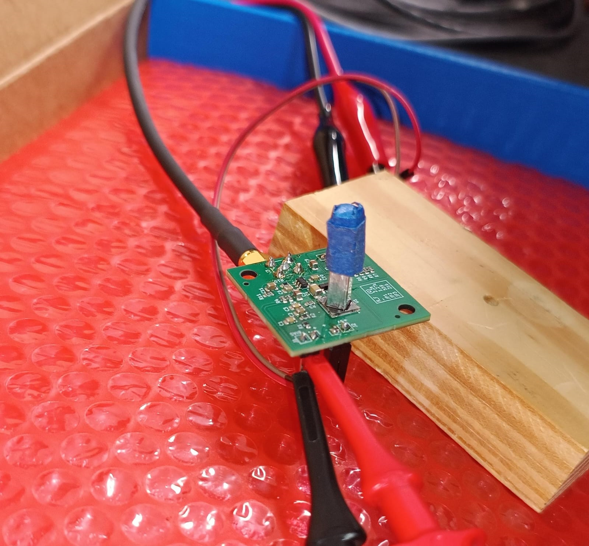

Monté el LYSO. Con la configuración del SPE (2,5 V nominal, 2,2 kΩ, escala de pocos mV/div, trigger de pocos mV) no veía ni PE ni eventos de centelleo. Aparecía un pulso constante que no cambiaba; no lo capturé, ocurrió durante la fuga de luz del §3.4 y su causa queda sin determinar.

**Interpretación:**
- **Los eventos del cristal son raros frente a las cuentas oscuras.** Se miden ~100 por segundo (§3.8), contra ~1 MHz de cuentas oscuras.
- **Además, quedan fuera de pantalla.** Un evento del Lu-176 deposita cientos de keV (≳ 1000 PE), y con 2,2 kΩ satura, muy por encima de una pantalla de ~80 mV.

**Cambio de configuración:** escala de ~500 mV/div con offset, 100 ns/div y trigger de cientos de mV. Con eso **aparecieron los eventos**.

### 3.4 Luz externa

**Primero, compliance inmediato:** con el cristal montado, el script llegaba enseguida al compliance de 100 µA.

- **Por qué no podía ser el Lu-176 (estimación):** ~100 eventos/s × 1000–2500 PE × 0,48 pC × 1,12 ≈ 50–130 nA. A eso se suman ~0,4 µA de corriente oscura a 2,5 V nominal (0,78 MHz × 481 fC × 1,125, LOG 18).
- **Causa: luz externa.** Tapé la caja con cinta, cerré las ventanas y apagué las luces. La corriente bajó por debajo del compliance y los eventos se vieron bien.

**Pero la oscuridad no quedó resuelta.** Lecturas de `bias_sipm_needles.py` a V_source = 27,219 V (2,5 V nominal):

| Tiempo del script | I_bias | Estado del script | Condición |
|---|---|---|---|
| 29:37 – 30:05 | 33,3 → 29,9 µA (bajando) | ALTO | Durante las mediciones |
| 37:01 – 37:16 | 3,79 – 4,09 µA | normal | Después de cambiar las condiciones de la caja [completar qué se cambió] |

- **Lo esperado** son ~0,4–0,5 µA (corriente oscura más Lu-176). Con ~31 µA el exceso equivale a **~57 avalanchas por µs**; con ~3,9 µA, a ~6 por µs.
- **Interpretación:** es luz que entra por la caja, que no cierra del todo (inferencia fuerte: la corriente cambia con las condiciones de la caja). Que la corriente bajara durante los 30 s registrados también es compatible con afterglow del cristal, que se expuso a la luz al montarlo. No separé las dos causas.
- El estado "normal" del script solo indica que la corriente bajó del umbral del script, no que se cumpla la condición de oscuridad.

### 3.5 Captura de SPE con el cristal montado (17:14 y 17:15)

`C1Vov2p5_RF2200_LYSO_escalaPE00000.trc` y `…00001.trc`: 2,5 V nominal, 2,2 kΩ, trigger en **3 mV**, escala del SPE.

**Lo que vi:** seguían apareciendo los eventos del Lu-176 y **no se distinguían los picos de PE**.

**Análisis:**

| | Sin cristal (15:40) | Con cristal (17:14) | Con cristal (17:15) |
|---|---|---|---|
| Ruido rms de la base | 1,65 mV | **15,1 mV** | **17,0 mV** |
| Pico de 1 PE | 11,7 mV, σ1/μ1 = 0,23 | No separado (σ1/μ1 = 0,38) | No encontrado |

**Interpretación:**
- El ruido de la base es ~10 veces mayor, y no lo explican los eventos del Lu-176. Por el teorema de Campbell (varianza = tasa × ∫h²dt, con el pulso de 1 PE de ~11,7 mV y ~77 ns de FWHM), una base con 15 mV rms corresponde a **~36 MHz de pulsos**. Es el mismo orden que las ~57 avalanchas por µs del §3.4: los pulsos de 1 PE se apilan (inferencia fuerte).
- Los eventos del Lu-176 no eran el problema: son ~1 cada 10⁴ disparos y el algoritmo v2.0 los rechaza.
- **Estas secuencias no sirven para calibrar en PE.**

### 3.6 Eventos de centelleo con R_F = 2,2 kΩ a 2,5 V nominal: saturan (16:12)

`C1Vov2p5_RF2200_gamma_saturando00000.trc`: 1000 segmentos, 500 mV/div con offset de −1,100 V, 100 ns/div, trigger en 285 mV.

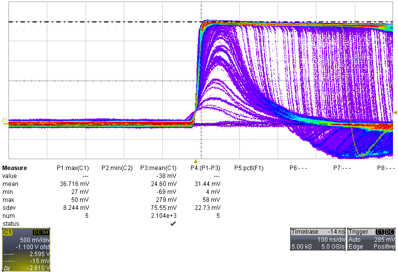

**Hechos** (fig. 3a, §3.8):
- **El techo plano de saturación está a ~2,6 V sobre la base:** los cursores dan 2,595 V y −15 mV (Δ = 2,610 V), y el archivo llega a 2,64 V absolutos.
- La mediana de la amplitud es de 2,62 V: **más de la mitad de los eventos saturan.**
- Cuanto más grande el evento, más tiempo queda en el techo.
- Después de los pulsos saturados, la salida baja hasta −0,95 V y **no vuelve a la base antes del final del segmento** (~514 ns después del trigger).
- Tasa de disparo: **99,6 eventos/s**.

**Interpretación:**
- La saturación es la esperada. El LOG 9 da para LYSO una ventana de R_F de 150–330 Ω (con la carga del datasheet, que es la que vale según la C_cel medida en el LOG 18).
- **Hipótesis:** la excursión negativa es la recuperación del opamp al salir de saturación. No es el acople AC (τ = C11·R11 = 10 ms). Desaparece si el pulso no satura. Cuánto dura la recuperación no se puede medir con segmentos de 1 µs.

### 3.7 V_ov baja con el cristal (2,2 kΩ)

Antes de cambiar R_F, bajé V_ov para ver los pulsos sin saturar.

| Archivo | Hora | V_ov nominal | V_ov real estimada* | Tasa de disparo | Observación |
|---|---|---|---|---|---|
| `C1Vov2p5_RF2200_gamma_saturando00000.trc` | 16:12 | 2,5 V | ~2,76 V | 99,6/s | Saturan (§3.6) |
| `C1Vov0p5_RF2200_LYSO00000.trc` | 16:27 | 0,5 V | ~0,76 V | 94,4/s | La mayoría sin saturar; algunos saturan |
| `C1Vov0p25_RF2200_LYSO00000.trc` | 16:38 | 0,25 V | ~0,51 V | 78,2/s | **Pulsos bien definidos, sin saturar**, salvo algún evento raro |

\* V_ov real = nominal + 0,26 V, con V_0 = 24,46 ± 0,08 V del LOG 18. Ese valor se midió otro día; entre días, V_0 se movió ~0,3 V.

*Figura 1. V_ov = 2.5 V.*

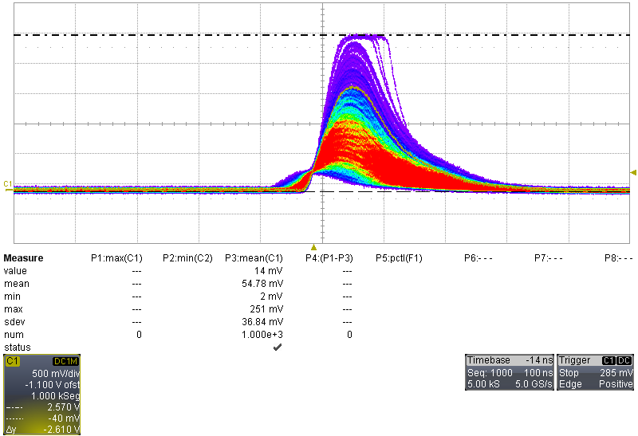

*Figura 2. V_ov = 0.5 V.*

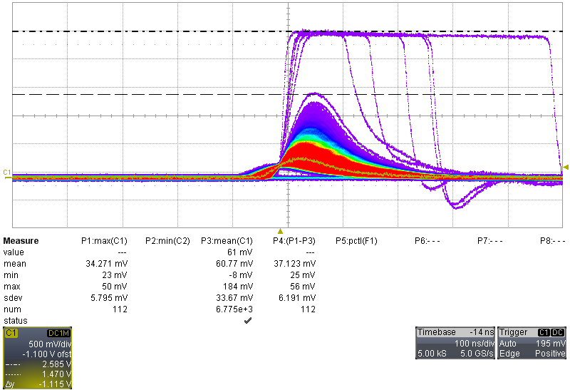

*Figura 3. V_ov = 0.25 V.*

Entre ~2,76 y ~0,51 V reales, la ganancia baja ~5,4 veces (es ∝ V_ov). Además baja la PDE, que cerca del breakdown cae rápido (inferencia).

> [!IMPORTANT]
> La variabilidad de la altura de los pulsos con la tension de polarizacion que se aprecia en estas mediciones es la justificación experimental de la necesidad de un circuito de compensación térmica. La variación en temperatura genera un corrimiento de V_br, lo cual genera un corrimiento en V_ov, el cual cambia la altura del pulso, potencialmente arruinando la espectroscopia. La caracterización térmica del SiPM y el consecuente diseño de un circuito de compensacion de BIAS es necesario para la sonda.

**Estos datos son cualitativos.** A ~0,5 V real el SPE (~90 fC, ~2 mV con 2,2 kΩ) no se separa del ruido, así que no se puede calibrar en PE. Además, la ganancia varía ~4 %/°C, contra ~0,8 %/°C a 2,76 V. El archivo de 0,25 V se usa solo para la forma del pulso con 2,2 kΩ (§3.10 b).

**Decisión (10/11):** para medir, V_ov fija en 2,5 V nominal y R_F baja (216 Ω). Es lo que prevé el diseño del banco: calibrar con R_F alta y medir con R_F baja.

### 3.8 Eventos del Lu-176 con R_F = 216 Ω (JP3), 2,5 V nominal

| Archivo | Hora | Trigger (estimado de los datos*) | Segmentos | Tasa de disparo |
|---|---|---|---|---|
| `C1Vov2p5_RF216_LYSO00000.trc` | 16:57 | ~250 mV | 1000 | 96,7/s |
| `C1Vov2p5_RF216_LYSO_00000.trc` | 17:28 | ~150 mV | 1000 | 102,5/s |

\* Mediana de la señal en t = 0.

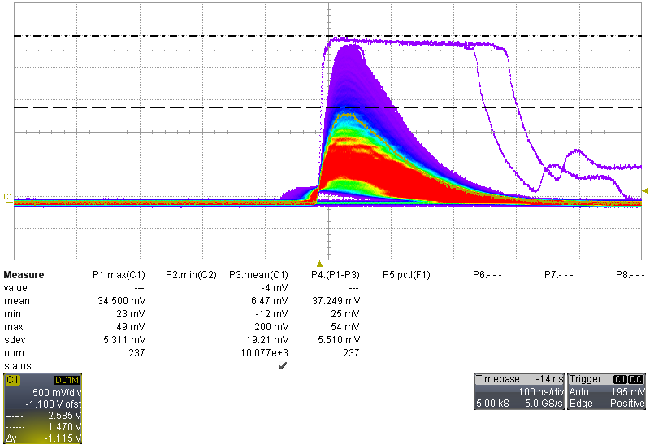

**Forma y estabilidad.** Pulso promedio de los eventos de 0,5 a 1,5 V, normalizado al pico:

| Desde el trigger | 0 | 40 ns (pico) | 100 ns | 200 ns | 300 ns | 400 ns | 450–500 ns |
|---|---|---|---|---|---|---|---|
| Relativo al pico | 0,32 | 0,99 | 0,68 | 0,20 | 0,04 | 0,00 | −0,006 a −0,009 |

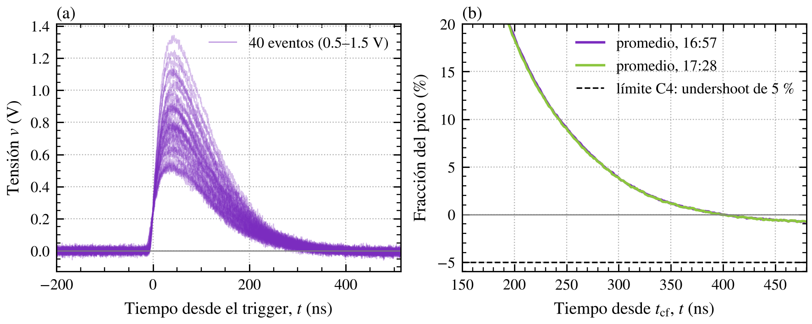

*Figura 2. R_F = 216 Ω, 2,5 V nominal. (a) 40 eventos individuales del Lu-176: sin oscilación ni ringing. (b) Cola del pulso promedio de los dos archivos: el undershoot llega a −0,6 a −0,9 % del pico, lejos del límite C4 (5 %).*

El pulso vuelve a la base a ~400 ns del trigger, y el área acumulada hasta 350 ns ya es el 100 %. **Un segmento de 1 µs con ~0,5 µs antes del trigger alcanza para LYSO.**

**Rango dinámico:**

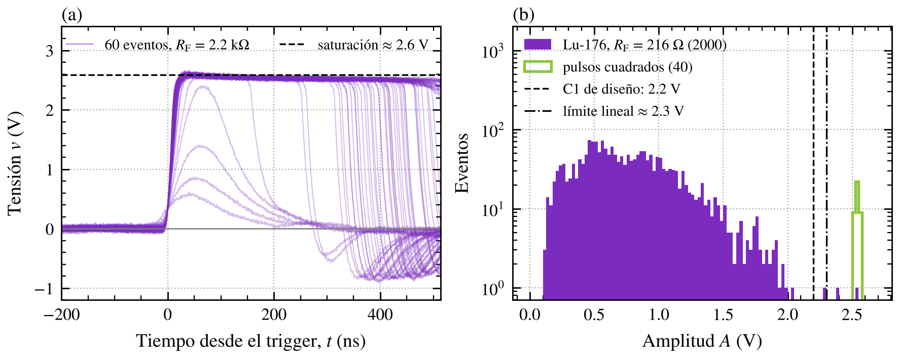

*Figura 3. (a) Con R_F = 2,2 kΩ los eventos saturan a ~2,6 V; después de saturar, la salida baja hasta ~−0,9 V y no vuelve a la base dentro del segmento. (b) Con R_F = 216 Ω, las amplitudes del Lu-176 (2 000 eventos) quedan por debajo del límite lineal (~2,3 V) salvo ~1 de cada 1000. Los pulsos cuadrados del §3.9 (trigger en 2,405 V) se acumulan contra la saturación.*

**Espectro de carga** (`espectro_centelleo_evb.py` v1.0, nuevo; §Scripts):

| | 16:57 | 17:28 |
|---|---|---|
| Eventos limpios | 998/1000 | 999/1000 |
| Fuera del rango lineal (> 2,3 V) | 1 | 1 |
| Rechazados por pulso previo o segundo pulso | 1 | 0 |
| Carga mediana | 460 pC (~960 avalanchas) | 456 pC (~950 avalanchas) |
| Percentil 99,5 | 1178 pC (~2450 avalanchas) | 1196 pC (~2490 avalanchas) |

Avalanchas = Q / 481 fC (calibración provisoria, §3.2). Es el número de celdas disparadas: incluye el crosstalk.

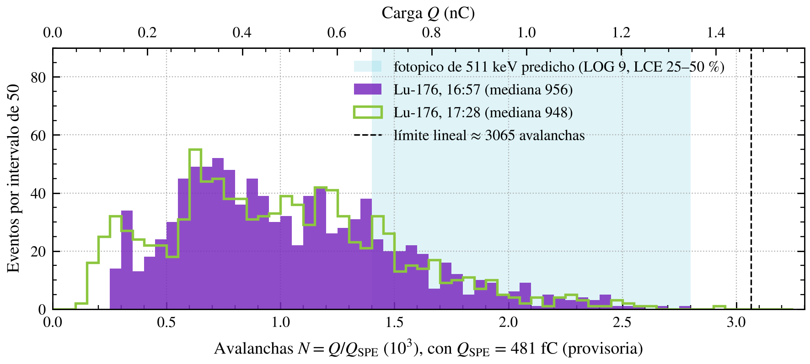

*Figura 5. Espectro de carga del Lu-176 con 216 Ω para los dos archivos (el corte de la izquierda lo pone el trigger, distinto en cada uno). La banda marca dónde caería el fotopico de 511 keV según el LOG 9 para una LCE del 25–50 %; la línea, el límite lineal de la salida.*

**Hechos:**
- **Los dos archivos coinciden dentro de ~1,5 %**, en la mediana y en el percentil 99,5, aun con distinto umbral y con 30 minutos de diferencia (fig. 5).
- **Solo ~1 evento cada 1000 sale del rango lineal** (fig. 3b).
- En pantalla, los pulsos redondeados llegan hasta ~2,355 V. Por encima hay algunos pulsos cuadrados, saturados en ~2,585 V.
- La relación amplitud/carga es lineal: **amplitud ≈ 1,56 mV/pC × Q** (§3.10 a). El límite lineal de 2,3 V equivale a **~1,47 nC ≈ 3 070 avalanchas**.

**Inferencias:**
- **El fotopico de 511 keV entraría con esta configuración** (fig. 5).
  - Con la cadena del LOG 9 (16 350 fotones × LCE × PDE 0,31 × 1,12 de crosstalk), el fotopico cae en ~1 400–2 800 avalanchas para una LCE del 25–50 %.
  - Eso está por debajo de las ~3 070 avalanchas del límite lineal. 216 Ω a 2,5 V alcanza hasta una LCE de ~54 %, sin contar la saturación del SiPM.
  - Las líneas de mayor energía (1274 keV del Na-22, Co-60) no entrarían.
- La luz extra del §3.4 suma ~17 ± 4 avalanchas en la ventana, frente a ~1000 por evento: menos del 2 %.
- Estos datos sirven para ver los eventos y fijar la configuración. No sirven como fondo de referencia: el fondo se toma el día de la fuente, con el mismo montaje.
- **No se identifican las emisiones del Lu-176** (escalones del beta corrido por los gammas absorbidos de 88, 202 y 307 keV). Con ~2 000 eventos, umbrales distintos en la parte baja y sin un modelo de escape de gammas para esta geometría, no se pueden asignar energías. **Decisión (10/11):** no intentarlo. La escala en keV sale de una fuente. El espectro del Lu-176 queda como **referencia de estabilidad de la ganancia** (es reproducible dentro de ~1,5 %).

### 3.9 Tasa de los pulsos cuadrados

Para distinguir si los pulsos cuadrados son eventos del Lu-176 de mayor energía (H1) o una población aparte (H2: muones), tomé secuencias con el trigger en **2,405 V**. Ese nivel está entre el último pulso redondeado (~2,355 V) y la saturación (~2,585 V). El archivo `…trigg2p400000.trc` tiene un solo segmento: es la prueba de configuración.

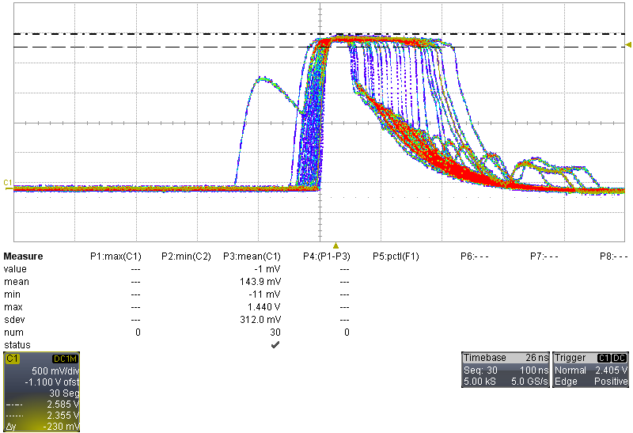

| Archivo | Hora de guardado | Segmentos | Duración (primer a último trigger) | Tasa |
|---|---|---|---|---|
| `C1Vov2p5_RF216_LYSO_trigg2p400001.trc` | 17:35 | 10 | 217,5 s | 2,5/min |
| `C1Vov2p5_RF216_LYSO_trigg2p400002.trc` | 17:41 | 30 | 542,0 s | 3,2/min |
| **Combinado** | | 38 intervalos | 759,5 s | **3,0 ± 0,5 por minuto** |

- **Los intervalos son compatibles con una exponencial** (coeficiente de variación 0,95; KS p = 0,78): son eventos al azar, no periódicos.
- El tiempo sobre 2,4 V va de 50 a 240 ns por evento.
- **Lectura:** si fueran eventos del Lu-176 saturando (H1), la secuencia se llenaría en segundos (~100 eventos/s). **H1 queda descartada.** Esto es compatible con muones (§4), pero no lo prueba.

### 3.10 Análisis adicional de los eventos del Lu-176 con 216 Ω

Sobre los dos archivos del §3.8 (~2 000 eventos). Apunta a G2, a G4 y a la electrónica de lectura de la sonda.

#### a) Amplitud contra carga

| Carga | Eventos | Amplitud / carga | Dispersión evento a evento |
|---|---|---|---|
| 100–300 pC | 427 | 1,602 ± 0,003 mV/pC | 4,0 % |
| 300–500 pC | 659 | 1,555 ± 0,002 mV/pC | 2,7 % |
| 500–700 pC | 535 | 1,561 ± 0,002 mV/pC | 2,2 % |
| 700–900 pC | 237 | 1,566 ± 0,002 mV/pC | 2,0 % |
| 900–1100 pC | 85 | 1,572 ± 0,004 mV/pC | 2,1 % |
| 1100–1400 pC | 32 | 1,571 ± 0,004 mV/pC | 1,6 % |

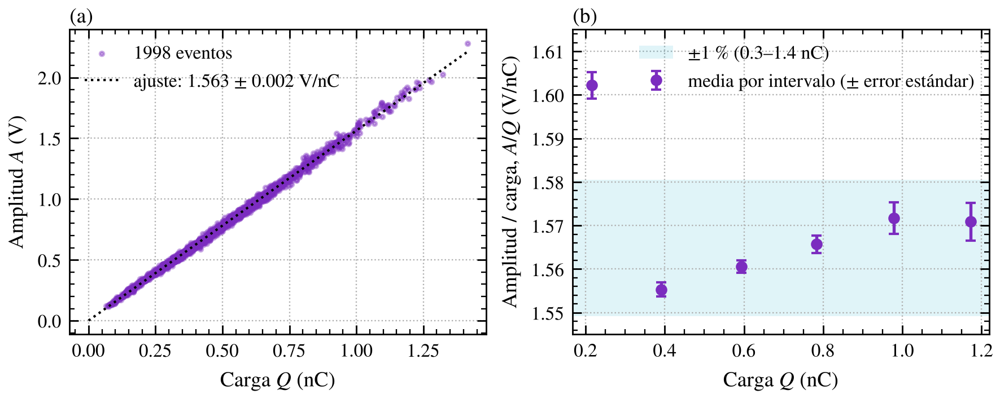

*Figura 4. (a) Amplitud contra carga de cada evento del Lu-176 con 216 Ω (ajuste: 1,56 mV/pC). (b) Cociente por intervalo de carga: entre 300 y 1400 pC queda dentro de ±1 %; debajo de 300 pC, cerca del umbral, da ~3 % más.*

**Hechos:**
- Entre 300 y 1400 pC la relación amplitud/carga es constante dentro de ~1 % (1,555–1,572 mV/pC, con una leve tendencia creciente).
- Por debajo de 300 pC da ~3 % más; esa zona está cerca del umbral de trigger.
- La dispersión evento a evento es de ~2 % rms.

**Interpretación:**
- La forma del pulso no depende de la energía en este rango, así que **la amplitud es proporcional a la energía**. Tampoco hay compresión medible al acercarse al riel.
- El ruido (§3.10 c) explica solo ~0,5 % en la amplitud y ~0,5 % en la carga. El resto, **~1,9 % rms (~4,5 % FWHM), es variación real de la forma de evento a evento** (inferencia: fluctuaciones estadísticas en los tiempos de llegada de los fotones).
- **Consecuencia (inferencia, a verificar con el fotopico):** medir por amplitud (detector de pico) sumaría ~4,5 % FWHM en cuadratura a la resolución en energía; integrar la carga no. Es relevante para la electrónica de lectura de la sonda (objetivo 4 de la propuesta). **Se verifica calculando la resolución del fotopico de 511 keV de las dos formas.**

#### b) Forma del pulso y comparación con el modelo del LOG 9

| Configuración | Subida 10–90 % | FWHM | τ de la cola | Duración sobre el 10 % | Duración sobre el 1 % |
|---|---|---|---|---|---|
| 216 Ω, 2,5 V (16:57) | 27 ns | 125 ns | 70 ns | 253 ns | 368 ns |
| 216 Ω, 2,5 V (17:28) | 27 ns | 125 ns | 70 ns | 252 ns | 370 ns |
| 2,2 kΩ, 0,25 V | 50 ns | 110 ns | 65 ns | 250 ns | 372 ns |
| **Predicción del LOG 9** (LYSO, 40 ns ⊛ respuesta a un fotón) | — | — | — | **~255 ns** | **~365 ns** |

Duraciones medidas sobre el pulso promedio alineado en t_cf (`figuras_log19.py`).

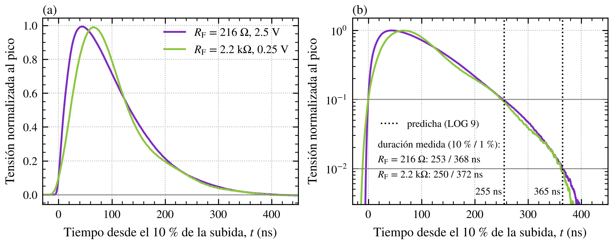

*Figura 6. (a) Forma promedio normalizada con 216 Ω y con 2,2 kΩ, alineada en el 10 % de la subida. (b) La misma forma en escala logarítmica: las duraciones al 10 % y al 1 % caen sobre las del LOG 9 (líneas punteadas).*

**Hechos:**
- **Las duraciones medidas coinciden con las del modelo del LOG 9 dentro de ~2 %.**
- Los dos archivos con 216 Ω dan la misma forma.
- Con 2,2 kΩ la subida es casi el doble de lenta (50 contra 27 ns).

**Interpretación:**
- **El modelo de cascada del LOG 9 (decaimiento del LYSO convolucionado con la respuesta a un fotón) describe bien el pulso real.** Ese modelo es el que se usó para elegir el banco de R_F, para la memoria de pile-up y para la regla de C_F (J5, G4).
- La subida más lenta con 2,2 kΩ es el límite de ancho de banda del TIA con R_F alta. Es consistente con el angostamiento del SPE al bajar R_F (LOG 18).
- La FWHM algo mayor con 216 Ω (125 contra 110 ns) queda sin explicar. Con 2,2 kΩ la V_ov también era distinta.

#### c) Ruido en carga sin pulso (216 Ω)

Medido en la zona previa al pulso (base de 100 ns, integración de 310 ns, escalado a la ventana de 440 ns):

| | Valor |
|---|---|
| σ de la carga sin pulso | ~3,5 pC ≈ **9 avalanchas rms** |
| Ruido rms crudo de la base | 12 mV (3,6 mV con una media móvil de 10 ns) |

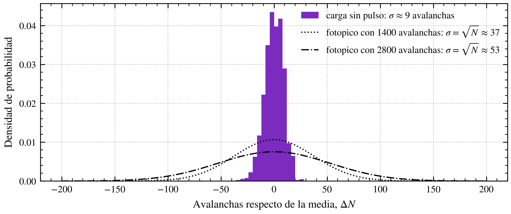

*Figura 7. Distribución de la carga integrada sin pulso (σ ≈ 9 avalanchas) comparada con el ancho estadístico que tendría el fotopico de 511 keV con 1 400 y 2 800 avalanchas (σ = √N ≈ 37 y 53).*

**Interpretación:**
- El ruido de la base a 500 mV/div lo domina el **osciloscopio**: la placa sola da 0,62 mV rms con 216 Ω (LOG 18). A eso se suma la luz extra del §3.4 (inferencia).
- Sumado en cuadratura al ancho estadístico del fotopico (~37–53 avalanchas), lo ensancha menos del ~3 %. **El ruido de la cadena no limita G2.**
- Igual conviene usar la escala vertical más chica en la que entre el fotopico.

## 4. Hipótesis: los eventos raros que saturan son muones cósmicos

A 0,25 V nominal casi todos los eventos quedan dentro de pantalla, pero **algún evento raro sigue saturando**. Con 216 Ω a 2,5 V hay pulsos cuadrados a **3,0 ± 0,5 por minuto**, con intervalos al azar.

**Hipótesis:** son **muones cósmicos** que atraviesan el cristal.

**Argumentos (estimaciones):**
- **Energía depositada.** Un muón de ionización mínima deposita ~9 MeV/cm en LYSO (~1,25 MeV·cm²/g × 7,1 g/cm³): entre ~4 MeV (4,5 mm) y ~20 MeV (24 mm), según el recorrido. El máximo del Lu-176 es ~1,2 MeV (beta más los gammas de 88, 202 y 307 keV).
- **Tasa.** El flujo a nivel del mar es ~1 por cm² por minuto sobre una superficie horizontal, con distribución ∝ cos²θ; una cara vertical recibe ~¼ por unidad de área. Con el cristal parado, el área efectiva es ~1,4 cm²: 0,225 cm² arriba más ~1,1 cm² de las caras laterales. Eso da **~1–2 por minuto**, algo más a la altura de Bariloche.
- **Comparación.** Lo medido (3,0 ± 0,5 por minuto) es **~2 veces mayor** que esa estimación gruesa. Es compatible en orden de magnitud; la estimación del área efectiva es aproximada.

**Cómo verificarla (pendiente, tema secundario):**
- **Dos umbrales** por encima del final del Lu-176. Si son muones, la tasa baja poco entre los dos; si fuera la cola del Lu-176, caería a casi cero. Con 216 Ω a 2,5 V no queda margen hasta la saturación, así que hace falta menos ganancia.
- **Sin cristal**, con el mismo umbral: tendría que dar ~0.
- **Orientación del cristal** (con el soporte): cambia el área efectiva y el recorrido.
- **Coincidencia** con el centellador plástico (Ø9 × 50 mm). Necesita un segundo canal.

## 5. Validación de la electrónica

Con los datos de hoy, la EVB-TIA v0 se comporta como se diseñó, ahora con pulsos de centelleo y no solo con el SPE. Queda validada la forma, la estabilidad, el rango dinámico y la linealidad de la salida. Falta la escala absoluta: la conversión a avalanchas con R_F baja y la energía.

### 5.1 Criterios de diseño contra los datos de hoy

| Criterio (Trazabilidad / LOG 9) | Qué dicen los datos | Figura | Estado |
|---|---|---|---|
| **RQ2: ver el SPE** | El pico de 1 PE aparece a 11,7 mV, igual que en el LOG 18 dentro de ~1,5 %, después de mover y reconectar todo. La ganancia de la cadena con 2,2 kΩ se reproduce entre días | 1 | ✅ Reconfirmado |
| **C4: estable, sin ringing, undershoot < 5 %** | Con pulsos de centelleo grandes (hasta ~2 V) y 216 Ω no hay oscilación ni ringing. El undershoot de la cola es de −0,6 a −0,9 % del pico | 2 | ✅ Validado con pulsos reales (el LOG 18 lo había hecho solo con el SPE) |
| **C1: el fotopico no satura** | La salida es lineal hasta ~2,3 V y satura en ~2,6 V. El límite de 2,2 V del diseño era conservador y tiene margen real. Con 216 Ω solo ~1 de cada 1000 eventos del Lu-176 sale del rango lineal | 3 | ✅ Rango dinámico medido |
| **Linealidad de la electrónica** | El cociente amplitud/carga es constante dentro de ~1 % entre 300 y 1400 pC. No hay compresión medible al acercarse al riel | 4 | ✅ Hasta ~2,3 V |
| **RQ3: cubrir LYSO sin rediseñar** | 216 Ω, dentro de la ventana del LOG 9, deja el Lu-176 en el rango lineal. El límite lineal equivale a ~3 070 avalanchas | 3, 5 | ✅ LYSO / ⬜ GSO no probado |
| **RQ4 y C2: fotopico de 511 keV entre 0,5 y 2,2 V** | Con 1,56 mV/pC, el fotopico predicho (~1 400–2 800 avalanchas) caería en ~1,05–2,1 V | 5 | 🟡 Inferencia, falta la fuente |
| **RQ1: medir la energía de cada gamma** | Hay espectro de carga, reproducible dentro de ~1,5 %. No hay escala en keV | 5 | 🟡 Parcial |
| **RQ6: protección** | La placa siguió funcionando después de llegar al compliance (sobrecarga de luz) y de saturar muchas veces. No fue un ensayo diseñado | — | 🟡 Evidencia indirecta |

### 5.2 Validación del modelo de simulación

| Qué | Evidencia | Figura | Peso |
|---|---|---|---|
| **Forma del pulso de gamma** | Duración sobre el 10 % y sobre el 1 % del pico (253 y 368 ns) contra la del LOG 9 (~255 y ~365 ns): coinciden dentro de ~2 %. El LOG 17 había validado el modelo con el SPE; hoy queda validado con pulsos de gamma | 6 | Hecho |
| **Ancho de banda contra R_F** | La subida es de 27 ns con 216 Ω y de 50 ns con 2,2 kΩ: con R_F alta el TIA tiene menos ancho de banda | 6 | Hecho |
| **Base corrida por el acople AC** | La base de −2,1 mV y la meseta después del pulso encajan con el mecanismo del LOG 18 (tasa de pulsos × área media por pulso) | 1 | Inferencia |

### 5.3 Qué no queda validado

| Tema | Por qué importa | Qué dicen los datos |
|---|---|---|
| **Conversión de carga a avalanchas con 216 Ω** | Pasar el fotopico a N_PE asume Q = área / R_F. Eso solo está validado hasta 559 Ω (LOG 18) | Con 216 Ω el 1 PE no se resuelve. Hoy se asumió, no se midió |
| **Ruido de la placa en la escala de medición** | Resolución (G2) | A 500 mV/div domina el osciloscopio (~9 avalanchas rms, fig. 7). No limita, pero no mide la placa |
| **Recuperación tras saturar** | Tiempo muerto con eventos fuera de rango, como los muones; importa para la tasa de cuentas | Con 2,2 kΩ, la salida baja hasta −0,95 V después de saturar y no vuelve dentro del segmento de 1 µs (fig. 3a) |
| **Pulsos lentos espurios** (20–45 mV, 150–200 ns) | En un espectro pueden parecer eventos de baja energía | Aparecen en la captura de la referencia sin cristal (§3.2). Causa sin determinar (como las excursiones del LOG 18) |
| **GSO, C_F, otras R_F con centelleo** | RQ3, G4 | No probados hoy |

## 6. Qué aporta esta sesión al objetivo

| Resultado | Para qué sirve | Peso |
|---|---|---|
| Eventos de centelleo con la EVB-TIA v0 | La cadena cristal → SiPM → TIA funciona | Hecho |
| **216 Ω a 2,5 V nominal**: Lu-176 en el rango lineal; límite lineal ≈ 3 070 avalanchas | Configuración para la medición con fuente. El fotopico de 511 keV entraría para LCE ≲ 54 % | Hecho / inferencia |
| **Forma del pulso de LYSO = modelo del LOG 9** (dentro de ~2 %) | Valida el modelo usado para el banco de R_F, el pile-up y la regla de C_F (G4) | Hecho |
| Amplitud ∝ carga (~1 %), con ~2 % rms de variación de forma | Integrar la carga sería mejor que detectar el pico (G2, electrónica de la sonda) | Hecho / inferencia a verificar con el fotopico |
| Ruido en carga: ~9 avalanchas rms, dominado por el osciloscopio | No limita la resolución a 511 keV (G2) | Inferencia |
| Segmento de 1 µs con ~0,5 µs antes del trigger | Alcanza para el pulso del LYSO (vuelve a la base a ~400 ns) | Hecho |
| Salida lineal hasta ~2,3 V; saturación en ~2,585–2,64 V | Rango dinámico real (el criterio C1 usaba 2,2 V) | Hecho |
| Espectro de carga del Lu-176, reproducible dentro de ~1,5 % | Referencia de estabilidad de la ganancia; script de análisis listo para el fotopico | Hecho |
| La amplitud del SPE coincide con la del LOG 18 | La ganancia es la misma entre días (~2 %) | Inferencia |
| Criterio de oscuridad: I_bias < ~1 µA a 2,5 V nominal antes de medir con cristal | Hoy no se cumplió, y por eso no se pudo calibrar con el cristal montado | Lección |
| Pulsos cuadrados a 3,0 ± 0,5 por minuto, al azar | Compatibles con muones. Tema secundario, en pausa | Hipótesis |

## 7. Limitaciones

| Tema | Detalle |
|---|---|
| **Oscuridad insuficiente** | I_bias de ~31 µA durante las mediciones y ~3,9 µA al final, contra ~0,4–0,5 µA esperados. Entra luz por la caja sin cerrar (y quizás hay afterglow). También afectó la referencia sin cristal (base de −2,1 mV) |
| **Calibración en PE** | El área del SPE de la referencia sin cristal está sesgada (+19 %, control +10 %). Se usa provisoriamente Q_SPE = 481 fC del LOG 18, apoyada en la amplitud |
| **Sujeción del cristal** | Nula: el acople puede haber cambiado entre mediciones, por ejemplo al cerrar JP3 |
| **Sin SPE repetido al final** | No se puede evaluar la deriva dentro de la sesión |
| **Temperatura** | No medida |
| **V_ov real** | Depende del V_0 del LOG 18 (medido otro día) |
| **Ruido en carga** | Estimado con una geometría de ventanas distinta a la del análisis (base de 100 ns, integración de 310 ns, escalado) |
| **Pulsos lentos y anchos** en la referencia sin cristal | ~150–200 ns, 20–45 mV, sin forma de SPE. Causa sin determinar; quizás relacionados con las excursiones espurias del LOG 18 |
| **Pulso constante** del §3.3 | Visto durante la fuga de luz, sin captura. Causa sin determinar |

## Decisiones técnicas y lecciones

| Decisión / lección | Justificación | Impacto futuro |
|---|---|---|
| **V_ov de trabajo = 2,5 V nominal** para la espectroscopía | Relación 2 PE / 1 PE lineal; punto del datasheet y del LOG 9; menos crosstalk | La resolución en función de V_ov se estudia después |
| **Variar R_F, no V_ov,** para evitar la saturación | A V_ov baja no se puede calibrar en PE y la ganancia depende mucho de la temperatura | Es el uso previsto del banco de R_F |
| **216 Ω para LYSO a 2,5 V** | Lu-176 en el rango lineal; el fotopico de 511 keV entraría para LCE ≲ 54 % | Primera configuración para el fotopico |
| **Segmento de 1 µs** para LYSO | El pulso vuelve a la base a ~400 ns del trigger | Para GSO (componente de 400 ns) habrá que alargarlo |
| **El modelo de cascada del LOG 9 queda validado para LYSO** | La duración del pulso coincide dentro de ~2 % | Se puede usar para la regla de C_F (J5) y para el pile-up |
| **Calcular la resolución del fotopico por carga y por amplitud** | La forma varía ~2 % rms de evento a evento | Decide entre integrador y detector de pico para la electrónica de la sonda |
| **No identificar las emisiones del Lu-176**; usar su espectro como referencia de estabilidad | La escala en keV sale de una fuente; el espectro es reproducible dentro de ~1,5 % | Control de deriva por sesión, temperatura (BETA) e igualación de ganancias en el sistema multipíxel |
| **Usar la escala vertical más chica en la que entre el fotopico** | A 500 mV/div el ruido lo domina el osciloscopio | Menor ruido en carga |
| **Referencia de SPE sin cristal el mismo día** | Separa el efecto del cristal de los cambios de setup | Tomarla en cada sesión con cristal, con la oscuridad verificada |
| **Criterio de oscuridad: I_bias con el cristal montado igual a la corriente oscura** (< ~1 µA a 2,5 V nominal) | Hoy hubo ~31 µA y después ~3,9 µA | Verificarlo antes de cada medición con cristal |
| **La hermeticidad a la luz es un requisito del detector**, no una variable de la espectroscopía | En la sonda, el cristal y el SiPM van en una carcasa opaca; el problema de hoy es del setup de laboratorio | El mismo criterio sirve para validar la sonda: I_bias y espectro con la luz encendida y apagada |
| **La caja tiene que cerrar del todo** | Los cables no tienen paso y las mantas no alcanzan | Paso de cables hermético: conectores pasantes, o ranura con goma espuma negra y cinta negra |
| **Soporte impreso para placa y cristal** | Con sujeción nula, el acople varía | El filamento claro o de pared fina puede dejar pasar luz |
| **Con más luz, el área de v2.0 se sesga y la amplitud no** | Los cortes relativos a la distribución de cada archivo se adaptan a una tasa de pulsos alta | Si la base o el control de v2.0 dan sesgados, comparar por amplitud |
| **El trigger tiene que quedar debajo del pico de 1 PE** | Se volvió a ver el corte del 1 PE | A 2,5 V (SPE ~11,7 mV) el trigger va en ~1–3,5 mV absolutos |
| **Para ver eventos de centelleo: escala de cientos de mV/div y trigger de cientos de mV** | Con la configuración del SPE son ~1 cada 10⁴ disparos y quedan fuera de pantalla | Configuración de partida con fuente |
| **Vaselina líquida como acople de referencia** | Índice parecido al de una grasa óptica; disponible | Las comparaciones de acople van contra esta condición |

---

## Pendientes

- [ ] Completar los campos **[completar]** (reflector del cristal; qué se cambió en la caja para bajar a ~3,9 µA)
- [ ] **Confirmar la calibración de la sesión** (Q_SPE = 481 fC del LOG 18, §3.2)
- [ ] **Caja hermética:** paso de cables que permita cerrar la tapa
- [ ] **Siguiente paso de la línea principal:** medición con fuente para el fotopico de 511 keV (216 Ω, 2,5 V nominal), con el soporte impreso, el criterio de oscuridad cumplido y la referencia de SPE de la misma sesión. Falta definir qué fuentes hay en el laboratorio
- [ ] Con el fotopico: resolución por carga y por amplitud (§3.10 a)
- [ ] Verificar la hipótesis de los muones (§4). Tema secundario, en pausa
- [ ] Subir las figuras 1–7 y las capturas a `docs/images/logs/` (capturas renombradas: `19_captura_*.png`)

---

## Archivos

| Archivo | Hora | Medición | Sección |
|---|---|---|---|
| `C1Vov2p5_RF2200_00000.trc` | 15:40 | SPE sin cristal, 2,5 V, 2,2 kΩ, trigger 3,5 mV | §3.2, fig. 1 |
| `C1Vov2p5_RF2200_gamma_saturando00000.trc` | 16:12 | LYSO, 2,5 V, 2,2 kΩ, 500 mV/div, trigger 285 mV | §3.6, fig. 3a |
| `C1Vov0p5_RF2200_LYSO00000.trc` | 16:27 | LYSO, 0,5 V, 2,2 kΩ | §3.7 |
| `C1Vov0p25_RF2200_LYSO00000.trc` | 16:38 | LYSO, 0,25 V, 2,2 kΩ | §3.7, fig. 6 |
| `C1Vov2p5_RF216_LYSO00000.trc` | 16:57 | LYSO, 2,5 V, 216 Ω | §3.8, §3.10, figs. 2–7 |
| `C1Vov2p5_RF2200_LYSO_escalaPE00000.trc`, `…00001.trc` | 17:14, 17:15 | SPE con cristal, 2,5 V, 2,2 kΩ, trigger 3 mV | §3.5 |
| `C1Vov2p5_RF216_LYSO_00000.trc` | 17:28 | LYSO, 2,5 V, 216 Ω | §3.8, §3.10, figs. 2–5 |
| `C1Vov2p5_RF216_LYSO_trigg2p400000.trc` | 17:34 | Prueba de configuración (1 segmento) | §3.9 |
| `C1Vov2p5_RF216_LYSO_trigg2p400001.trc`, `…00002.trc` | 17:35, 17:41 | Pulsos cuadrados, trigger 2,405 V (10 y 30 segmentos) | §3.9, fig. 3b |

En los nombres de archivo, el osciloscopio guardó `trigg2p4` + el contador (`trigg2p400000`); las capturas de pantalla dicen `trigg2p`. En todos los casos el trigger es de 2,4 V.

Capturas de pantalla: `Vov2p5_RF1.png` y `Vov2p5_RF2.png` (SPE sin cristal), `Vov2p5_RF2200_gamma_saturando_.png`, `Vov0p5_RF2200_LYSO.png`, `Vov0p5_RF2200_beta.png`, `Vov0p25_RF2200_LYSO.png`, `Vov0p25_RF2200_LYSO1.png`, `Vov2p5_RF216_LYSO.png`, `Vov2p5_RF216_LYSO1.png`, `Vov2p5_RF216_LYSO_.png`, `Vov2p5_RF216_LYSO_trigg2p.png`, `Vov2p5_RF216_LYSO_trigg2p1.png`.

## Scripts

| Script | Función | Estado |
|---|---|---|
| `bias_sipm_needles.py` | Bias fijo | Sin cambios |
| `area_pulsos_evb.py` | Área del SPE (v2.0) | Sin cambios; §3.2 y §3.5 |
| `espectro_centelleo_evb.py` | Espectro de carga de eventos de centelleo: base local, ventana de −40 a +400 ns desde t_cf, rechazo de pulso previo y de segundo pulso, eventos fuera del rango lineal contados aparte; eje en pC y en avalanchas (Q_SPE como parámetro) | **Nuevo**, v1.0 (10/11) |
| `figuras_log19.py` | Figuras 1–7 de este log, a partir de los .trc del 10/11. Uso: `python figuras_log19.py <carpeta de datos> <carpeta de salida>` (necesita `area_pulsos_evb.py`) | **Nuevo** (10/11) |

## Referencias

- **LOG 18 (06/11):** V_0 = 24,46 ± 0,08 V, C_cel = 175 fF, Q_SPE vs V_ov, banco de R_F, ruido con 216 Ω (0,62 mV), relación de áreas 2 PE / 1 PE, tasa de cuentas oscuras, base corrida por el acople AC.
- **LOG 17 (05/11):** espectro de fotoelectrones; ruido de la base.
- **LOG 12:** AND9788/D, limpieza del SiPM.
- **LOG 9 (23/09):** ventanas de R_F por escenario (LYSO 150–330 Ω), escalado a 511 keV, duración del pulso de un gamma en LYSO (~255 ns al 10 %, ~365 ns al 1 %).
- **Trazabilidad_Diseno_Amplificacion_EVB-TIA.md:** requisitos RQ1–RQ8 y criterios C1–C4.
- **DataSheet MICROC-SERIES/D** (onsemi): PDE 31 % a 2,5 V, curva de PDE vs V_ov, dV_br/dT = 21,5 mV/°C.
- **Knoll**, *Radiation Detection and Measurement*, Tabla 8.3: propiedades del LYSO.

---

*Log generado al finalizar la sesión del 10 de noviembre de 2026.*
