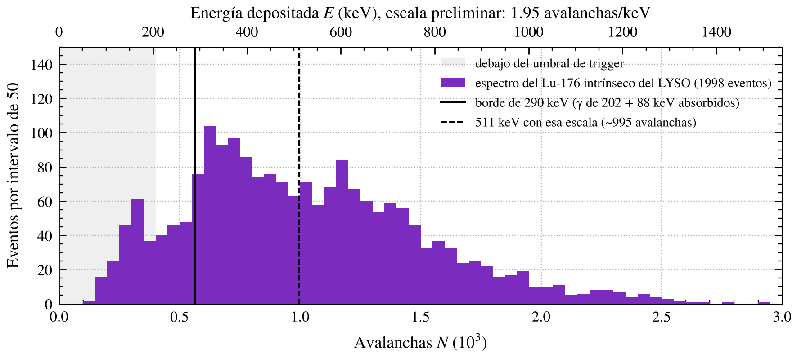
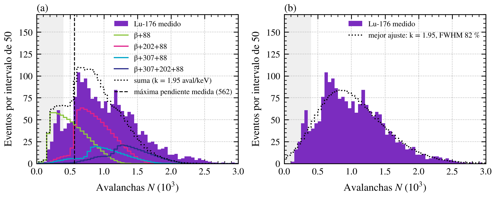
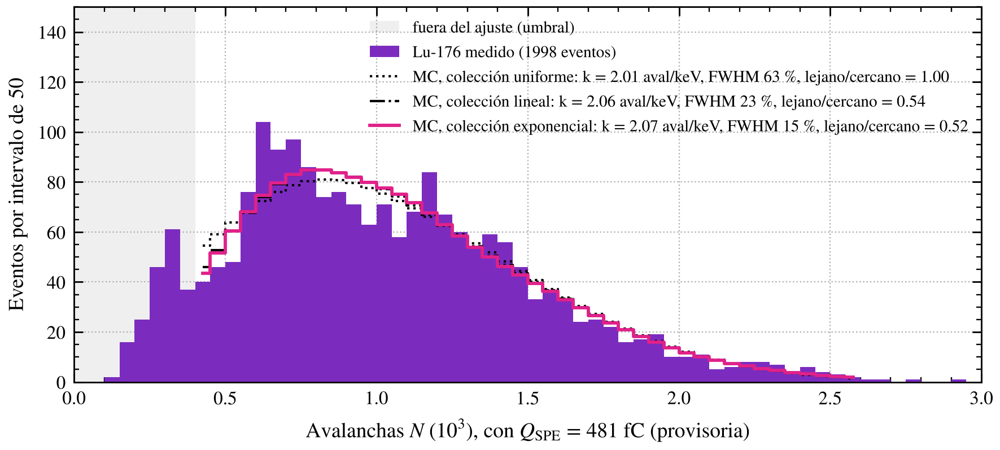
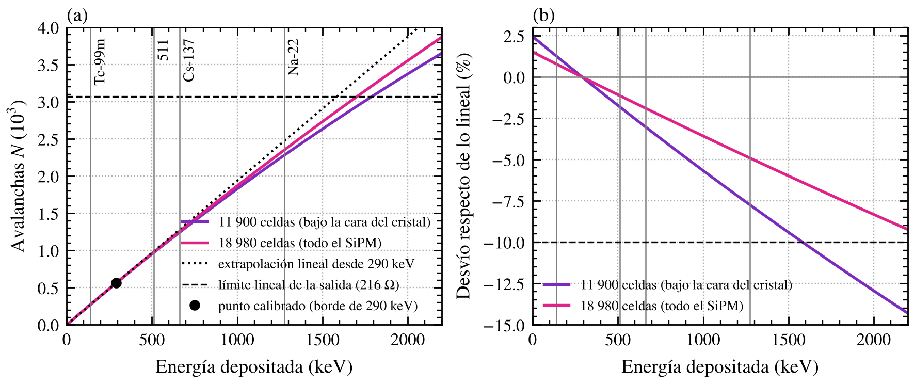
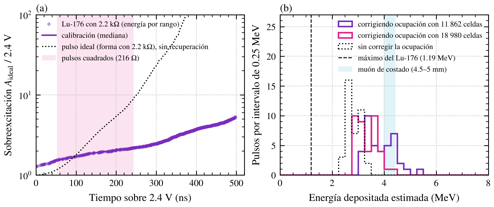

# 20 LOG — Jueves 12 de noviembre de 2026

## Escala de energía preliminar con el Lu-176, colección de luz del LYSO y energía de los pulsos que saturan

**Tipo:** sesión de análisis, sin mediciones nuevas. Trabajé sobre los datos del 10/11 (LOG 19): ~2000 eventos del Lu-176 intrínseco del LYSO con R_F = 216 Ω a 2.5 V nominal, los eventos que saturan con 2.2 kΩ y los pulsos cuadrados con el trigger en 2.405 V.
**Continúa:** LOG 19 (primeros eventos de centelleo con la EVB-TIA v0, 10/11).

**Estado al cierre:** saqué una **escala de energía preliminar sin fuente: k ≈ 2.0 ± 0.1 avalanchas/keV** (511 keV ≈ 1000–1050 avalanchas), a partir del escalón de 290 keV del espectro del Lu-176. Tres métodos independientes coinciden dentro de ±3 %. De ahí sale que **al SiPM llega ~18 % de la luz** del cristal, la mitad de lo supuesto en el diseño (LOG 9: 25–50 %). El espectro se explica mucho mejor si la **colección de luz cae a lo largo del cristal**: el extremo lejano junta ~la mitad de la luz que el cercano (exponencial con λ ≈ 37 mm, sugerencia de Fabri). Con 216 Ω se puede medir hasta **~1.7 MeV**. Los **pulsos cuadrados depositan ~3–4 MeV** (estimación por tiempo sobre umbral), un orden de magnitud compatible con muones que cruzan el cristal de costado. Todo esto es **preliminar**: un solo punto de energía y Q_SPE provisoria.

> [!NOTE]
> Esta sesión **actualiza una decisión del LOG 19 (§3.8)**: ahí había decidido no asignar energías al espectro del Lu-176. Con el paper de Ko et al. (2021), que me pasó Luis Rovere, sí se pudo extraer una escala. El espectro del Lu-176 sigue sirviendo además como referencia de estabilidad de la ganancia.

---

> [!IMPORTANT]
> ## HITO 7 — PRIMERA ESCALA DE ENERGÍA, SIN FUENTE
>
> **Calibración en energía preliminar con la radiactividad propia del LYSO:** k ≈ 2.0 avalanchas/keV, desde el escalón de 290 keV del Lu-176 (β + γ de 202 y 88 keV absorbidos). Tres métodos coinciden dentro de ±3 %.
>
> | Hito | Fecha | Resultado |
> |---|---|---|
> | 5 | 05/11 | Espectro de fotoelectrones y validación del modelo (LOG 17) |
> | 6 | 10/11 | Primeros eventos de centelleo (LYSO, Lu-176) con la EVB-TIA v0 (LOG 19) |
> | **7** | **12/11** | **Escala de energía preliminar con el Lu-176 intrínseco; colección de luz ~18 % con gradiente a lo largo del cristal** |

---

## 1. Objetivo de la sesión

Sacar lo que se pueda de los datos del 10/11 antes de medir con fuente, sin medir nada nuevo:

1. ¿Se pueden distinguir las emisiones del Lu-176 en el espectro y usarlas como escala de energía?
2. ¿Qué dice eso de la colección de luz (supuesto J7 del LOG 9: LCE 25–50 %)?
3. ¿Qué rango de energía se puede medir con la configuración actual (pregunta de Luis)?
4. ¿Qué energía depositan los pulsos cuadrados que saturan (hipótesis de muones, LOG 19 §4)?

Además, armé un informe resumen de la sesión del 10/11 para José.

## 2. Datos y herramientas

| Qué | Detalle |
|---|---|
| Datos | `C1Vov2p5_RF216_LYSO00000.trc` y `…_00000.trc` (Lu-176, 216 Ω, 2.5 V nominal); `C1Vov2p5_RF2200_gamma_saturando00000.trc` (Lu-176 saturando, 2.2 kΩ); `C1Vov0p25_RF2200_LYSO00000.trc` (forma y A/Q con 2.2 kΩ); `C1Vov2p5_RF216_LYSO_trigg2p400001/2.trc` (pulsos cuadrados) |
| Carga por avalancha | Q_SPE = 481 fC (LOG 18), **provisoria** (LOG 19 §3.2) |
| Paper de referencia | Ko et al., *Sensors* 21, 7040 (2021): espectro intrínseco del Lu-176 en LYSO de 3 × 3 × 20 mm³, medido y simulado con MCNP6.1 (probabilidades de interacción y de depósito total por gamma, tabla 3) |
| Cristal | LYSO 4.5 × 5 × 24 mm³, envuelto en aluminio, extremo opuesto al SiPM pintado con pintura blanca de aluminio; composición supuesta Lu₁.₈Y₀.₂SiO₅, 7.1 g/cm³ |
| Cadena de luz (LOG 9) | 16 350 fotones a 511 keV; PDE 31 % a 2.5 V; crosstalk ×1.125 |

## 3. Desarrollo

### 3.1 Por qué el espectro del Lu-176 tiene un escalón en 290 keV

El Lu-176 decae β⁻ al nivel de 597 keV del Hf-176, que baja en cascada emitiendo γ de **307 → 202 → 88 keV**. El beta (0–593 keV, media 182 keV) se deposita siempre entero: recorre una fracción de mm. Cada gamma puede quedar absorbido o escapar; el de 88 keV sale como electrón de conversión interna el ~85 % de las veces. Todo pasa en ns, así que el cristal ve un solo evento con la suma.

El espectro es entonces el espectro beta repetido y **corrido por la energía de los gammas que quedaron adentro**. Como el beta arranca en 0, cada copia empieza con un escalón:

| Gammas absorbidos | Escalón en | ¿Se ve? |
|---|---|---|
| 88 | 88 keV | No: debajo del trigger |
| 202 + 88 | **290 keV** | **Sí: el más marcado** (combinación más probable) |
| 307 + 88 | 395 keV | No se resuelve con ~2000 eventos |
| 307 + 202 + 88 | 597 keV | No se resuelve |

El espectro termina en 597 + 593 ≈ 1190 keV.

### 3.2 Primeros intentos (descartados)

Con `lu176_escala.py` v0.1 probé dos cosas que no funcionaron:

- **Rasgos del espectro** (máximo y hombro contra la figura del paper): el "hombro" que encontraba el algoritmo no era un rasgo real. Descartado.
- **Plantilla con las probabilidades del paper fijas:** daba k = 2.27 con una forma que no encajaba. Las probabilidades son de otro cristal (3 × 3 × 20 mm³). Descartado; lo reemplazan los métodos 2 y 3.

### 3.3 Método 1: posición del escalón de 290 keV

`escala_lu176_borde.py`:

1. Histograma de 25 avalanchas, suavizado, y punto de **máxima pendiente de subida** entre 420 y 900 avalanchas: **562 avalanchas**. Bootstrap (400 remuestreos): 562–588 (p16–p84). Por archivo: 538 y 588. El salto es significativo en los dos (3.2σ y 4.7σ; ~5.5σ combinados).
2. En el modelo del espectro en keV, la máxima pendiente de ese escalón cae en **289 keV**: no exactamente en 290 por la resolución.
3. **k = 562 / 289 ≈ 1.95 avalanchas/keV** (1.86–2.03 según el archivo).

**Identificación por descarte:** el de 88 keV está debajo del trigger. Si fuera el de 395 o el de 597 keV, el espectro terminaría en otro lugar. Con k ≈ 1.95 el final esperado (1190 keV) cae en ~2300 avalanchas, que es donde termina lo medido.

*Figura 1. Espectro del Lu-176 con 216 Ω (1998 eventos). Eje inferior en avalanchas; eje superior en keV con la escala de 1.95 avalanchas/keV. Línea continua: escalón de 290 keV. Discontinua: dónde caería 511 keV (~995 avalanchas). Gris: debajo del trigger.*

### 3.4 Método 2: forma completa con las proporciones libres

Mismo script. El espectro en keV es la suma de las cuatro combinaciones (beta + gammas absorbidos), cada una con su proporción libre. Lo paso a avalanchas con k y lo ensancho con σ_N = R·√(511 keV·E)·k. Lo comparo con lo medido entre 400 y 2600 avalanchas, con verosimilitud de Poisson; incertidumbre de k por perfil (Δ(−ln L) = 0.5).

- **k = 1.946 (1.868–2.024) avalanchas/keV.**
- Pero el ajuste lleva la resolución al límite (**82 % FWHM**, nada físico) y dos proporciones a cero (β+202+88: 0.72; β+307+202+88: 0.28). Es el método menos confiable. Que necesite un ancho tan grande indica que al modelo le falta algo que ensancha el espectro (§3.6).

*Figura 2. (a) Las cuatro combinaciones de beta + gammas absorbidos, con las probabilidades del paper, dibujadas con k = 1.95 y su suma (punteada); la discontinua marca la máxima pendiente medida. (b) Mejor ajuste con las proporciones libres: k = 1.95, pero con 82 % FWHM.*

### 3.5 Método 3: Monte Carlo de mi cristal

`mc_lu176.py` v0.2: simulación en Python del transporte de los gammas en mi prisma. El script lo escribió Claude a partir de los algoritmos estándar de transporte de fotones (los mismos que usan MCNP o PENELOPE). Por decaimiento:

1. Posición uniforme en el volumen.
2. Beta sorteado del espectro beta y depositado en el lugar.
3. Cada gamma: conversión interna (rendimientos de la tabla 3 del paper) o transporte. Distancia hasta la interacción d = −ln(ξ)/μ_total; si sale del prisma, escapa. Si no, sortea la interacción:
   - **fotoeléctrico**, con emisión de rayos X K del Lu (52–63 keV) que se siguen igual;
   - **Compton**, con el ángulo de Klein–Nishina por rechazo;
   - **Rayleigh**, que solo cambia la dirección.
4. Guarda cada depósito (energía y altura z, con z = 0 en la cara acoplada al SiPM).

**Datos físicos:** coeficientes de atenuación de las tablas de Elam, Ravel y Sieber (2002), con el paquete `xraydb`. μ(511 keV) = 0.818 /cm, que da una longitud de atenuación de 1.22 cm, coherente con los ~1.2 cm de los fabricantes. 300 000 decaimientos tardan ~20 s.

**Validación contra MCNP** (cristal del paper, 3 × 3 × 20 mm³, 40 000 decaimientos):

| Gamma | P(interacción), MC propio | Paper (MCNP6.1) | Fracción con depósito total, MC propio | Paper |
|---|---|---|---|---|
| 307 keV | 0.237 | 0.224 | 0.667 | 0.641 |
| 202 keV | 0.430 | 0.399 | 0.816 | 0.818 |
| 88 keV | 0.881 | 0.863 | 0.879 | 0.909 |

Coincide dentro de 2–8 %. La probabilidad de interacción da siempre algo más alta; la causa no está determinada (densidad, composición o biblioteca de secciones eficaces). Solo comparé uno de los casos del paper.

**Mi cristal (4.5 × 5 × 24 mm³, 300 000 decaimientos):** P(interacción) = 0.332 / 0.551 / 0.919 y fracción con depósito total 0.735 / 0.875 / 0.923 para 307 / 202 / 88 keV. Absorbe más que el del paper, como se espera.

**Simplificaciones:** electrones depositados en el lugar (sin transporte ni bremsstrahlung); Compton sobre electrones libres; Rayleigh isotrópico; solo fluorescencia K del Lu; forma del espectro beta aproximada (forma permitida con un factor lineal ajustado a mano para reproducir la media de 182 keV, aunque la transición no es permitida); sin transporte de la luz (se modela aparte, §3.6).

### 3.6 Colección de luz: ~18 % y gradiente a lo largo del cristal

**Ajuste** (`ajuste_mc_lu176.py` v0.2): N = k·Σ E_i·f(z_i), donde f es la colección de luz relativa, que promedia 1 a lo largo del cristal. Ensanchamiento σ_N = R·√(511·Luz)·k. Poisson entre 400 y 2600 avalanchas, 120 000 eventos simulados. Tres modelos de f:

- **uniforme:** f = 1;
- **lineal:** f = 1 + g·(z/L − 1/2);
- **exponencial decreciente:** f ∝ exp(−z/λ), que representa la absorción de la luz en el camino al SiPM (**sugerencia de Fabri**).

| Colección de luz | k (aval/keV) | FWHM a 511 keV | Parámetro | Extremo lejano / cercano | χ² / gl | −ln L |
|---|---|---|---|---|---|---|
| Uniforme | 2.01 | 63 % | — | 1 | 67 / 42 | −5426.3 |
| Lineal | 2.06 | 23 % | g = −0.60 (−0.65 a −0.55) | 0.54 | 57 / 41 | −5431.1 |
| **Exponencial** | **2.07** | **15 %** | **λ ≈ 37 mm** (L/λ = 0.65 ± < 0.1) | **0.52** | **54 / 41** | **−5432.2** |

*Figura 3. Espectro del Lu-176 medido y los ajustes con el Monte Carlo de mi cristal: colección uniforme (punteada), lineal (rayas y puntos) y exponencial (magenta).*

**Hechos:**
- Con colección uniforme el modelo solo se acerca a los datos con una resolución absurda (63 % FWHM).
- Con colección que cae a lo largo del cristal mejora a ~3.4σ respecto de la uniforme (Δ(−ln L) = 5.9, un parámetro más).
- Lineal y exponencial se distinguen poco (Δ(−ln L) = 1.1, ~1.5σ). Con ~2000 eventos no se puede elegir la forma.
- Lo robusto, independiente del modelo: **el extremo lejano junta ~la mitad de la luz que el cercano**.
- La exponencial da 15 % FWHM a 511 keV, un valor típico de LYSO con SiPM; por eso es la más creíble físicamente.

**Colección de luz absoluta.** Con ~1030 avalanchas a 511 keV:

LCE = 1030 / (16 350 × 0.31 × 1.125) ≈ **18 %**, contra 25–50 % en el diseño (LOG 9, J7).

Lo medido es el producto LY·LCE·PDE·Q_SPE. Atribuirle toda la diferencia a la LCE es una **inferencia**: podría estar repartida (menos luz del cristal, otra PDE real, la carga por avalancha).

**Interpretación (hipótesis):** el cristal es largo y angosto (24 mm contra 4.5 × 5 mm), y la luz que nace lejos rebota más veces contra el aluminio antes de llegar.

Consecuencia para la sonda (inferencia): los 140 keV del Tc-99m interactúan en los primeros mm de la cara de entrada, que en una sonda es la opuesta al SiPM. Si el gradiente se confirma, el envoltorio y el largo del cristal pasan a ser decisiones de diseño.

### 3.7 Resumen de la escala de energía

| Método | Qué usa | k (avalanchas/keV) |
|---|---|---|
| 1. Escalón de 290 keV | Solo la posición del escalón | 1.95 (1.86–2.03) |
| 2. Modelo del paper, proporciones libres | Forma completa, física de otro cristal | 1.95 (1.87–2.02) |
| 3a. Monte Carlo, colección uniforme | Forma completa, mi geometría | 2.01 |
| 3b. Monte Carlo, colección lineal | Ídem, con gradiente | 2.06 (2.04–2.08) |
| 3c. Monte Carlo, colección exponencial | Ídem, con absorción | 2.07 |

**k ≈ 2.0 ± 0.1 avalanchas/keV**, o sea 511 keV ≈ 1000–1050 avalanchas (≈ 0.96 pC/keV).

**La coincidencia no prueba que k esté bien.** Los métodos dependen de supuestos distintos, pero comparten estos:
1. **El mismo Q_SPE provisorio:** si estuviera mal un 10 %, los k se moverían juntos (en pC/keV no cambia).
2. **La misma identificación del escalón** como el de 290 keV.
3. **Linealidad supuesta:** con un solo punto no se comprueba.
4. **Los mismos ~2000 eventos y los mismos datos nucleares.**

Es una calibración de un solo punto, internamente consistente. Se confirma con una fuente de líneas conocidas (Na-22: 511 y 1275 keV; Cs-137: 662 keV).

### 3.8 Rango de energía medible

Surgió de una conversación con Luis, que me preguntó el rango energético actual y la distribución de los fotones en el centellador.

Con 216 Ω y 2.5 V nominal hay dos límites:
- **Electrónica:** corte duro en el límite lineal de la salida, ~2.3 V ≈ 3070 avalanchas (LOG 19).
- **SiPM:** compresión gradual por ocupación de celdas, N_medido = N_celdas·(1 − e^(−N/N_celdas)). Tomé como extremos las ~11 900 celdas bajo la cara del cristal (4.5 × 5 de 6 × 6 mm) y las 18 980 del SiPM entero, extrapolando desde el punto de 290 keV (`rango_energia_sipm.py`).

| Energía | Avalanchas esperadas | Compresión del SiPM |
|---|---|---|
| 140 keV (Tc-99m) | ~275 | +1 % (despreciable) |
| 511 keV | ~975 | −1 a −2 % |
| 662 keV (Cs-137) | ~1250 | −2 a −3 % |
| 1275 keV (Na-22) | ~2300 | −5 a −8 % |
| **1700–1800 keV** | **3070 (límite lineal)** | **−7 a −10 %** |

*Figura 4. (a) Avalanchas esperadas contra energía para los dos extremos de celdas iluminadas, la extrapolación lineal y el límite lineal de la salida (discontinua); verticales en Tc-99m, 511 keV, Cs-137 y Na-22. (b) Desvío respecto de la recta.*

- **Se puede medir hasta ~1.7 MeV**; ahí corta la electrónica. La compresión del SiPM hasta ahí se corrige calibrando con más de una energía.
- El modelo probablemente exagera un poco la compresión: no tiene en cuenta que las celdas se recargan durante el pulso (95 ns contra ~40 ns del LYSO).
- Por abajo el límite lo pone el trigger, no el SiPM. Con ~9 avalanchas rms de ruido, los 140 keV (~275 avalanchas) deberían medirse bajando el trigger (inferencia).
- Si hiciera falta más rango: bajar R_F (hasta 159 Ω en el banco) o V_ov.

### 3.9 Energía de los pulsos cuadrados (tiempo sobre umbral)

Los pulsos cuadrados saturan, así que no tienen amplitud ni área útiles. Usé su **tiempo sobre 2.4 V** (ToT) para estimar cuánto se pasa del umbral el pulso que habrían tenido sin saturar: x = A_ideal / 2.4 V (`energia_pulsos_saturados.py`).

1. **Pulso ideal, sin efectos del opamp** (forma promedio con cola exponencial): **no sirve.** Probado con los eventos del Lu-176 que saturan con 2.2 kΩ (energía conocida, máximo 1.19 MeV), les asigna una mediana de ~7.6 MeV. Al saturar, el opamp tarda en recuperarse y eso estira el pulso mucho más que la forma ideal.
2. **Calibración con los datos.** Ordené los 1000 eventos del Lu-176 a 2.2 kΩ por ToT y les asigné, por rango, la energía del espectro medido con 216 Ω (misma tasa por segundo por encima de cada energía; tiempos vivos 20.1 s y 10.0 s). Con A/Q = 17.1 mV/pC a 2.2 kΩ (eventos sin saturar a 0.25 V) eso da la curva ToT → x, que ya incluye la recuperación del opamp. Cubre ToT de ~50 a ~500 ns; los 168 eventos que siguen saturados al final del segmento quedan afuera.
3. **Pasaje a 216 Ω (inferencia):** supongo que el ToT depende solo de x. Si la recuperación es "vaciar la carga en exceso a través de R_F", la escala de tiempo es ∝ R_F/(A/Q), y en las dos R_F es parecida: 129 ns con 2.2 kΩ y 139 ns con 216 Ω.
4. **Energía:** N = x·2.4 V/(1.559 mV/pC)/Q_SPE avalanchas, corregidas por ocupación de celdas (11 900 y 18 980), con k = 2.0.

*Figura 5. (a) Calibración ToT → sobreexcitación con el Lu-176 a 2.2 kΩ (puntos y mediana) y el pulso ideal sin recuperación (punteada); la banda marca el rango de ToT de los pulsos cuadrados. (b) Energía estimada de los 39 pulsos cuadrados, con y sin corregir la ocupación de celdas; la discontinua es el máximo del Lu-176 y la banda, lo que deja un muón que cruza de costado.*

**Resultados (39 pulsos, ToT de 52 a 243 ns, mediana 109 ns):**
- x = 1.53–2.18, lo que da ~5000–6300 celdas disparadas (p10–p90).
- Sin corregir la ocupación: 2.5–3.1 MeV.
- **Corrigiendo la ocupación: 2.9–4.5 MeV** (mediana 3.3–3.8 MeV según la cantidad de celdas).
- Referencia: un muón de ionización mínima deja ~8.9 MeV/cm en LYSO, o sea ~4.0–4.4 MeV cruzando de costado (4.5–5 mm) y ~21 MeV a lo largo (24 mm).

**Lectura:** son eventos de unos pocos MeV, 2.5–4 veces el máximo del Lu-176. El orden de magnitud es **compatible con muones que cruzan de costado**, pero no lo prueba.

En la charla con Fabri y Leo surgió que podrían llegar a ser, con mucha suerte, muones cósmicos. Estos pulsos no aparecieron en las mediciones sin centellador, lo que indica que no son ruido eléctrico. Ojo: el archivo sin cristal del 10/11 abarca solo 1.8 ms de adquisición, así que ese indicio viene de lo que vi en pantalla, no del archivo.

**Salvedades:**
- El pasaje de 2.2 kΩ a 216 Ω no está verificado.
- La estimación hereda k, Q_SPE y el modelo de ocupación, que con la mitad de las celdas disparadas pesa un factor 1.2–1.4.
- El trigger en 2.4 V con 216 Ω equivale a ~1.6 MeV: por construcción solo se ven eventos por encima de eso.
- Da un orden de magnitud, no una medición.

### 3.10 ¿MCNP para mejorar la simulación?

Encontré PyMCNP (interfaz de Python para archivos y corridas de MCNP) y Sazali et al. (2022), que corre muchas instancias de MCNP en paralelo desde Python. Ninguno de los dos cambia la física:
- PyMCNP necesita el ejecutable de MCNP, que se distribuye con licencia (RSICC).
- El paper de Sazali trata de tiempos de cómputo con neutrones; no tiene centelleadores ni luz.

El transporte de gammas del MC propio ya coincide con MCNP dentro de unos pocos %. La incógnita principal es la **luz**, y MCNP no transporta fotones ópticos. Si más adelante se simula la sonda completa, la herramienta sería Geant4/GATE con física óptica, que necesita datos que hoy no tengo (pulido de las caras, reflectividad del envoltorio). Por ahora no lo uso.

### 3.11 Informe para José

Armé un resumen de la sesión del 10/11 y de este análisis para José: un doc en Claude y un PDF en LaTeX (`informe_LYSO.pdf`, 9 páginas, 8 figuras).

Comentarios míos que quedaron en el informe:
- **Calibración en PE:** las mediciones sin centellador (LOG 17 y 18) son las que dan la carga por avalancha preliminar y la caracterización de los PE.
- **Caja oscura:** el 10/11 mudé la placa al "muertito", pero como no puedo pasar los cables por el costado dejé la tapa un poco abierta y la tapé con telas. Al cambiar de lugar las telas la corriente del SiPM variaba muchísimo, así que comprobé experimentalmente que entraba bastante luz. Quiero poner en condiciones al "muertito" y olvidarme de la luz.
- **Simulación del pulso:** es la del LTSpice convolucionada en Python con la respuesta del LYSO de bibliografía. En una primera iteración la había convolucionado con un triángulo y la diferencia era notable, así que con esto valido la respuesta del LYSO usada.
- **Temperatura:** si en vez de medir altura de pulso integramos el área, creo que la dependencia con V_ov sería un problema menor (normalizando por V_ov da el mismo pulso). Igual habría que saber V_ov, y eso depende de la deriva térmica.
- **Colección de luz:** el modelado del centellador no es irrelevante; parece ser algo muy estudiado y hay bastante bibliografía.

## 4. Qué aporta esta sesión

| Resultado | Para qué sirve | Peso |
|---|---|---|
| **k ≈ 2.0 ± 0.1 avalanchas/keV** desde el Lu-176 | Primera escala en keV sin fuente; ubica 511 keV en ~1000–1050 avalanchas y 140 keV en ~275 | Preliminar (un punto, Q_SPE provisoria) |
| **LCE ≈ 18 %** (diseño: 25–50 %) | Revisa J7 del LOG 9: la señal es ~la mitad de la prevista. Más margen de rango dinámico, peor piso estadístico de resolución | Inferencia |
| **Colección de luz con gradiente** (lejano/cercano ≈ 0.5; exponencial λ ≈ 37 mm) | Envoltorio y largo del cristal de la sonda; el Tc-99m interactúa en la cara lejana al SiPM | Hipótesis (~3.4σ contra uniforme) |
| MC propio validado contra MCNP (2–8 %) | Probabilidades de absorción para cualquier geometría de prisma | Herramienta |
| Rango medible hasta ~1.7 MeV con 216 Ω | Qué fuentes y líneas entran en la configuración actual | Extrapolación |
| Pulsos cuadrados: ~3–4 MeV | Compatibles en orden de magnitud con muones de costado | Estimación |

## 5. Limitaciones

| Tema | Detalle |
|---|---|
| **Q_SPE provisoria** | Todo lo expresado en avalanchas, k y LCE se mueve con ella |
| **Un solo punto de energía** | No comprueba la linealidad; la compresión del SiPM es extrapolada |
| **~2000 eventos** | No se resuelven los escalones de 395 y 597 keV; lineal y exponencial no se distinguen |
| **Forma del espectro beta** | Aproximada con un factor lineal ajustado a mano; puede imitar parte del gradiente |
| **MC validado en un solo caso** | Diferencia sistemática de +2 a +8 % en P(interacción) sin explicar |
| **Pasaje del ToT de 2.2 kΩ a 216 Ω** | Supuesto, no verificado |
| **Modelo de ocupación de celdas** | Sin recarga durante el pulso, crosstalk tratado como fotones, luz uniforme sobre las celdas |

## Decisiones técnicas y lecciones

| Decisión / lección | Justificación | Impacto futuro |
|---|---|---|
| **Usar el Lu-176 como escala de energía preliminar** (actualiza el LOG 19 §3.8) | El escalón de 290 keV se identifica y tres métodos coinciden | Escala en keV antes de tener fuente; se confirma con Na-22 o Cs-137 |
| **El modelo de colección uniforme no describe el espectro** | Necesita 63 % FWHM; con gradiente baja a 15–23 % | Cualquier modelo del espectro del cristal tiene que incluir la colección de luz |
| **Las probabilidades de absorción dependen de la geometría** | Con las del paper el ajuste se sesga (k = 2.27) | Usar el MC con la geometría de cada cristal |
| **El pulso ideal no sirve para estimar energía por tiempo sobre umbral** | La recuperación del opamp domina (mediana de 7.6 MeV para eventos de ≤ 1.19 MeV) | Calibrar el ToT con datos de energía conocida |
| **El espectro del Lu-176 sirve como fuente de calibración interna** | Siempre disponible, ~100 eventos/s | Control de ganancia por sesión, temperatura (BETA) y multipíxel |

---

## Pendientes

- [ ] Confirmar la escala con una fuente (Na-22: 511 y 1275 keV; Cs-137: 662 keV)
- [ ] Confirmar Q_SPE con la caja oscura de verdad ("muertito" con paso de cables)
- [ ] Gradiente de colección de luz: confirmarlo con medición
- [ ] Subir figuras 1–5 a `docs/images/logs/` y los scripts nuevos al repo

---

## Archivos

| Archivo | Contenido |
|---|---|
| `20_fig1_borde_290keV` (PDF + PNG) | Escalón de 290 keV y escala preliminar |
| `20_fig2_componentes` (PDF + PNG) | Componentes del modelo y ajuste con proporciones libres |
| `20_fig3_coleccion_luz` (PDF + PNG) | Ajuste del MC con colección uniforme, lineal y exponencial |
| `20_fig4_rango_energia` (PDF + PNG) | Rango de energía medible |
| `20_fig5_pulsos_saturados_energia` (PDF + PNG) | Energía de los pulsos cuadrados por ToT |
| `nuestro_4p5x5x24_v2.npz` | Salida del MC (300 000 decaimientos, cada depósito con su z); se regenera con `mc_lu176.py` |
| `informe_LYSO.pdf` / `.tex` | Informe para José |

## Scripts

| Script | Función | Estado |
|---|---|---|
| `lu176_escala.py` | Espectro beta del Lu-176, Compton simple, tabla 3 del paper; métodos A y B (descartados, §3.2) | v0.1; se usa como biblioteca |
| `escala_lu176_borde.py` | Métodos 1 y 2 (escalón y forma completa con proporciones libres); figuras 1 y 2. Uso: `python escala_lu176_borde.py <carpeta .trc> <salida>` | **Nuevo**, v1.0 |
| `mc_lu176.py` | MC del Lu-176 en un prisma de LYSO; guarda cada depósito. Uso: `python mc_lu176.py <a> <b> <L> <n> <salida.npz>` | **Nuevo**, v0.2 |
| `ajuste_mc_lu176.py` | Ajuste del MC al espectro medido con colección uniforme, lineal y exponencial; figura 3. Uso: `python ajuste_mc_lu176.py <carpeta .trc> <mc.npz> <salida>` | **Nuevo**, v0.2 |
| `rango_energia_sipm.py` | Ocupación de celdas y límite lineal; figura 4. Uso: `python rango_energia_sipm.py <salida>` | **Nuevo**, v1.0 |
| `energia_pulsos_saturados.py` | Energía de los pulsos que saturan por ToT, calibrada con el Lu-176 a 2.2 kΩ; figura 5. Uso: `python energia_pulsos_saturados.py <carpeta .trc> <salida>` | **Nuevo**, v0.1 |

Todos necesitan `estilo_pi.py` y `figuras_log19.py` (lector de eventos) en la misma carpeta; el MC necesita `xraydb` (`pip install xraydb`).

## Referencias

- **LOG 19 (10/11):** datos, configuración 216 Ω, límite lineal (~2.3 V ≈ 3070 avalanchas), A/Q = 1.56 mV/pC, pulsos cuadrados, hipótesis de muones.
- **LOG 18 (06/11):** Q_SPE = 481 fC a 2.5 V nominal, V_0 = 24.46 V.
- **LOG 9 (23/09):** cadena de luz (16 350 fotones a 511 keV, PDE, crosstalk) y supuesto J7 (LCE 25–50 %).
- **Ko et al.**, *Sensors* 21, 7040 (2021): espectro intrínseco del Lu-176 en LYSO, MCNP6.1 (tabla 3). Me lo pasó Luis Rovere.
- **W. T. Elam, B. D. Ravel, J. R. Sieber**, *Radiat. Phys. Chem.* 63, 121 (2002): coeficientes de atenuación y fluorescencia (vía `xraydb`).
- **O. Klein, Y. Nishina**, *Z. Phys.* 52, 853 (1929): sección eficaz de Compton.
- **F. Salvat**, *PENELOPE* (OECD/NEA): algoritmos de muestreo y cambio de dirección.
- **G. F. Knoll**, *Radiation Detection and Measurement*: interacción de gammas y centelleadores.
- **DataSheet MICROC-SERIES/D** (onsemi): 18 980 celdas, recarga 95 ns.
- **Sazali et al.**, *IOP Conf. Ser. Mater. Sci. Eng.* 1231, 012003 (2022) y **PyMCNP** (github.com/FSIBT/PyMCNP): evaluados en §3.10, no usados.

---

*Log generado al finalizar la sesión del 12 de noviembre de 2026.*
