# 21 LOG — Jueves 19 de noviembre de 2026

## Primera medición cualitativa con F-18 en INTECNUS (LYSO y GSO)

**Tipo:** sesión de medición fuera del lab, en INTECNUS. Medición **cualitativa**: no estaba el setup para medir cuantitativamente (el LeCroy no estaba disponible y usé un Keysight). Solo hay fotos de pantalla, no archivos.
**Continúa:** LOG 19 (primeros eventos de centelleo con la EVB-TIA v0) y LOG 20 (escala preliminar con el Lu-176).

**Estado al cierre:** la EVB-TIA v0 con LYSO y con GSO **ve el F-18**, el radiofármaco objetivo. Con el GSO sin fuente no aparece nada, mientras que con el LYSO sin fuente aparecen los eventos del Lu-176. Con fuente, los pulsos del GSO son bastante más chicos que los del LYSO, y con el LYSO a 5 mm de la fuente ya se ve apilamiento. Fue la primera vez que usé el soporte impreso en 3D del LYSO.

---

> [!IMPORTANT]
> ## HITO 8 — PRIMEROS EVENTOS CON EL RADIOFÁRMACO OBJETIVO (F-18)
>
> **La EVB-TIA v0 detecta los 511 keV del F-18 con LYSO y con GSO.** Medición cualitativa en INTECNUS.
>
> | Hito | Fecha | Resultado |
> |---|---|---|
> | 5 | 05/11 | Espectro de fotoelectrones y validación del modelo (LOG 17) |
> | 6 | 10/11 | Primeros eventos de centelleo (LYSO, Lu-176) con la EVB-TIA v0 (LOG 19) |
> | 7 | 12/11 | Escala de energía preliminar con el Lu-176 intrínseco (LOG 20) |
> | **8** | **19/11** | **Primeros eventos con F-18 (LYSO y GSO), cualitativo, en INTECNUS** |

---

## 1. Objetivo de la sesión

Ver cualitativamente cómo responde la EVB-TIA v0, con LYSO y con GSO, al radiofármaco objetivo (F-18), con y sin fuente.

## 2. Setup

| Qué | Detalle |
|---|---|
| Lugar | INTECNUS |
| Placa | EVB-TIA v0, **R_F = 216 Ω** (JP3 puesto) |
| Bias del SiPM | **V_bias = 27.219 V** |
| Alimentación | 5 V (5.27 mA) |
| Osciloscopio | Keysight InfiniiVision DSOX3104T, entrada 50 Ω. El LeCroy no estaba disponible |
| Fuente | F-18, **800–900 µCi** en el momento de medir, a **5 mm** del cristal |
| LYSO | 4.5 × 5 × 24 mm³, en el **soporte impreso en 3D** (primer uso) |
| GSO | 4 × 6 × 20 mm³, envuelto en aluminio y sujeto con cinta: **soporte improvisado**, porque el soporte impreso que llevé era el del LYSO |
| Oscuridad | Placa tapada con mantas |
| Temperatura | No medida |
| Registro | Solo fotos de la pantalla y del setup |

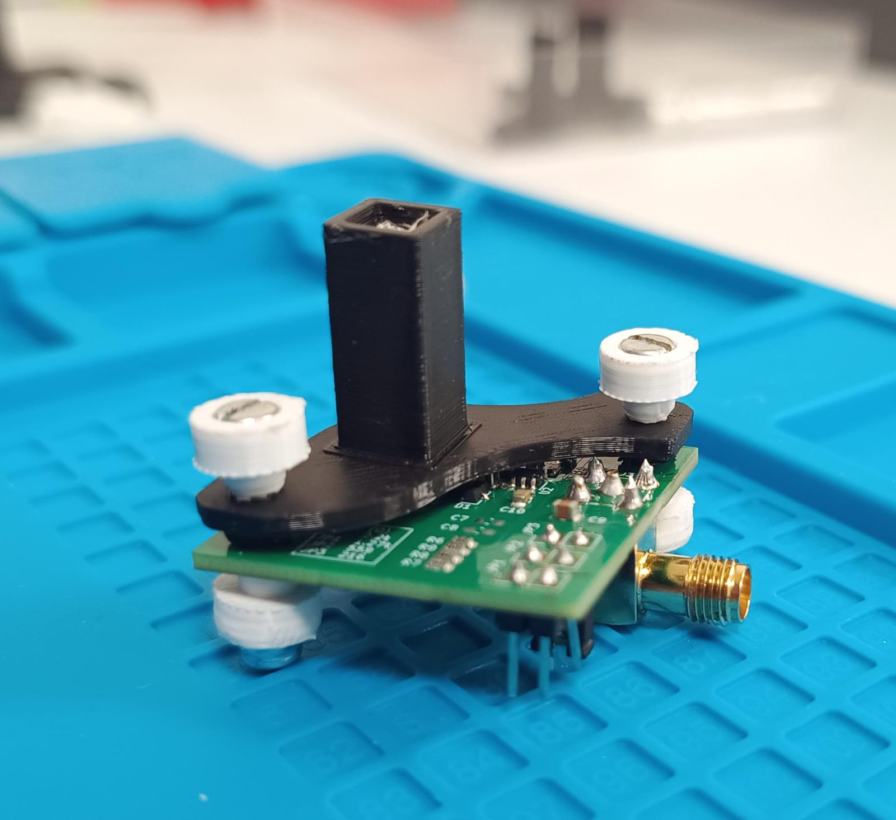

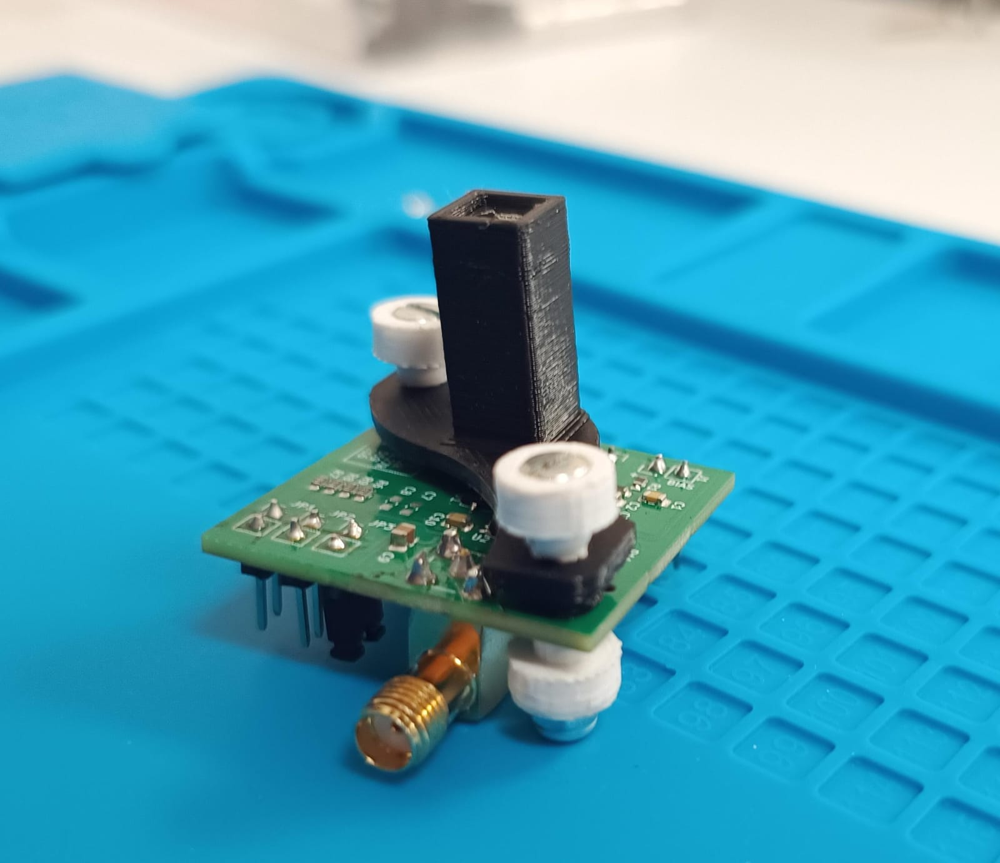

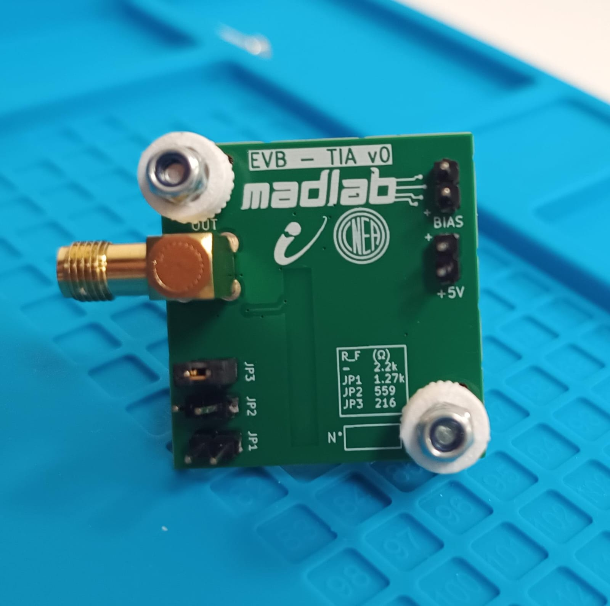

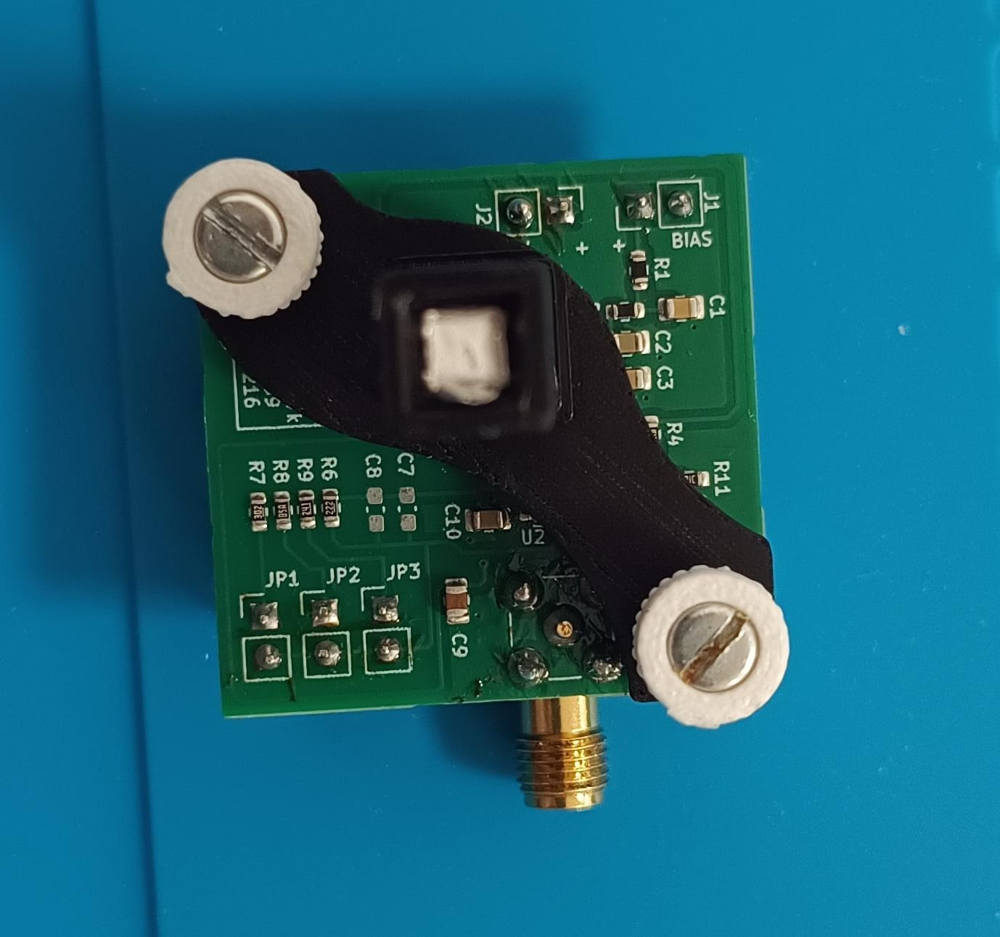

*Figuras 1 a 4. EVB-TIA v0 con el soporte impreso en 3D del LYSO, y dorso de la placa con JP3 puesto (R_F = 216 Ω).*

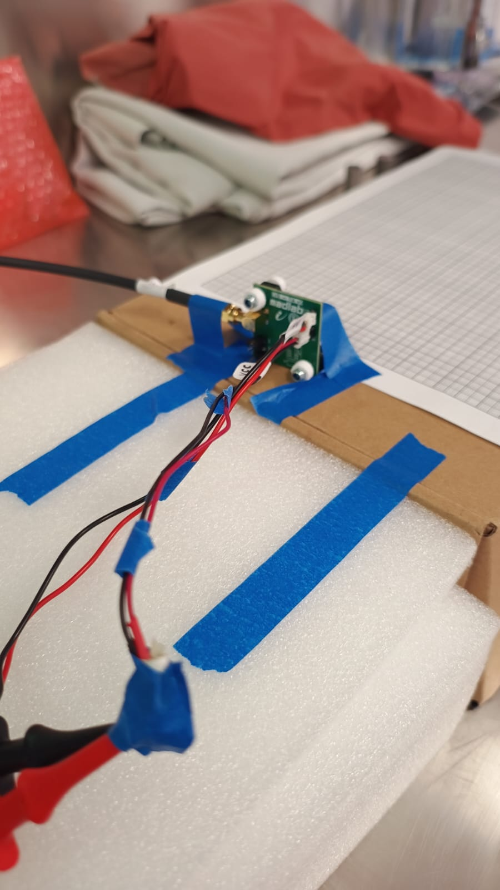

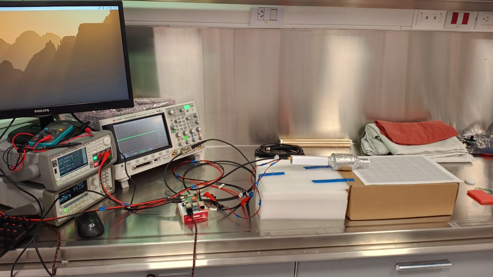

*Figuras 5 y 6. Montaje en INTECNUS: placa vertical sobre espuma y cartón, hoja milimetrada para posicionar la fuente, y banco con el osciloscopio Keysight y las fuentes.*

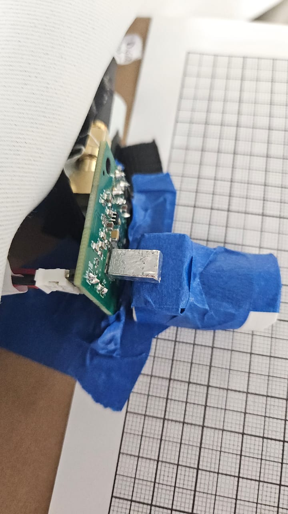

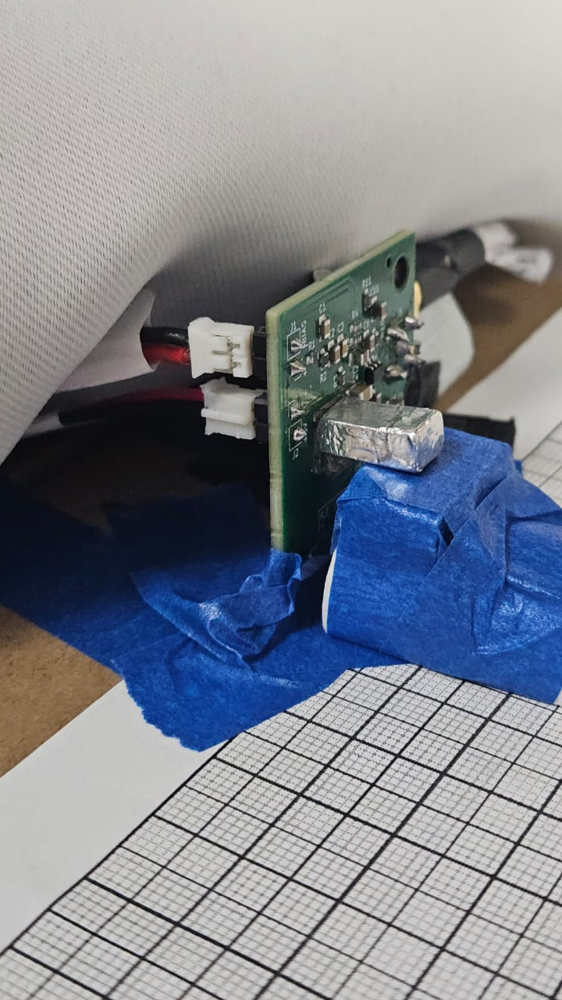

*Figuras 7 y 8. GSO envuelto en aluminio y sujeto a la placa con cinta (soporte improvisado).*

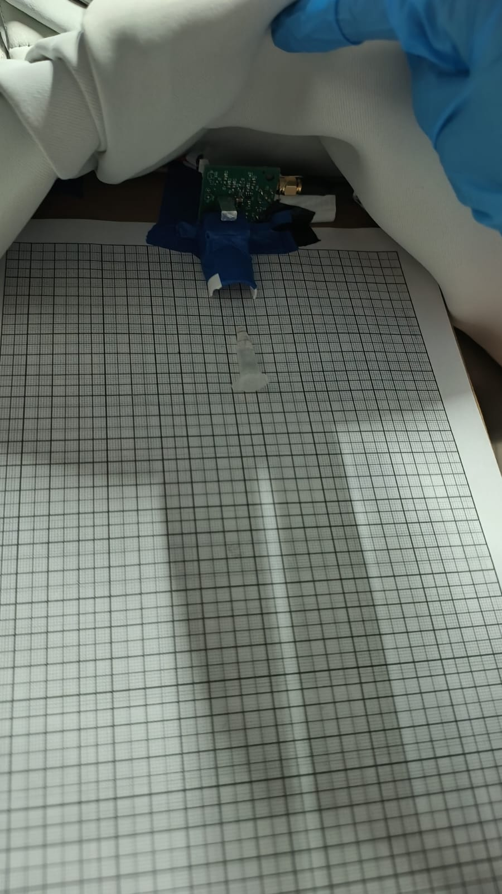

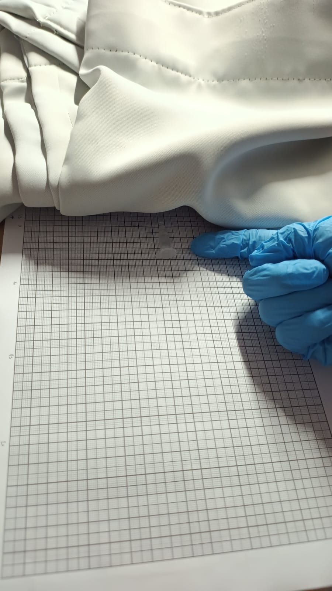

*Figuras 9 y 10. Fuente de F-18 sobre la hoja milimetrada, frente al cristal, con la placa tapada con mantas.*

## 3. Observaciones

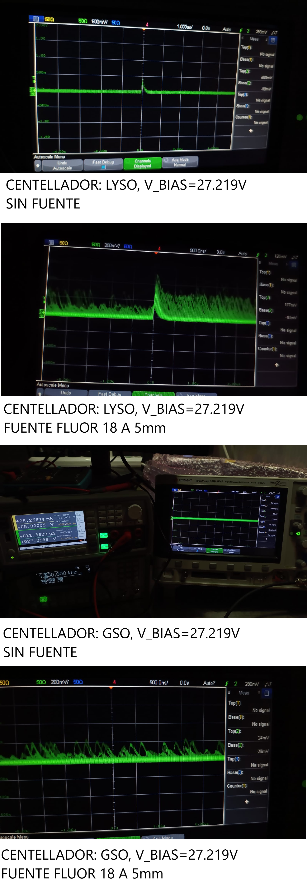

*Figura 11. Capturas del osciloscopio: LYSO sin fuente, LYSO con F-18 a 5 mm, GSO sin fuente (con la lectura de la SMU) y GSO con F-18 a 5 mm. V_bias = 27.219 V y R_F = 216 Ω en todas.*

| # | Cristal | Fuente | Escala | Qué se ve |
|---|---|---|---|---|
| 1 | LYSO | No | 500 mV/div, 1 µs/div, trigger 269 mV | Un evento aislado: fondo del Lu-176, como en los LOG 19 y 20 |
| 2 | LYSO | F-18 a 5 mm | 200 mV/div, 500 ns/div, trigger 125 mV | Pulso disparado de unos cientos de mV y muchos pulsos antes y después del trigger (apilamiento) |
| 3 | GSO | No | 200 mV/div, trigger 273 mV | Línea plana, sin pulsos |
| 4 | GSO | F-18 a 5 mm | 200 mV/div, 500 ns/div, trigger 280 mV | Muchos pulsos de ~150–200 mV en toda la pantalla, ninguno alineado en t = 0 |

- **Los dos cristales ven el F-18.** La diferencia con y sin fuente es evidente en los dos.
- **El GSO sin fuente funciona como control.** Sin radiactividad propia apreciable no aparece nada, lo que apoya que los eventos del LYSO sin fuente son del Lu-176 (LOG 19).
- **Los pulsos del GSO son más chicos que los del LYSO**, a ojo del orden de 1/3. Es coherente con que el GSO produce bastante menos luz que el LYSO.
- **Con el LYSO a 5 mm de la fuente se ve apilamiento.** Con la persistencia de pantalla no se puede sacar la tasa.
- **En la captura 4 el osciloscopio no disparó** ("Auto?"): el trigger (280 mV) quedó por encima de los pulsos del GSO, así que son barridos sin disparo.
- **Corriente del SiPM con GSO y sin fuente: 11.36 µA** (lectura de la SMU, figura 11). En el lab, a V_br + 2.5 V, la corriente oscura daba ~0.4–0.6 µA (LOG 5). No quedó determinado a qué se debe la diferencia.
- **Se observó una clara variación entre la cantidad de pulsos observados y la distancia de la fuente a la placa**

## 4. Limitaciones

| Tema | Detalle |
|---|---|
| Cualitativa | Solo fotos de pantalla, con persistencia; sin archivos ni histogramas |
| Osciloscopio | Keysight en lugar del LeCroy, así que no es comparable directamente con los LOG 17–20 |
| Temperatura | No medida: la sobretensión real en INTECNUS no se conoce |
| GSO | Soporte improvisado, posición y acople no controlados como en el LYSO |
| Escalas | Las capturas tienen escalas y triggers distintos entre sí |

## Decisiones técnicas y lecciones

| Decisión / lección | Justificación | Impacto futuro |
|---|---|---|
| Medición cualitativa con lo disponible | El LeCroy no estaba disponible y no había setup para medir cuantitativamente | Confirma que la cadena detecta F-18; lo cuantitativo requiere el setup correspondiente |
| Primer uso del soporte impreso del LYSO | Se usó en condiciones reales fuera del lab | El GSO necesita su propio soporte |

---

## Pendientes

- [ ] Subir las figuras y fotos a `docs/images/logs/`

---

## Archivos

| Archivo | Contenido |
|---|---|
| `21_fig1_capturas_osciloscopio.png` | Recopilación de las cuatro capturas del osciloscopio |
| `21_foto1_soporte_lyso_lateral.png`, `21_foto2_soporte_lyso_lateral2.png` | Soporte impreso del LYSO, vistas laterales |
| `21_foto3_evb_dorso_jumpers.png` | Dorso de la EVB-TIA v0, JP3 puesto |
| `21_foto4_soporte_lyso_superior.png` | Soporte impreso del LYSO, vista superior |
| `21_foto5_montaje_intecnus.png` | Montaje de la placa en INTECNUS |
| `21_foto6_banco_intecnus.png` | Banco de medición en INTECNUS |
| `21_foto7_gso_soporte_improvisado.png`, `21_foto8_gso_soporte_improvisado2.png` | GSO con soporte improvisado |
| `21_foto9_fuente_frente_cristal.png` | Fuente frente al cristal, placa tapada |
| `21_foto10_fuente_f18.png` | Fuente de F-18 sobre la hoja milimetrada |

## Referencias

- **LOG 19 (10/11):** primeros eventos de centelleo con LYSO; atribución del fondo al Lu-176.
- **LOG 20 (12/11):** escala de energía preliminar con el Lu-176.
- **LOG 5 (24/08):** corriente oscura de los SiPM a V_br + 2.5 V.

---

*Log generado al finalizar la sesión del 19 de noviembre de 2026.*
