# 22 LOG — Viernes 20 de noviembre de 2026

## Campaña de medición con F-18 en INTECNUS: distancia, sensibilidad lateral y angular, blindaje de tungsteno y fantoma NEMA (GSO)

**Tipo:** sesión de medición en INTECNUS (20/11) y análisis de los datos (20/11 y 21/11). Las mediciones las hicimos con Lara Torletti, en el marco de su tesis de maestría. Esta vez con el LeCroy y archivos .trc, a diferencia del LOG 21.
**Continúa:** LOG 21 (primera medición cualitativa con F-18) y LOG 20 (escala de energía preliminar con el Lu-176).

**Estado al cierre:** medimos con F-18 cristales de GSO de cuatro largos en distintas configuraciones y sacamos más de 13 GB de .trc. La EVB-TIA v0 resuelve el fotopico de 511 keV del F-18 con una FWHM de 11.8 a 18.6 % según el cristal y la configuración. El espectro tiene las mismas estructuras que un espectro de referencia de F-18 (fotopico y pico de retrodispersión en ~0.17 MeV). La tasa de cuentas baja con la distancia, pero ni A/d² ni A/(d + d0)² describen bien los datos (χ² muy alto en todas las series). El blindaje de tungsteno baja ~30 % el pico de retrodispersión y agrega un pico nuevo en ~55 keV, compatible con los rayos X K del tungsteno. Analicé en detalle solo una parte de los datos; el resto queda para después de los finales.

---

> [!IMPORTANT]
> ## HITO 9 — PRIMEROS ESPECTROS DEL F-18 CON EL FOTOPICO DE 511 keV RESUELTO
>
> **La EVB-TIA v0 con GSO mide el espectro del F-18 con el fotopico de 511 keV separado del Compton** (FWHM 11.8 a 18.6 %). Campaña completa en INTECNUS con distancia, sensibilidad lateral y angular, blindaje y fantoma NEMA.
>
> | Hito | Fecha | Resultado |
> |---|---|---|
> | 6 | 10/11 | Primeros eventos de centelleo (LYSO, Lu-176) con la EVB-TIA v0 (LOG 19) |
> | 7 | 12/11 | Escala de energía preliminar con el Lu-176 intrínseco (LOG 20) |
> | 8 | 19/11 | Primeros eventos con F-18 (LYSO y GSO), cualitativo, en INTECNUS (LOG 21) |
> | **9** | **20/11** | **Primeros espectros del F-18 con el fotopico resuelto; campaña de distancia, lateral, angular, blindaje y NEMA** |

---

## 1. Objetivo de la sesión

Medir de forma cuantitativa la respuesta de la EVB-TIA v0 con GSO al F-18, que es el radiofármaco objetivo del PI, en las situaciones que importan para la sonda:

- Tasa de cuentas contra distancia a la fuente, para varios largos de cristal.
- Sensibilidad lateral y angular, con y sin blindaje de tungsteno.
- Respuesta con un fantoma NEMA.

## 2. Setup

| Qué | Detalle |
|---|---|
| Lugar | INTECNUS |
| Placa | EVB-TIA v0 con el SiPM onsemi MICROFC-60035-SMT, R_F = 216 Ω (JP3), igual que en el LOG 21 |
| Bias del SiPM | V_bias = 27.219 V, elegido para V_ov = 2.5 V nominal. Lectura de la SMU: 27.2188 V y 11.36 µA |
| Alimentación | 5 V (5.27 mA) |
| Osciloscopio | LeCroy, modo SEQUENCE, 1000 segmentos por archivo, ventana de 1 µs (500 ns antes del trigger), muestreo de 0.2 ns, entrada DC 1 MΩ |
| Trigger | 10.5 mV en la primera mitad de las mediciones y 12 mV en la segunda. El punto exacto del cambio está **a completar** |
| Fuente | F-18 en un vial (foto 2). Actividad: **a completar** |
| Cristales | GSO de 4 × 6 mm² de sección. GSO1 = 20 mm, GSO2 = 15 mm, GSO3 = 6 mm y GSO4 = 12 mm de largo. Todas las caras pintadas de blanco y envueltas en aluminio, salvo la que se acopla al SiPM |
| Blindaje | Cilindro de tungsteno (W) con apertura axial de 8 mm, pared de 5.20 mm y largo de 36.10 mm. En los nombres de archivo, la W después del cristal (GSO3W, GSO4W) indica que se midió con blindaje |
| Soporte | Soporte impreso en 3D del GSO |
| Temperatura | 22.8 °C en la tanda de 20 cm de la mañana; en el resto no está registrada |
| Registro | Títulos del LeCroy con el punto medido: `med_<n>_pd<cristal>_X<cm>_Y<cm>_A<grados>_med` ('p' es el punto decimal y 'neg' el signo menos). X es la posición lateral, Y la distancia fuente–placa y A el ángulo |

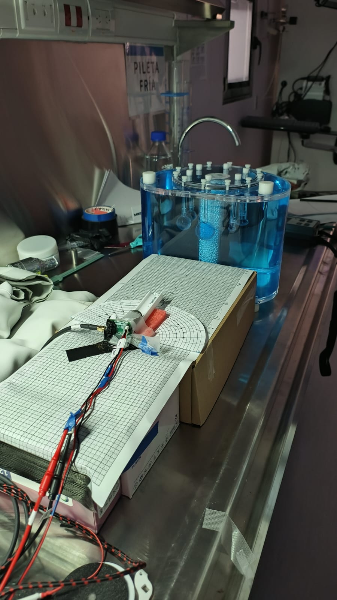

*Foto 1. Placa con el blindaje cilíndrico sobre la hoja milimetrada y la hoja polar que usamos para fijar el ángulo. Atrás, el fantoma NEMA.*

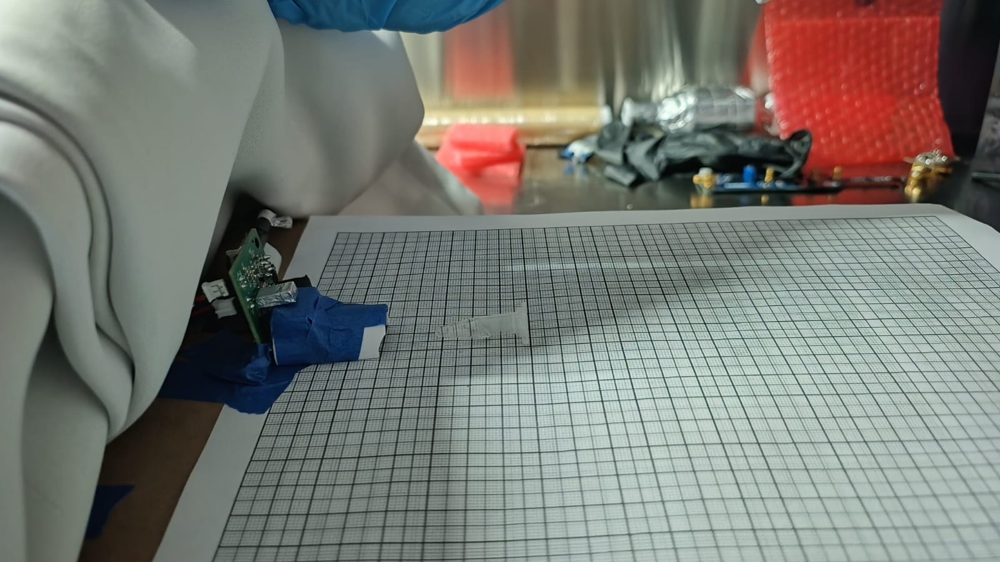

*Foto 2. Fuente de F-18 en un vial, parado sobre la hoja milimetrada frente al cristal.*

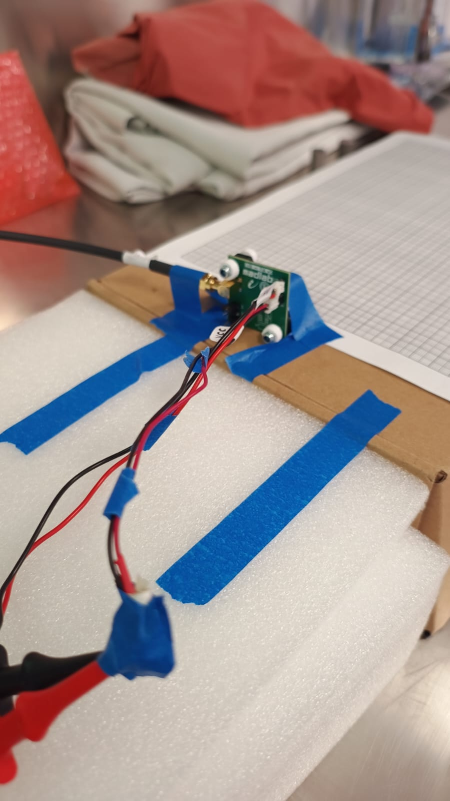

*Foto 3. Sujeción de la placa, vertical y pegada con cinta al borde de una caja, con la hoja milimetrada adelante.*

## 3. Mediciones

| Serie | Carpeta | Cristal | Puntos | Hora |
|---|---|---|---|---|
| Distancia (mañana) | `analisis\Med*` | GSO (4 × 6 × 20 mm³) | fondo, Y = 10, 20 y 30 cm | 11:19–12:01 |
| Distancia | `Autosave_GSO2` | GSO2 (15 mm) | fondo, Y = 2.5 a 35 cm (8 puntos) | 13:03–13:35 |
| Distancia | `Autosave_GSO1_again` | GSO1 (20 mm) | Y = 2.5 a 35 cm (8 puntos) | 13:52–14:51 |
| Distancia | `Autosave_GSO3` | GSO3 (6 mm) | fondo, Y = 2.5 a 35 cm (8 puntos) | 15:05–15:39 |
| Lateral con blindaje | `lateral` | GSO3W | Y = 15 cm, X = −7.5 a 7.5 cm cada 2.5 cm | desde 16:03 |
| Lateral con blindaje, otra geometría | `diflateralblindaje` | GSO3W | (X, Y) = (0, 5), (5, 0), (2.5, 0) y (0, 2.5) cm | desde 16:39 |
| Angular con blindaje | `sensibilidad_angular` | GSO3W | Y = 7.5 cm, A = 0 a 180° cada 30° | desde 16:59 |
| Fantoma NEMA | `nema` | GSO3 (6 mm) | MEMA y NEMApos1 a NEMApos4 | desde 17:33 |
| Distancia y lateral con blindaje | `lateral12mm` | GSO4W (12 mm) | fondo, Y = 2.5 a 15 cm (X = 0), y Y = 15 cm con X = −7.5 a 7.5 cm | desde 18:33 |

Tomamos 20 o más archivos de 1000 disparos por punto. Sin contar la serie de la mañana ni `Autosave_GSO2`, la reducción tiene 1480 archivos y 1 479 079 eventos.

## 4. Herramientas de análisis

| Script | Qué hace |
|---|---|
| `exploratorio_intecnus.py` v0.6 | Figura de 4 paneles por punto: persistencia, amplitud contra área, espectro de áreas con el ajuste del fotopico y tasa de disparo de cada archivo |
| `tasa_distancia_intecnus.py` v0.6 | Tasa contra distancia desde los .trc, con los ajustes A/d² y A/(d + d0)² |
| `espectro_energia_f18.py` v0.3 | Espectro en energía con calibración de un punto (fotopico = 511 keV, lineal por cero) |
| `reducir_intecnus.py` v0.2 | Lee una vez todos los .trc y guarda una tabla por archivo (`reduccion_archivos.csv`) y una por evento (`reduccion_eventos.npz`, ~20 MB) |
| `series_intecnus.py` v0.2 | Recorre todas las carpetas y genera las figuras de cada punto y de cada serie |
| `comparar_blindaje.py` v0.1 | Compara los espectros de un mismo punto con y sin blindaje |

Criterios comunes a todos los scripts:

- Área del pulso: integral de (v − base) entre t_cf − 40 ns y t_cf + 460 ns, en V·ns, tal como sale del osciloscopio. No la convierto a carga con la Q_SPE porque la Q_SPE sigue siendo provisoria.
- Evento limpio: sin otro pulso en los ~500 ns previos y sin un segundo pulso dentro de la ventana de integración. Los cortes usan la mediana más 5σ robusta del estadístico en cada archivo.
- Tasa de un punto: media de las tasas de disparo de sus archivos, sin los archivos a más de 5σ de Poisson de la mediana. La barra de error es la dispersión entre archivos dividida por √n.
- Sin corrección por decaimiento del F-18 ni umbral común entre puntos.

## 5. Resultados

### 5.1 Primera tanda de la mañana (10, 20 y 30 cm)

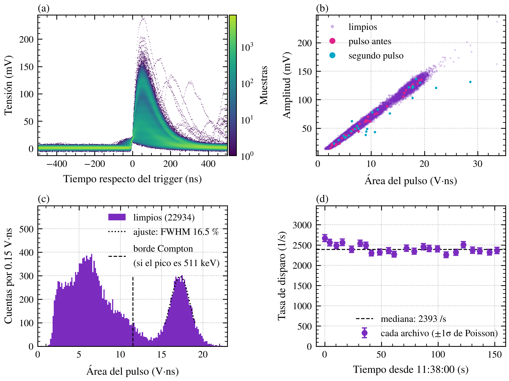

*Figura 1. Medición a 20 cm (23 archivos). (a) persistencia, (b) amplitud contra área de cada evento, (c) espectro de áreas de los eventos limpios con el ajuste del fotopico, (d) tasa de disparo de cada archivo.*

- A 20 cm el fotopico queda en 17.24 ± 0.02 V·ns (amplitud mediana 121 mV), con FWHM 16.5 %. La caída del continuo Compton coincide con el borde esperado si el pico es el de 511 keV (0.667 × fotopico = 11.50 V·ns).
- Los eventos apilados son 0.3 % del total a 2414 /s.
- El ancho de la base en la persistencia (σ ≈ 1.6 mV) no es ruido. Es el escalón del ADC de 8 bits con la pantalla de ~400 mV (400 mV / 256 ≈ 1.6 mV). En el fondo, con pantalla de 80 mV, la base da 0.4 mV.

| Medición | Tasa (1/s) | Fotopico (V·ns) | FWHM |
|---|---|---|---|
| 10 cm | 7801 ± 54 | señal recortada | — |
| 20 cm | 2414 ± 22 | 17.24 | 16.5 % |
| 30 cm | 1057 ± 8 | 17.19 | 17.7 % |

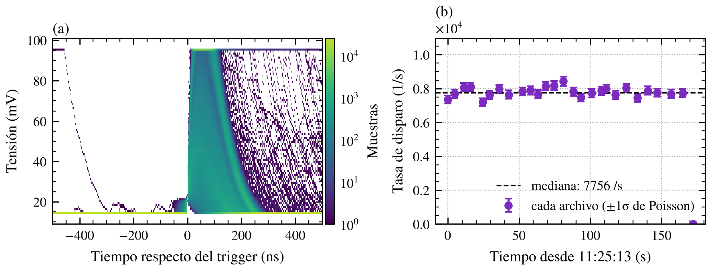

*Figuras 2 y 3. Mediciones a 10 cm (señal recortada, solo persistencia y tasa) y a 30 cm.*

- La medición de 10 cm quedó con la escala vertical mal puesta (10 mV/div, offset −55 mV), así que la pantalla iba de 15 a 95 mV. La base quedó fuera de pantalla (el 80 % de las muestras está en el tope inferior del ADC) y los pulsos de más de 95 mV están recortados, incluido el fotopico. Solo sirve la tasa, con un umbral efectivo más alto (~21.6 mV) que a 20 y 30 cm.
- En el último archivo de 10 cm (19 disparos en 2.9 s) y en el último de 30 cm (la tasa cae de ~1075 a ~500 /s dentro del archivo) la fuente se estaba retirando. Quedan afuera de la tasa por el criterio de 5σ.

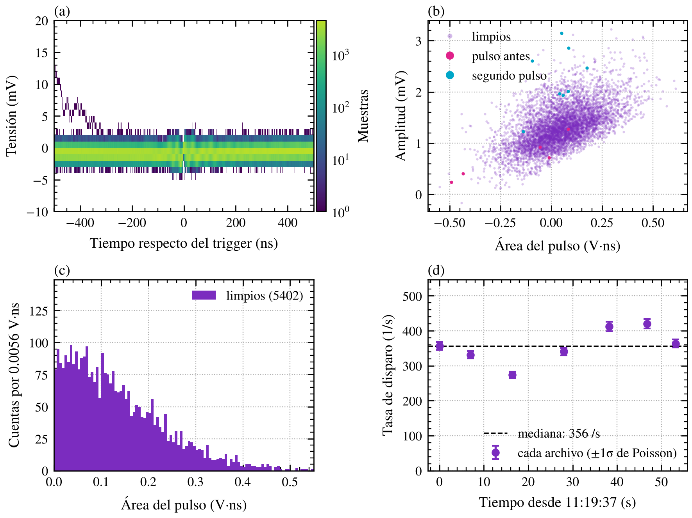

*Figura 4. Fondo de la mañana (sin fuente), con el trigger casi en el ruido.*

- El fondo se tomó con el trigger casi en el ruido (~1 mV, pantalla de ±40 mV), así que los ~356 /s son disparos en ruido. En ~20 s de tiempo vivo no hay pulsos de más de ~3 mV. El fondo por encima del trigger de las mediciones con fuente es del orden de 0.1 /s o menos, despreciable frente a los ~1000 /s a 30 cm.

### 5.2 Espectro en energía y comparación con un espectro de referencia

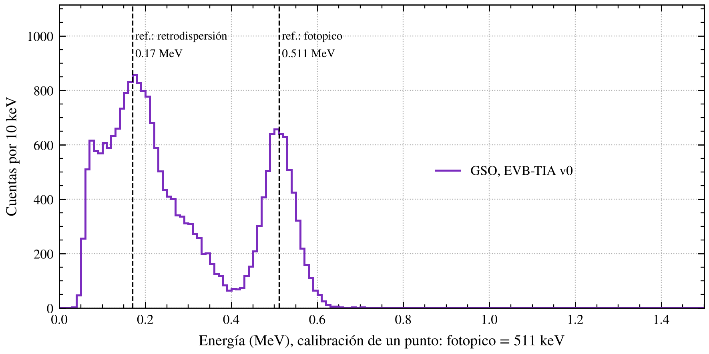

*Figura 6. Espectro en energía de la medición a 20 cm (22 934 eventos limpios), con calibración de un punto (fotopico = 511 keV).*

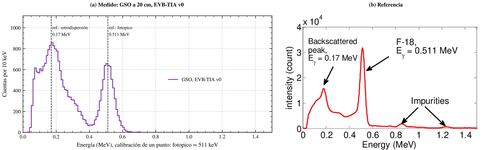

*Figura 7. (a) Espectro medido a 20 cm. (b) Espectro de referencia de F-18 (fuente a completar).*

| Rasgo | Referencia | GSO a 20 cm |
|---|---|---|
| Pico de retrodispersión | 0.17 MeV | máximo en 0.175 MeV |
| Valle entre Compton y fotopico | ~0.37 MeV | ~0.40 MeV |
| Fotopico / valle | ~7 | 6.8 |
| Fotopico / retrodispersión | ~2 | 0.7 |
| FWHM del fotopico | ~10 % (a ojo) | 16.5 % |

- El fotopico en 511 keV no es una verificación, porque lo fijé así al calibrar. Lo que sí sale de la medición es dónde caen las demás estructuras con esa escala, y coinciden con la referencia.
- El pico de retrodispersión lo forman fotones de 511 keV que rebotan a ~180° en los materiales que rodean al cristal y vuelven con 511/3 ≈ 170 keV.
- En el GSO el fotopico pesa menos frente al Compton que en la referencia. La hipótesis es el tamaño chico del cristal, en el que muchos fotones dispersan una vez y escapan. No conozco el detector de la referencia, así que no lo puedo confirmar.
- Las cuentas por debajo de ~0.2 MeV no son ruido. Son eventos de Compton en el propio cristal y caen sobre la misma banda de amplitud contra área que el fotopico.

### 5.3 Tasa de cuentas contra distancia

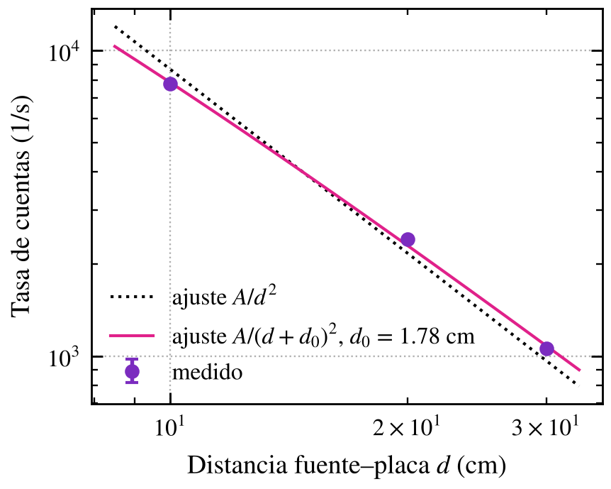

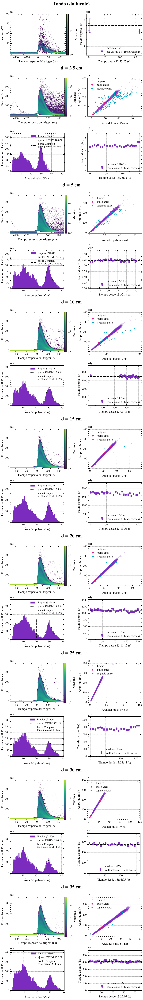

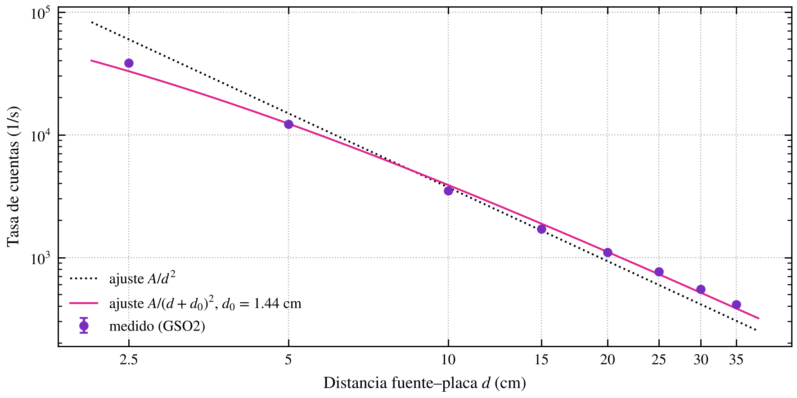

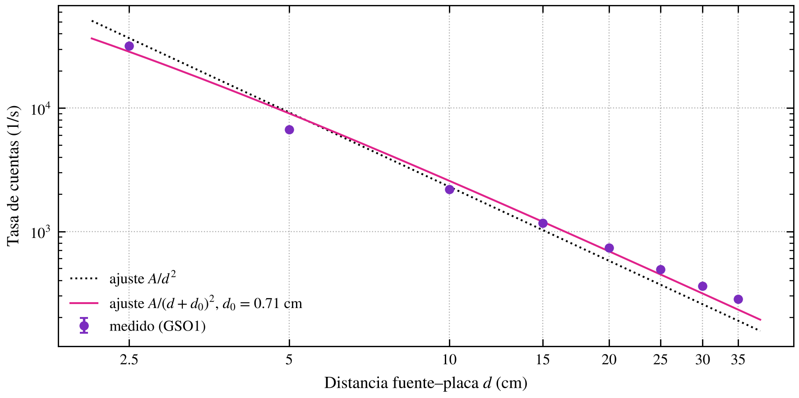

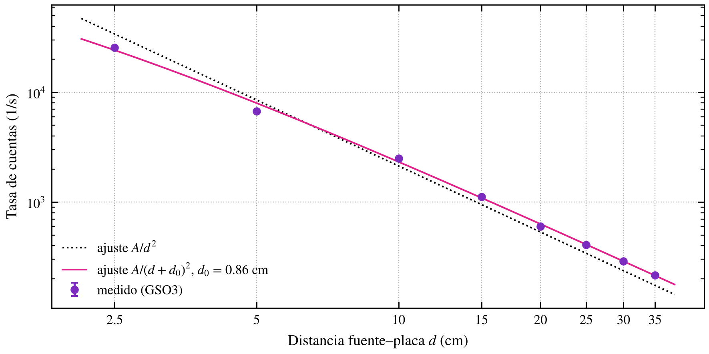

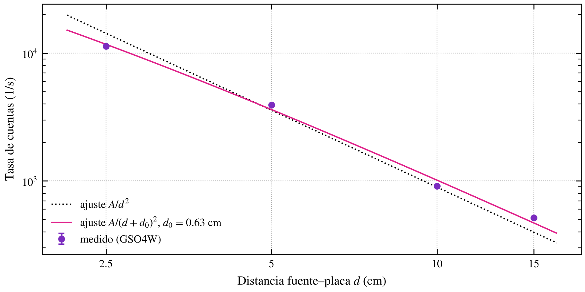

*Figuras 5 y 8 a 12. Serie de la mañana, exploratorios de la serie GSO2 (fondo y 2.5 a 35 cm) y tasa contra distancia de GSO2, GSO1, GSO3 y GSO4W, con los ajustes A/d² (punteado) y A/(d + d0)² (magenta).*

| Serie | Puntos | A/d²: χ² (g.l.) | A/(d + d0)²: d0 | A/(d + d0)²: χ² (g.l.) |
|---|---|---|---|---|
| Mañana | 10, 20, 30 cm | 529 (2) | 1.78 ± 0.09 cm | 37 (1) |
| GSO2 | 2.5 a 35 cm | 9107 (7) | 1.42 ± 0.02 cm | 1014 (6) |
| GSO1 | 2.5 a 35 cm | 13 968 (7) | 0.71 ± 0.01 cm | 6149 (6) |
| GSO3 | 2.5 a 35 cm | 9317 (7) | 0.86 ± 0.01 cm | 1092 (6) |
| GSO4W | 2.5 a 15 cm | 2333 (3) | 0.63 ± 0.02 cm | 658 (2) |

- Agregar d0 baja mucho el χ², pero en ninguna serie el ajuste es bueno, ya que los apartamientos del modelo son mucho mayores que las barras de error.
- En GSO2 la tasa va de 38 502 /s a 2.5 cm a 414 /s a 35 cm. A 10 cm el fotopico queda en ~30 V·ns, y la FWHM va de 16.6 a 18.6 % según la distancia.
- El decaimiento del F-18 afecta a las series. En GSO1 el punto de 2.5 cm se midió a las 13:52 y el resto entre 14:27 y 14:51 (la fuente decae entre 20 y 30 % en ese tiempo), y en GSO3 las distancias se midieron en orden creciente durante 30 minutos. Probé corregirlo y el χ² sigue muy alto, así que el decaimiento no explica por sí solo el desacuerdo.
- Hipótesis para d0, sin verificar: el punto de referencia de la distancia (placa contra cristal), la profundidad de interacción en el cristal y la geometría de la fuente.

### 5.4 Sensibilidad lateral

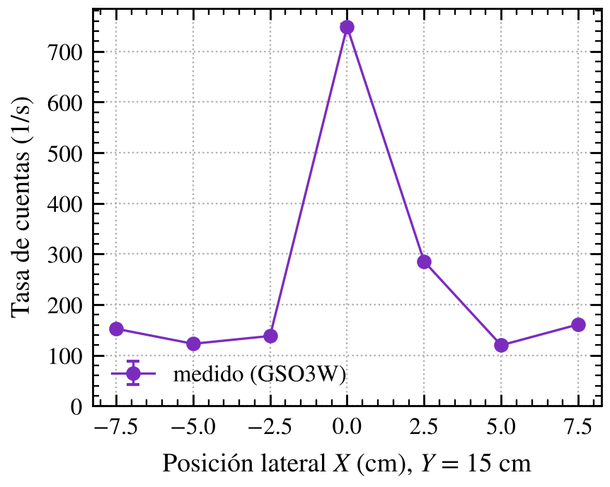

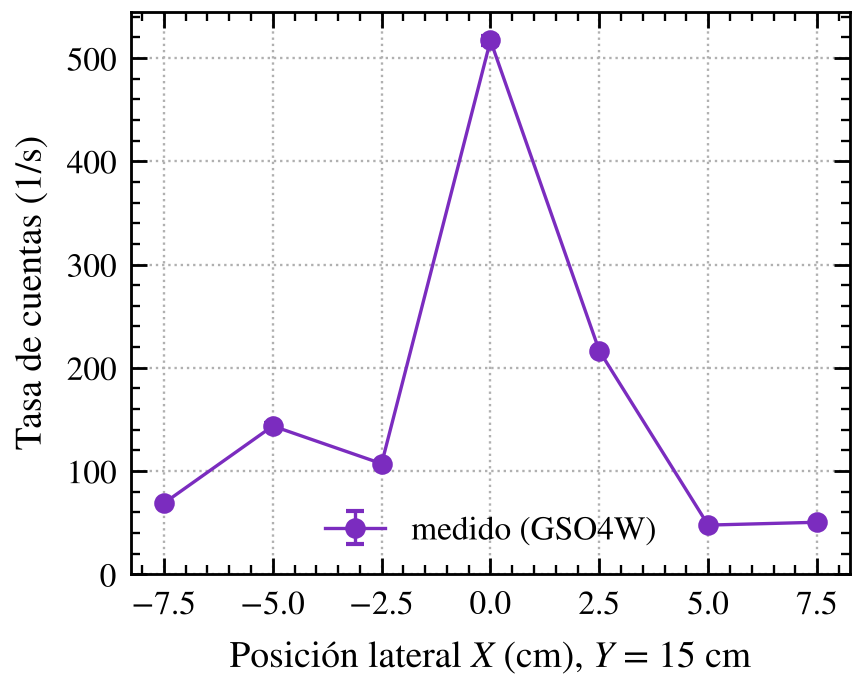

*Figuras 13 y 14. Tasa contra posición lateral a Y = 15 cm, con blindaje, para GSO3W (6 mm) y GSO4W (12 mm).*

| X (cm) | −7.5 | −5 | −2.5 | 0 | 2.5 | 5 | 7.5 |
|---|---|---|---|---|---|---|---|
| GSO3W (1/s) | 153 | 123 | 138 | 749 | 285 | 120 | 161 |
| GSO4W (1/s) | 69 | 144 | 107 | 517 | 216 | 48 | 50 |

- Con el blindaje, a 2.5 cm del eje la tasa ya baja a entre 18 y 42 % de la del centro.
- El perfil no es simétrico. A ±2.5 cm, en GSO3W la tasa es 285 /s de un lado y 138 /s del otro.
- En GSO3W la tasa sube de ±5 a ±7.5 cm en los dos lados.
- En GSO4W, cinco archivos de X = −5 cm dan entre 68 y 83 /s, el mismo valor que X = −7.5 cm, mientras el resto da ~140 /s. No sabemos si en esos archivos la fuente estaba en otra posición.

### 5.5 Sensibilidad angular

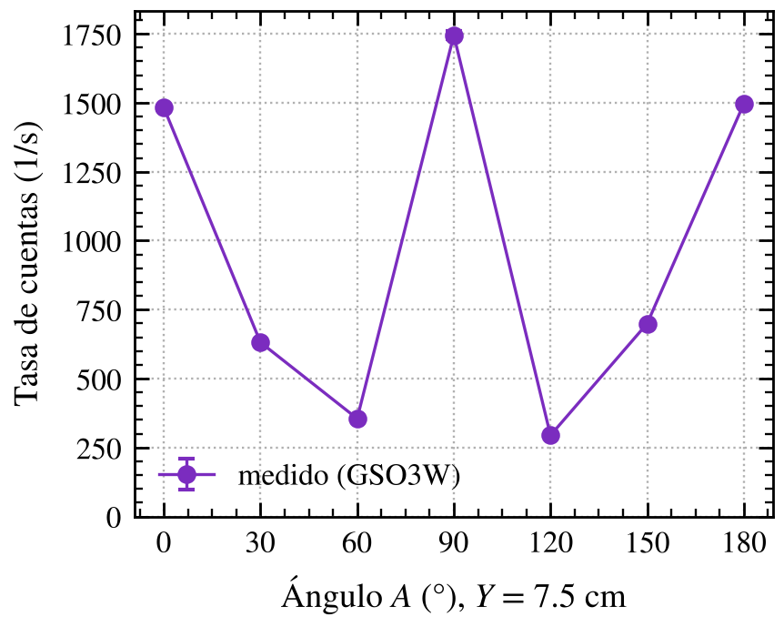

*Figura 15. Tasa contra ángulo a Y = 7.5 cm, con blindaje (GSO3W).*

| A (°) | 0 | 30 | 60 | 90 | 120 | 150 | 180 |
|---|---|---|---|---|---|---|---|
| Tasa (1/s) | 1482 | 631 | 355 | 1745 | 294 | 699 | 1496 |

- Hay máximos en 0°, 90° y 180° y mínimos en 60° y 120°. Las tasas a 0° y 180° son casi iguales (1482 y 1496 /s).

### 5.6 Blindaje de tungsteno

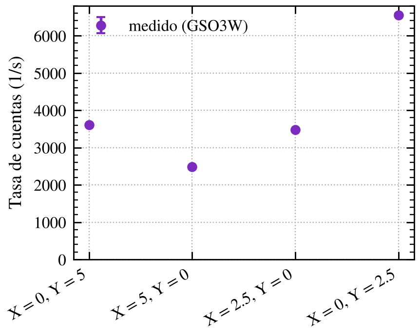

*Figura 16. Tasa de los puntos de `diflateralblindaje` (GSO3W).*

| (X, Y) (cm) | (0, 2.5) | (0, 5) | (2.5, 0) | (5, 0) |
|---|---|---|---|---|
| Tasa (1/s) | 6555 | 3602 | 3478 | 2477 |

Para ver el efecto del blindaje comparé el mismo punto (X = 0, Y = 5 cm) sin W (`med_23`, GSO3, 15:14) y con W (`med_37`, GSO3W, 16:39), normalizando por cantidad de mediciones (cuentas por archivo de 1000 disparos). El script recorre todo el espectro en intervalos de 5 keV y marca solo las zonas con al menos dos intervalos seguidos a más de 3σ.

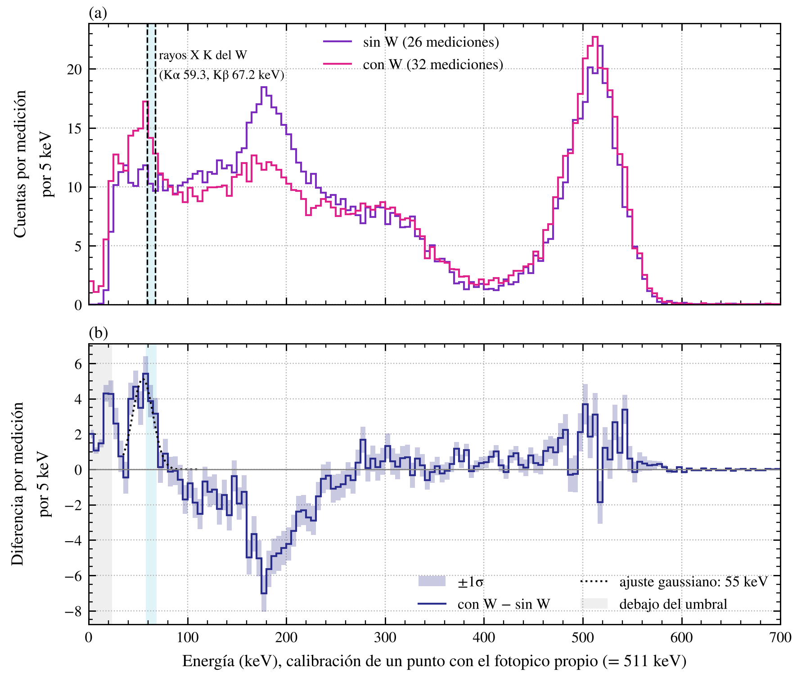

*Figura 18. (a) Espectros en energía sin W (26 mediciones) y con W (32 mediciones), normalizados por medición; la franja celeste marca los rayos X K del tungsteno. (b) Diferencia (con W − sin W) con ±1σ.*

| Zona | Con W − sin W (cuentas por medición) | Lectura |
|---|---|---|
| 0–25 keV | +175 % | No interpretable, está en el umbral |
| 40–70 keV | +24.6 ± 2.3 (+39 %) | Pico nuevo |
| 160–210 keV | −48 ± 3 (−30 %) | Retrodispersión |
| 220–230 keV | −26 % | Cola de la retrodispersión |

- El ajuste gaussiano de la diferencia da un pico en 54.8 ± 1.4 keV con σ 10.3 ± 1.4 keV. Es compatible con los rayos X K del tungsteno (Kα 58.0 y 59.3 keV, Kβ 67.2 keV), que se producen cuando un fotón ioniza la capa K del tungsteno del blindaje. El centro queda ~4.5 keV por debajo de Kα. Una hipótesis es que la escala de un punto no vale a tan baja energía, porque el cristal no produce luz exactamente proporcional a la energía. El ancho es compatible con el esperado si la resolución escala como 1/√E (~8.8 keV), sumando que Kα y Kβ no se resuelven.
- En la reducción, el pico de ~55 keV aparece en 20 de los 27 puntos con blindaje que pude evaluar (GSO3W y GSO4W), sin aparecer en varios de los puntos laterales desplazados ni en A = 90°, y en ninguno de los 8 puntos de distancia de GSO3 sin blindaje, cuyo umbral (< 25 keV) permitiría verlo. También aparece en NEMApos4 (GSO3, sin blindaje), lo cual no está explicado. GSO1 no sirve de control porque su umbral quedó en ~60 keV.
- La zona de la retrodispersión baja ~30 %. La hipótesis es que el blindaje frena fotones que se dispersan en los materiales de alrededor y llegan al cristal por los lados o por detrás, de forma que mejora la selectividad direccional de la sonda. Al costo de agregar los rayos X del tungsteno, que quedan lejos de 511 keV y se descartan con una ventana de energía.
- El Compton entre 250 y 480 keV y el fotopico no cambian de forma significativa. El apilamiento es 0.33 y 0.32 %, y la FWHM 11.8 y 12.3 %.
- En tasa por segundo, corrigiendo el decaimiento entre las dos mediciones (×1.72 para med_37), el fotopico queda igual (1791 y 1817 /s), la retrodispersión baja (×0.69) y la zona de 35 a 75 keV sube (×1.18).
- La base de med_37 estaba en 4.73 mV y la de med_23 en 1.05 mV. Si med_23 se midió con el trigger en 10.5 mV y med_37 con 12 mV, sobre la base el trigger queda en 9.45 y 7.27 mV, lo cual explica que med_37 registre más eventos por debajo de 25 keV. En los datos, los pulsos más chicos que disparan tienen ~14 a 17 mV sobre la base, más que esos valores, y no sé a qué se debe.

### 5.7 Fantoma NEMA

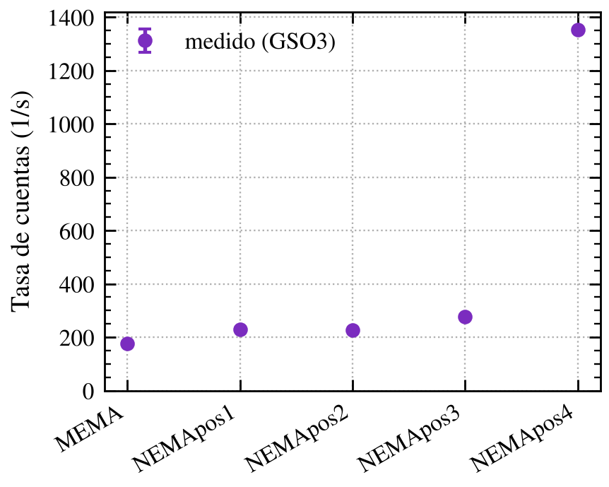

*Figura 17. Tasa de cada posición con el fantoma NEMA (GSO3).*

| Posición | MEMA | NEMApos1 | NEMApos2 | NEMApos3 | NEMApos4 |
|---|---|---|---|---|---|
| Tasa (1/s) | 177 | 229 | 227 | 277 | 1352 |

- En todas las posiciones la dispersión entre archivos es 3 a 4 veces la de Poisson.

### 5.8 Calidad de los datos

- Siete archivos quedaron incompletos (el último del autosave de cada punto) y los scripts los saltean.
- El punto `med_37` está copiado en `lateral` y en `diflateralblindaje`, y lo cuento una sola vez.
- Algunos archivos sueltos tienen la tasa disparada en medio de una serie estable y después la tasa vuelve sola a su valor. En GSO1 a 30 cm un archivo da 28 310 /s contra ~360 /s del resto, y en GSO3W a X = −5 cm seis archivos seguidos (16:29:45 a 16:30:09) llegan a 16 234 /s contra ~125 /s. Una hipótesis es otra fuente o un paciente inyectado pasando cerca. El criterio de 5σ los excluye.
- En `Med06_10cm` (GSO2) el primer archivo es de las 13:03:15 y el siguiente es ~4 minutos posterior.

## 6. Limitaciones

| Tema | Detalle |
|---|---|
| Calibración en energía | Un solo punto (511 keV), lineal por cero; las energías bajas no están verificadas |
| Decaimiento del F-18 | Las tasas no están corregidas; las series duran hasta 1 h |
| Trigger | Cambió de 10.5 a 12 mV a mitad de la campaña y no sé en qué punto; la base también cambió entre mediciones |
| Geometría | No está registrada en este LOG la posición del blindaje ni la referencia exacta de la distancia |
| Q_SPE | Provisoria, por eso los espectros quedan en V·ns |
| Análisis parcial | La mayor parte de los datos queda para después de los finales |

## Decisiones técnicas y lecciones

| Decisión / lección | Justificación | Impacto futuro |
|---|---|---|
| Espectros en área del pulso (V·ns), sin convertir a carga | La Q_SPE es provisoria; el área no depende de R_F ni de Q_SPE | La conversión a carga y a avalanchas queda para cuando la Q_SPE esté confirmada |
| Tasa de cada punto con la media de los archivos sin los que están a más de 5σ | Excluye los archivos con la fuente retirada o con fuentes externas sin elegirlos a mano | Mismo criterio en todos los scripts |
| Ajustes de distancia sobre la tasa sin corregir | Primero ver los datos tal como salen | La corrección por decaimiento queda como opción a decidir |
| Reducir los .trc una sola vez y analizar sobre la reducción | 13 GB no se pueden subir; la reducción pesa ~20 MB | Los análisis se pueden hacer sin volver a leer los .trc |
| Revisar la escala vertical antes de cada tanda | La medición de 10 cm de la mañana quedó recortada | Comprobar en pantalla que se vean la base y el fotopico |
| Dejar fija la configuración del trigger y anotar cada cambio | El cambio de trigger a mitad de la campaña complica comparar puntos | Anotar el trigger en el título o en el registro de la sesión |

---

## Pendientes

- [ ] Indicar en qué punto se cambió el trigger de 10.5 a 12 mV
- [ ] Completar con las fotos y las anotaciones de Lara la actividad de la fuente, el punto desde el que se mide Y, la posición del cristal dentro del blindaje y la definición de X y de A
- [ ] Completar la fuente del espectro de referencia de la figura 7
- [ ] Decidir si se corrige el decaimiento del F-18 en las series
- [ ] Analizar en detalle los datos de la campaña (NEMA, perfiles lateral y angular, comparación entre largos de cristal) con las herramientas de análisis de datos del curso del ICTP
- [ ] Ver qué pasó con NEMApos4 y con los archivos de GSO4W en X = −5 cm
- [ ] Correr la reducción sobre `Autosave_GSO2`
- [ ] Subir las figuras a `docs/images/logs/`

---

## Archivos

| Archivo | Contenido |
|---|---|
| `22_fig1_exploratorio_20cm.png` | Exploratorio de la medición a 20 cm (mañana) |
| `22_fig2_exploratorio_10cm_recortada.png` | Exploratorio de la medición a 10 cm, señal recortada |
| `22_fig3_exploratorio_30cm.png` | Exploratorio de la medición a 30 cm |
| `22_fig4_exploratorio_fondo.png` | Exploratorio del fondo de la mañana |
| `22_fig5_tasa_distancia_manana.png` | Tasa contra distancia de la mañana |
| `22_fig6_espectro_energia_20cm.png` | Espectro en energía a 20 cm |
| `22_fig7_comparacion_referencia.png` | Espectro a 20 cm junto al espectro de referencia |
| `22_fig8_exploratorios_GSO2.png` | Exploratorios de la serie GSO2 en una columna |
| `22_fig9_distancia_GSO2.png` | Tasa contra distancia de GSO2, graficada con los valores de la salida de consola de `tasa_distancia_intecnus.py` (el PNG original no se guardó) |
| `22_fig10_distancia_GSO1.png` a `22_fig12_distancia_GSO4W.png` | Tasa contra distancia de GSO1, GSO3 y GSO4W |
| `22_fig13_lateral_GSO3W.png`, `22_fig14_lateral_GSO4W.png` | Perfiles laterales con blindaje |
| `22_fig15_angular_GSO3W.png` | Perfil angular con blindaje |
| `22_fig16_puntos_blindaje_GSO3W.png` | Puntos de `diflateralblindaje` |
| `22_fig17_nema_GSO3.png` | Tasas con el fantoma NEMA |
| `22_fig18_comparacion_blindaje.png` | Comparación con y sin blindaje en X = 0, Y = 5 cm |
| `22_foto1_montaje_blindaje_angulo_nema.png` | Montaje con blindaje, hoja polar y fantoma NEMA |
| `22_foto2_fuente_vial.png` | Fuente en el vial frente al cristal |
| `22_foto3_sujecion_placa.png` | Sujeción de la placa |
| `reduccion_archivos.csv`, `reduccion_eventos.npz` | Reducción de la campaña (sin la serie de la mañana ni `Autosave_GSO2`) |
| `exploratorio_intecnus.py`, `tasa_distancia_intecnus.py`, `espectro_energia_f18.py`, `reducir_intecnus.py`, `series_intecnus.py`, `comparar_blindaje.py` | Scripts de análisis (sección 4) |

## Referencias

- **LOG 21 (19/11):** primera medición cualitativa con F-18 en INTECNUS.
- **LOG 20 (12/11):** escala de energía preliminar con el Lu-176.
- **LOG 18 (06/11):** Q_SPE provisoria.
- Rayos X K del tungsteno: Kα2 57.98 keV, Kα1 59.32 keV, Kβ1 67.24 keV (valores tabulados).

---

## Cierre del cuatrimestre

Este es el último LOG del cuatrimestre. Los datos de la campaña en INTECNUS quedan por ahora solo con este análisis exploratorio preliminar, porque tengo finales y el trabajo del PI queda en pausa hasta terminarlos. Son más de 13 GB de mediciones, así que en el curso del ICTP vamos a aprovechar las herramientas de análisis de datos que aprendamos para analizar esta cantidad de datos en detalle y sacar más resultados.

---

*Log generado a partir de la sesión del 20 de noviembre de 2026 y del análisis del 20 y 21 de noviembre.*
