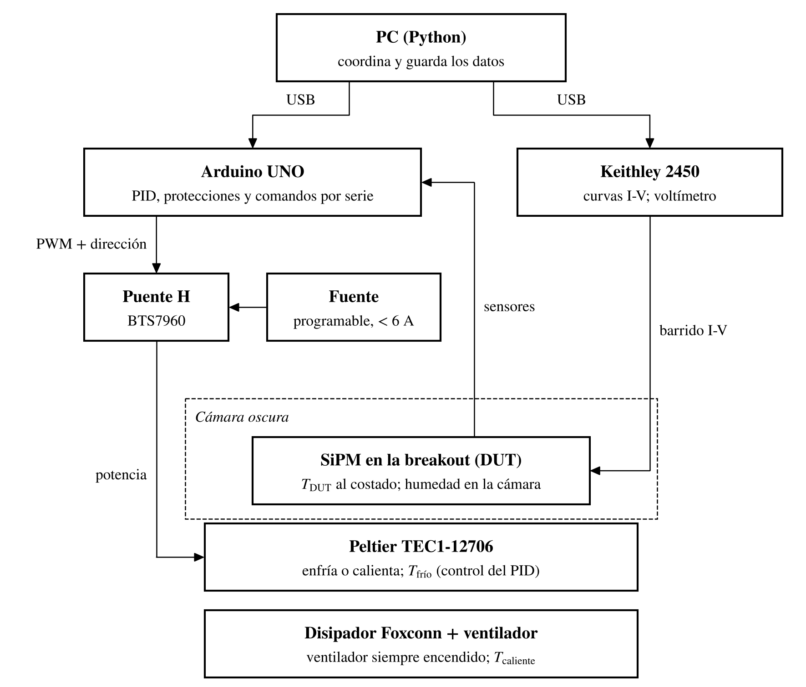
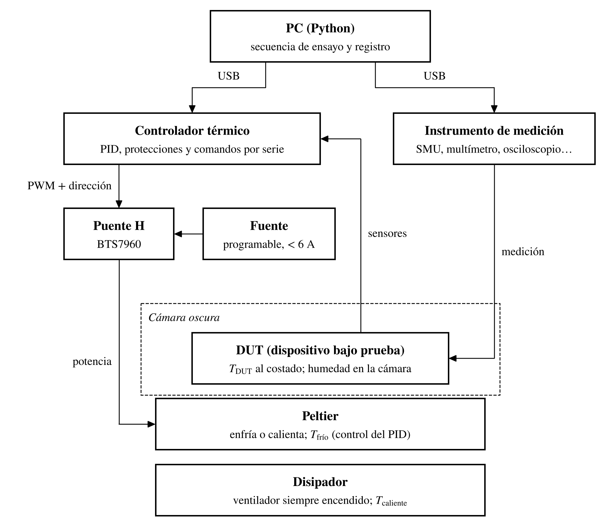
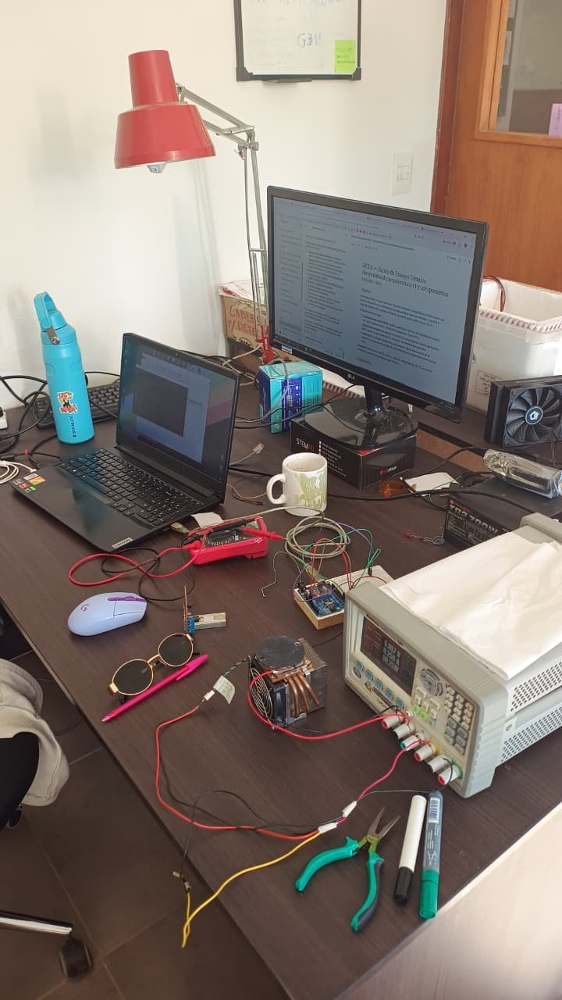
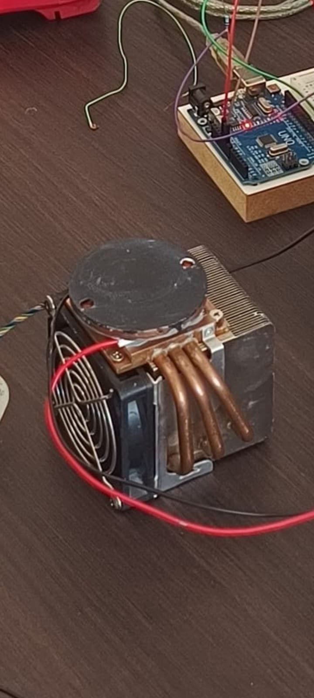
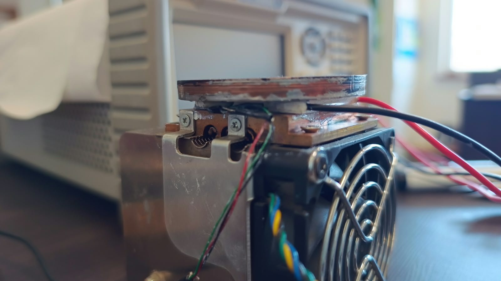

# BETA — Log de diseño

**Banco de Ensayo Térmico Automatizado**
**Autora:** Dana E. González
**Última actualización:** 11/11/2026

Registro de las decisiones de diseño de BETA: qué se decidió, por qué y qué impacto tiene. Complementa el LOG 13 (27/10), donde están la caracterización en lazo abierto y los datos medidos.

---

## 0. Criterios y plan de trabajo

**Criterio general:** es un diseño mecánico y electrónico de ingeniería. Se incluye sólo lo que hace falta para medir; nada de sobreingeniería.

**Qué tiene que medir BETA:**

1. **Curva I-V del SiPM variando la temperatura** → dV_br/dT. DUT: placa breakout.
2. **Pulsos de una fuente variando la temperatura** → espectroscopía en función de la temperatura. DUT: EVB-TIA y placas futuras.

El diseño mecánico se piensa a partir de estas dos mediciones y de sus desafíos de contacto térmico y fijación.

**Plan:**

| Etapa | Qué |
|---|---|
| Hasta que lleguen los componentes (el pedido se hace el viernes 06/11) | Diseño de la carcasa, de la fijación del DUT y de la ubicación de la electrónica |
| Con los componentes | Conexión del puente H, firmware y puesta en marcha |

---

## 1. Objetivo y alcance

BETA lleva un dispositivo bajo prueba (DUT) a una temperatura programada, la mantiene estable y coordina su medición desde la PC.

**Usos:**

1. **Caracterización de los SiPM:** dV_br/dT del MICROFC-60035-SMT (datasheet: 21.5 mV/°C; Taggart et al.: 17.7 ± 0.9 mV/°C), con N ≥ 3 dispositivos.
2. **Electrónica del detector:** diseño del circuito de compensación térmica del bias del SiPM con el coeficiente medido, y ensayo del circuito barriendo la temperatura.
3. **Espectroscopía en función de la temperatura:** pulsos de una fuente con la EVB, con y sin compensación (prueba final).
4. **Laboratorio:** el control térmico es independiente de lo que se mide.

**Meta:** BETA operativo y dV_br/dT medido para el póster de EAMTA (marzo 2027). El abstract se envió el 27/10.

### Requisitos funcionales (v1)

| Requisito | Valor |
|---|---|
| Rango | 10–40 °C (enfría y calienta) |
| Estabilidad | ±0.1 °C durante la medición |
| Operación | Automática desde Python |
| Protección contra condensación | Setpoint mínimo = punto de rocío + margen programable |

---

## 2. DUT

| DUT | Medición | Desafío mecánico | Estado |
|---|---|---|---|
| **Breakout** (nueva) | Curva I-V → dV_br/dT | Contacto térmico plano con la placa de abajo; fijación repetible | A diseñar |
| **EVB-TIA** | Pulsos → espectroscopía | Tiene pines pasantes hacia abajo: no apoya plana. Lleva cristal y fuente encima | Pendiente (idea: pedestal bajo el SiPM) |

### 2.1 Breakout para dV_br/dT

- Fabricada en el laboratorio por fresado CNC, como la del LOG 4/5. SiPM soldado a mano según el protocolo del LOG 6/12 (≤ 260 °C, ≤ 10 s, curva I-V inmediatamente después).
- Se usan SiPM del lote #01–#10: ya tienen curva I-V previa (LOG 3), así que se puede comparar antes y después de soldar.
- Requisitos:
  - footprint del SiPM y dos pads grandes para soldar los cables del SMU (cátodo y ánodo), todo de un lado; **nada pasante**, para que la cara de abajo quede plana;
  - agujeros de fijación (posición a definir con las medidas del disco);
  - lugar libre al costado del SiPM para el sensor móvil;
  - tres placas, una por SiPM.
- Diseño desde cero (02/11), con lo aprendido en la breakout del LOG 4 y en la EVB (LOG 10–12):

| Lección | Origen | Decisión en la breakout |
|---|---|---|
| Pistas de 1.0 mm para fresado robusto | LOG 4 (recomendación de José) | Pistas de 1.0 mm |
| Fuga de la placa en la curva I-V | LOG 7 | Aislación de 1.0 mm entre redes; sólo el SiPM en la placa |
| El footprint de SnapEDA no se verificó contra el plano oficial | LOG 4 (pendiente) | Verificar contra CASE 512AG antes de fresar; pads extendidos para soldar a mano |
| El símbolo de SnapEDA no tiene el pin 4 | LOG 4, LOG 10–11 | Agregar el pin 4 al símbolo y llevarlo al plano (disipación, recomendación de onsemi) |
| Pad 5 (paddle): no soldar, sin vías debajo | Datasheet p. 10 | Sin conexión |
| Pin 2 (salida rápida) sin uso | AND9782 | Sin conectar |
| Inversión de ánodo y cátodo daña el SiPM | LOG del 31/08, LOG 12 §8 | Marca de pin 1 en cobre; pads K y A de distinto tamaño o posición |
| Calentamiento largo destruye el SiPM; no retrabajar a mano | LOG 6, AND9788 | Cobre limpio antes de soldar, pads accesibles, ≤ 260 °C, ≤ 10 s; flux no-clean; limpieza sólo con IPA al 20 % |
| "Plot on All Layers" contaminó los Gerber dos veces | LOG 4, LOG 12 | Vacío al exportar; origen absoluto en Gerber y taladros |
| La breakout del LOG 4 tenía el plano en la red del cátodo (Configuración A, elegida por la salida rápida) | LOG 4 | Esta placa no lee pulsos: plano en F.Cu conectado al ánodo (referencia, LO; ver polarización); además reparte el calor alrededor del SiPM y del sensor móvil |

- Fijación: agujeros M3 **sin cobre alrededor**, para que los tornillos no conecten el plano (ánodo) con la placa circular.
- **Polarización (02/11):** cátodo (pin 3) al HI del Keithley con +V_bias; ánodo (pin 1) al LO y al plano de cobre. Misma polaridad que la EVB (Configuración C) y tensiones positivas en los datos. Pin 2 sin conectar; pin 4 al plano; pad 5 sin soldar.
- **Conexión al Keithley (02/11):** header SMD de 1×3 con el pin del medio retirado (K y A a 5.08 mm), con marca de polaridad en la placa. Cables dupont hasta afuera de la caja, terminados en fichas banana.
- **Control de fuga:** medir la curva I-V de una placa sin SiPM; anillo de guarda sólo si ese control muestra fuga.

### 2.2 EVB en BETA

La EVB no puede apoyar plana por los pines pasantes. Idea a evaluar: un pedestal metálico que la toque sólo debajo del SiPM, con espacio alrededor para los pines.

---

## 3. Arquitectura electrónica

El Arduino mantiene la temperatura con un PID; la PC (Python) fija cada setpoint, espera la estabilidad y dispara la medición.

| Bloque | Componente | Conexión |
|---|---|---|
| Potencia | Rigol DP1308A, canal +6 V / 5 A (modo tensión constante) → puente H BTS7960 (IBT-2) → Peltier TEC1-12706 | B+/B− a la fuente; M+/M− a la Peltier |
| Disipación | Disipador Foxconn 364409-001 + ventilador | Canal +25 V fijado en 12 V, entre (+) y COM; siempre encendido |
| Control | Arduino UNO sobre protoboard | D5 → RPWM (enfriar), D6 → LPWM (calentar), D7 → R_EN y L_EN; GND común con la fuente |
| Temperatura | 3 × DS18B20 en el mismo bus | D2 + pullup de 4.7 kΩ |
| Humedad | Sensor I²C (AHT10/SHT31) o DHT22 | A4/A5 (I²C) o un pin digital (DHT22) |
| Medición | Keithley 2450 (en general, cualquier instrumento) | USB a la PC; directo al DUT |
| Orquestación | PC con Python | USB al Keithley y al Arduino |

*Figura 1. Arquitectura de BETA para medir dV_br/dT: la PC coordina, el Arduino mantiene la temperatura con el puente H y la Peltier, y el Keithley barre la curva I-V del SiPM en la breakout. Tres sensores de temperatura: T_frío (control), T_DUT (medición) y T_caliente (protección).*

*Figura 2. Diagrama general, para el registro del laboratorio: el DUT y el instrumento de medición cambian según el ensayo; el control térmico es siempre el mismo.*

### 3.1 Configuración desmontable

- El Arduino y la protoboard no quedan fijos en BETA: el Arduino se reutiliza en otros proyectos. No hay gabinete de electrónica.
- **La potencia no pasa por la protoboard:** la fuente va directo a las borneras del BTS7960 y de ahí a la Peltier. Por la protoboard sólo pasan señales (sensores, I²C y las líneas de control del puente H).
- El firmware tiene que detectar un sensor desconectado (−127 °C o 85 °C en el DS18B20) y cortar la potencia.
- El armado tiene que poder repetirse: tabla de conexiones pin a pin, foto del armado y sensores etiquetados.

*Figura 3. Armado del 28/10: Arduino UNO con la protoboard, el Foxconn con la Peltier y la placa circular, y la DP1308A alimentando la Peltier y el ventilador.*

### 3.2 Sensores de temperatura

| Sensor | Ubicación | Rol |
|---|---|---|
| T_frío | Cara fría de la Peltier | **Control:** el PID regula sobre este |
| T_DUT | Móvil, sobre la placa, al costado del SiPM | **Medición:** temperatura que se reporta con cada curva |
| T_caliente | Cara caliente / disipador | **Monitoreo y protección** |

- El PID controla sobre la cara fría y no sobre el DUT: entre la Peltier y T_DUT hay más interfaces, que agregan retardo al lazo. Controlando sobre la cara fría, el lazo es el caracterizado en el LOG 13 (L ≈ 5–8 s, τ ≈ 130–170 s; LOG 13, fig. 3).
- La diferencia T_DUT − T_frío queda registrada en cada ensayo: mide el gradiente entre el sensor de control y el DUT.
- El firmware distingue los tres sensores por su dirección 1-Wire.
- El sensor móvil se fija con cinta kapton y pasta térmica, **sin tocar la ventana del SiPM**: su limpieza está restringida (sólo IPA al 20 %, LOG 12) y más adelante el cristal se acopla ahí.

### 3.3 Polaridad

El puente H invierte el sentido de la corriente en la Peltier desde el firmware: PWM en RPWM enfría y PWM en LPWM calienta. El signo de la salida del PID elige el pin y su valor fija el duty. Python sólo manda el setpoint.

### 3.4 Punto de rocío

Fórmula de Magnus (constantes de Sonntag), con T y HR medidas **por el mismo sensor**:

$$
\gamma = \ln\left(\frac{HR}{100}\right) + \frac{b\,T}{c + T}, \qquad T_d = \frac{c\,\gamma}{b - \gamma}, \qquad b = 17.62,\; c = 243.12\ ^\circ\mathrm{C}
$$

El firmware rechaza setpoints por debajo de T_d + margen (programable, 3 °C inicial).

### 3.5 Firmware y protocolo (definición; se escribe cuando estén los componentes)

| Comando | Función |
|---|---|
| `SET <T>` | Fija el setpoint |
| `CRIT <tol> <ventana>` | Criterio de estabilidad, p. ej. `CRIT 0.1 120` |
| `MARGIN <°C>` | Margen sobre el punto de rocío |
| `STABLE?` | Sí/no según el criterio vigente |
| `GET` | T_frío, T_DUT, T_caliente, HR, punto de rocío, salida del PID, estado |
| `STOP` | Deshabilita el puente H (D7 en bajo) |

---

## 4. Carcasa y fijación

### 4.1 Requisitos (v1)

**Carcasa**

1. Encierra todo el conjunto: Peltier, disipador, ventilador y DUT.
2. Zona del DUT estanca a la luz, con tapa desmontable para cambiar de DUT sin desarmar el apilado térmico.
3. Interior suficiente para la EVB con cristal y fuente (prueba final).
4. Ningún plástico ni material inflamable en contacto con la Peltier ni con el disipador.
5. Lugar para silica gel.
6. Pasos para los cables (ver §4.3).

**Mecánicos**

7. Peltier y DUT sujetos con presión uniforme (contacto térmico; la cerámica de la Peltier se quiebra con presión despareja).
8. Tres DS18B20 según §3.2.
9. Sensor de humedad dentro de la zona del DUT, lejos de la cara fría.
10. Entrada y salida de aire del disipador libres.

**Seguridad**

11. Corte por sobretemperatura en el firmware y límite de corriente en la fuente.

**Condicionales** (sólo si una medición lo pide): blindaje con cinta de aluminio o cobre a masa; forro de espuma aislante.

### 4.2 Problema abierto: ventilación

Si la carcasa encierra el disipador, el calor que saca el ventilador (unos pocos watts) se acumula adentro si la caja está cerrada. Hace falta ventilar sin dejar entrar luz a la zona del DUT.

**Propuestas (sin decidir):**

| Propuesta | Concepto | A favor | A tener en cuenta |
|---|---|---|---|
| A. Dos zonas | Carcasa dividida por una placa metálica: zona oscura arriba (DUT), zona ventilada abajo (disipador y ventilador) | Una sola unidad cerrada | Rejillas en la zona de abajo; la placa separadora tiene que sellar a la luz alrededor de la Peltier |
| **B. Placa de aluminio como base de la carcasa** (28/10) | La placa fría es el piso de la zona oscura; la Peltier, el disipador y el ventilador quedan afuera, al aire libre | Ventilación resuelta sin rejillas; la carcasa sólo cierra sobre una superficie plana; el plástico apoya sobre la placa fría (10–40 °C) y no toca la Peltier ni el disipador; la potencia de la Peltier, el ventilador y T_caliente no cruzan la carcasa; el DUT se atornilla directo a la placa | La placa conviene lo más chica posible (p. ej. ~100 × 100 × 3 mm): su masa sube τ y su superficie expuesta suma carga térmica. Los tornillos que la aprietan contra el Foxconn son puentes térmicos: tornillos de nylon o arandelas aislantes |

Si el disco negro de la foto del 28/10 resulta ser una placa (posiblemente del montaje de la cámara de niebla), corresponde al concepto de la propuesta B y podría servir de base. Se confirma el viernes 30/10 con su diámetro y espesor.

### 4.3 Qué cruza la carcasa

| Línea | Conductores | Cuándo |
|---|---|---|
| Sensores (3 × DS18B20 + humedad, bus compartido) | 5: VCC, GND, 1-Wire, SDA, SCL (4 con DHT22) | v1 |
| Potencia de la Peltier (desde el BTS7960) | 2, de 18 AWG | v1 |
| Ventilador (12 V) | 2 | v1 |
| SMU → DUT | 2: HI y LO | v1 |
| Alimentación del circuito de compensación | 2 | Dic–feb |
| EVB: +5 V, bias y salida SMA | 4 + 1 coaxial | Prueba final |

### 4.4 Fijación del apilado

- La pasta térmica no fija: sólo rellena entre superficies apretadas. El apilado necesita presión.
- Opciones: tornillos al soporte del Foxconn (desmontable; preferida, porque ya se quemó una Peltier) o adhesivo térmico (permanente).
- Apilado actual (confirmado el 02/11), de arriba hacia abajo: placa circular conductora (montaje de la cámara de niebla) → Peltier TEC1-12706 (una sola; a confirmar en el laboratorio) → base de cobre del Foxconn. La placa circular no está atornillada: apoya sobre la pasta. El Foxconn tiene tornillos con resorte en el soporte de su base.
- La placa circular corresponde al concepto de la propuesta B (§4.2).

*Figura 4. Apilado actual visto desde arriba: placa circular conductora (pintada de negro, de la cámara de niebla) sobre la Peltier y la base de cobre del Foxconn.*

*Figura 5. Apilado de costado: placa circular, Peltier con pasta térmica y base de cobre del Foxconn, sujeta con un soporte de tornillos con resorte. Los cables finos son los del DS18B20 (T_frío); los gruesos, los de la Peltier.*

### 4.5 Fabricación

Diseño en Solidcad. Carcasa impresa en 3D en PETG negro (el laboratorio tiene dos impresoras de filamento y una de resina). Piezas chicas y precisas en resina. La carcasa no toca la Peltier ni el disipador (requisito 4).

---

## 5. Registro de decisiones

| Fecha | Decisión | Justificación | Impacto |
|---|---|---|---|
| 27/10 | El banco pasa a ser un instrumento (BETA) | Varios usos: SiPM, compensación del bias, espectroscopía, laboratorio | Control térmico genérico; capítulo propio en la tesis |
| 27/10 | Puente H BTS7960 en lugar de la placa con IRFZ44N | La placa no funciona, el IRFZ44N no es logic-level y hace falta calentar | Placa vieja descartada |
| 27/10 | PID en el Arduino, comandos desde Python | El control y las protecciones no dependen de la PC | Protocolo serie común a todos los ensayos |
| 27/10 | Criterio de estabilidad y margen de rocío programables | DUT y tiempos de estabilización distintos | Comandos `CRIT` y `MARGIN` |
| 27/10 | dV_br/dT y ensayo de la compensación como experimentos separados | El circuito se diseña con el coeficiente medido | Un solo canal del Keithley alcanza |
| 27/10 | Canal +6 V / 5 A de la DP1308A para la Peltier | Alcanzan ~2 W para todo el rango (LOG 13) | No hace falta otra fuente |
| 28/10 | Canal +6 V en **modo tensión constante** (6 V, límite 4–5 A) | El BTS7960 necesita B+ ≥ 5.5 V; en corriente constante la tensión caería en cada pulso de PWM | Corrige la conexión del LOG 13 |
| 28/10 | Disipador Foxconn; watercooling fuera de la v1 | El Foxconn está sobredimensionado para la carga (< ~2 W en el rango) | Reconsiderar sólo si con el montaje real no se llega a 10 °C |
| 28/10 | Sensor de humedad: SHT31, AHT10/AHT20 o DHT22 | Exactitud suficiente para el punto de rocío; DHT11 y BMP280 descartados | Hay sensores en el laboratorio; modelo a confirmar |
| 28/10 | IRF520 descartado | No es logic-level y es una sola llave (no permite calentar) | — |
| 28/10 | Carcasa impresa en 3D | Hay impresoras en el laboratorio; se ajusta a medida | Blindaje sólo si una medición lo pide |
| 28/10 | Nada de plástico ni inflamables en contacto con la Peltier ni con el disipador | Seguridad ante una falla del lado caliente | Apoyo y fijación metálicos cerca de la Peltier |
| 28/10 | Tres sensores de temperatura (control, DUT móvil, protección) | Medir la temperatura del DUT y el gradiente en cada ensayo | Control sobre la cara fría; reporte de T_DUT |
| 28/10 | Requisitos revisados contra sobreingeniería | Sólo lo que cambia resultados o evita problemas | Blindaje y espuma pasan a condicionales |
| 28/10 | Configuración desmontable sobre protoboard, sin gabinete de electrónica | El Arduino se reutiliza en otros proyectos | Tabla de conexiones y detección de sensor desconectado en el firmware |
| 28/10 | La carcasa encierra Peltier, disipador, ventilador y DUT | Una sola unidad | Hay que resolver la ventilación (§4.2) |
| 28/10 | Breakout nueva para dV_br/dT, fresada en el laboratorio | La EVB no permite medir la curva I-V del SiPM; hacerla acá es lo más rápido | SiPM del lote #01–#10, con I-V previa del LOG 3 |

---

## 6. Compras y componentes

| Componente | Estado |
|---|---|
| Arduino UNO, DS18B20, Peltier, Foxconn, DP1308A, Keithley 2450, MX-4 | Disponibles |
| Puente H BTS7960 (IBT-2) | Se compra la semana del 02/11 |
| Sensor de humedad | **DHT11 del laboratorio (hay 2)**, con margen de rocío de 5 °C en lugar de 3 °C para cubrir su menor exactitud. Se compra uno mejor sólo si el piso del rango resulta limitante |
| Sensores de temperatura adicionales (T_DUT y T_caliente) | Hay varios en el laboratorio; confirmar que sean DS18B20 |
| Microcontrolador | Arduino UNO, un STM32 o ESP32 y quizás una Raspberry disponibles; elegir el que pueda quedar dedicado a BETA |
| SiPM MICROFC-60035-SMT | 10 iniciales (#01–#10, con I-V del LOG 3) + 50 nuevos sin soldar |
| Diodos zener 1 W, 20–27 V (1N4747–1N4750) | Probablemente en el laboratorio; para medir el coeficiente de las referencias candidatas (diciembre) |
| Peltier TEC1-12706 de repuesto | Sugerido (ya se quemó una) |
| Placa de cobre virgen de una cara | A confirmar, para la breakout |

**Nota sobre los zeners (hipótesis):** un zener de más de ~6 V conduce por avalancha, como el SiPM, y su coeficiente térmico es positivo; cerca de 24 V debería ser del orden de +20 mV/°C. Hay que confirmarlo con la hoja de datos y midiéndolo en BETA.

---

## 7. Pendientes

**Relevamiento en el laboratorio:**

- [x] Disco negro → placa conductora sobre la Peltier (02/11)
- [ ] Medidas del conjunto Foxconn + ventilador (largo, ancho, alto)
- [x] Sensor de humedad → 2 DHT11 en el laboratorio (02/11)
- [ ] Confirmar que los sensores de temperatura del laboratorio sean DS18B20
- [ ] Placa de cobre virgen para la breakout

**Diseño:**

- [ ] Breakout en KiCad, diseñada desde cero (§2.1)
- [ ] Fijación del apilado y del DUT
- [ ] Ventilación de la carcasa (§4.2)
- [ ] Carcasa en 3D
- [ ] Montaje de la EVB (§2.2)

**Con los componentes:**

- [ ] Conexión del puente H y verificación del sentido de enfriar y calentar
- [ ] Firmware según §3.5
- [ ] Driver de Python e integración con el script I-V del Keithley
- [ ] Sintonía del PID y escalones con el montaje real
- [ ] Calibración de los DS18B20 en dos puntos
